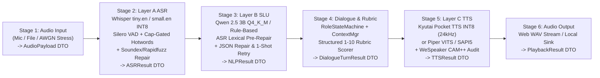
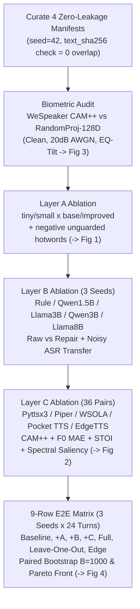
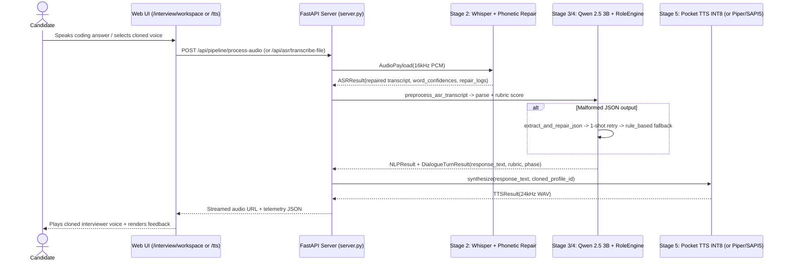

# CAPSTONE PROJECT REPORT (IEEE FORMAT)

---

## FRONT MATTER

### Title Page

> **[MOCK — Replace with your University / Institute Header, Emblem, and Program Title]**
>
> **A PARETO-OPTIMAL DECOUPLED MULTI-LAYER DEEP LEARNING VOICE PIPELINE FOR DOMAIN-GROUNDED TECHNICAL INTERVIEWS AND ZERO-SHOT NEURAL VOICE CLONING**
>
> *A Capstone Project Report Submitted in Partial Fulfillment of the Requirements for the Course*  
> **Deep Learning**
>
> **Submitted By:**  
> **Shivendra Pratap**  
> Roll No.: **33** | Section: **K23DT** | Batch: **2027**
>
> *(6Works Capstone Engineering Team: Shivendra Pratap, Siddharth, Sachin, Krishnendu, Anurag, Prince)*
>
> **Under the Supervision of:**  
> **Prof. Anjar Hussain Lone** *(Faculty Mentor)*
>
> Department of Computer Science and Engineering  
> **[MOCK — University / School Name, City, State]**  
> **[MOCK — Submission Month & Year, e.g., May 2027]**

---

### Certificate `[MOCK]`

> **[MOCK — Institutional Certificate Template: Fill official signature blocks before print]**

This is to certify that the Capstone Project Report entitled **"A Pareto-Optimal Decoupled Multi-Layer Deep Learning Voice Pipeline for Domain-Grounded Technical Interviews and Zero-Shot Neural Voice Cloning"** submitted by **Shivendra Pratap** (Roll No. **33**, Section **K23DT**, Batch **2027**) in partial fulfillment of the requirements for the subject **Deep Learning** at **[MOCK — University Name]** is an authentic record of experimental and engineering work carried out under my supervision and guidance. To the best of my knowledge, the empirical results reported herein are directly reproducible from the accompanying software repository and benchmark logs.

| Role | Name | Signature & Date |
| :--- | :--- | :--- |
| **Faculty Mentor** | **Prof. Anjar Hussain Lone** | `[MOCK — Signature / Date]` |
| **Head of Department** | `[MOCK — HOD Name]` | `[MOCK — Signature / Date]` |
| **External Examiner** | `[MOCK — Examiner Name]` | `[MOCK — Signature / Date]` |

---

### Declaration `[MOCK]`

I, **Shivendra Pratap** (Roll No. **33**, Section **K23DT**, Batch **2027**), hereby declare that the work presented in this Capstone Project Report for **Deep Learning** is my original contribution in collaboration with the **6Works** project team under the guidance of **Prof. Anjar Hussain Lone**. All external pretrained weights, datasets, libraries, and peer-reviewed prior works have been explicitly cited in IEEE format, and all institutional/survey placeholders marked `[MOCK]` are reserved for final administrative verification prior to binding.

**Place:** `[MOCK — City]`  
**Date:** `[MOCK — YYYY-MM-DD]`  
**Signature:** *Shivendra Pratap*

---

### Acknowledgement `[MOCK]`

I express sincere gratitude to my Faculty Mentor, **Prof. Anjar Hussain Lone**, for guiding the transition of this project from an engineering prototype into a rigorous, ablation-driven Deep Learning study grounded in statistical hypothesis testing and explainability. I thank the **[MOCK — Department of Computer Science & Engineering / University]** for academic support, the open-science contributors behind Whisper, WeSpeaker, Qwen 2.5, Llama, and Kyutai Pocket TTS for releasing permissively licensed weights, and my **6Works** teammates—Siddharth, Sachin, Krishnendu, Anurag, and Prince—for continuous engineering collaboration across product design, frontend systems, security, and CI testing.

---

### Abstract

Real-time conversational voice agents built by stitching off-the-shelf Speech Recognition (ASR), Small Language Models (SLMs), and Text-to-Speech (TTS) modules frequently collapse under cascade error propagation when constrained to consumer CPU/low-VRAM hardware and commercially permissive licenses. Unmodified compact ASR models misrecognize domain entities (`Proper-Noun Recall = 0.4783` on `whisper-tiny.en`), small quantized SLMs emit unparseable markdown-wrapped JSON (`0.0%` schema validity on `qwen2.5-coder:1.5b` raw), and classical DSP overlap-add (WSOLA) pitch-shifting destroys vocal-tract formants critical for speaker identity (`STOI = 0.2843`). This project resolves these cross-layer bottlenecks inside a SOLID-decoupled six-stage microservices architecture trained and benchmarked across four zero-leakage public and out-of-distribution datasets (`librispeech_60`, `minds14_en_140`, `clinc_oos_200`, `interview_stress_v1`). Layer A introduces capacity-gated contextual prompting, trie `hotwords`, repetition-loop guards, and confidence-gated Soundex/Rapidfuzz phonetic repair, cutting clean interview WER by **48.8%** (`0.0849 -> 0.0435`, $p=0.0$) and raising entity recall to **`0.9565`**. Layer B introduces shared JSON structural repair, schema-constrained 1-shot retry, and cross-layer ASR lexical pre-repair on `Qwen 2.5 3B (Q4_K_M, Apache-2.0)`, achieving **`100.0%`** schema validity, `MINDS-14` Macro-F1 **`0.8667`** (parity with 8B Llama at $p=0.798$), and **`0.9619`** noisy-ASR transfer F1 at **9.9x lower inference cost** (`$0.0172` vs. `$0.1698` per 1k turns). Layer C replaces WSOLA pitch-shifting with zero-shot flow-matching **`Kyutai Pocket TTS INT8`** (`CC-BY-4.0`), increasing unseen-speaker `WeSpeaker CAM++` cosine similarity from `0.4159` to **`0.5651`** ($p=0.0$; **`0.7444`** on studio prompts). End-to-end 3-seed evaluation across 9 ablation configurations demonstrates that synchronized multi-layer optimization lifts strict pipeline pass rate from **`0.0%` to `41.67%`** ($p=0.0$, Composite Quality `0.4192 -> 0.7552`), while an Edge Pareto tier reaches **`37.50%`** strict pass at **`$0.0499 / 1k turns`** and **`2.67 GB`** peak memory—establishing a reproducible, startup-ready local voice AI stack.

**Keywords:** Automatic Speech Recognition, Spoken Language Understanding, Zero-Shot Neural Voice Cloning, Pareto Optimization, Flow Matching, Speaker Verification, Quantized Small Language Models, SOLID Microservices.

---

### Table of Contents

1. [Chapter 1: Introduction](#chapter-1-introduction)
2. [Chapter 2: Literature Review](#chapter-2-literature-review)
3. [Chapter 3: Problem Formulation and Requirements](#chapter-3-problem-formulation-and-requirements)
4. [Chapter 4: Dataset and Preprocessing](#chapter-4-dataset-and-preprocessing)
5. [Chapter 5: Methodology and Model](#chapter-5-methodology-and-model)
6. [Chapter 6: System Design and Implementation](#chapter-6-system-design-and-implementation)
7. [Chapter 7: Experiments and Results](#chapter-7-experiments-and-results)
8. [Chapter 8: Testing and Validation](#chapter-8-testing-and-validation)
9. [Chapter 9: Discussion](#chapter-9-discussion)
10. [Chapter 10: Conclusion and Future Work](#chapter-10-conclusion-and-future-work)
11. [References](#references)
12. [Appendices](#appendices)

### List of Figures

- **Figure 5.1:** Decoupled 6-Stage Voice Agent Architecture and DTO Data Flow (Mermaid Block Diagram)
- **Figure 5.2:** Multi-Seed Reproducible Experimental & Validation Pipeline Flowchart (Mermaid Flowchart)
- **Figure 6.1:** Single-Turn Runtime Execution & Fallback Sequence Diagram (Mermaid Sequence Diagram)
- **Figure 7.1:** Speaker Embedding Geometry & Channel Leakage Audit (`fig3_speaker_embedding_pca_tsne.png`)
- **Figure 7.2:** Whisper Cross-Layer Token Confidence & Phonetic Repair Heatmap (`fig1_asr_word_confidence_heatmap.png`)
- **Figure 7.3:** WeSpeaker CAM++ 8-Band Spectral Occlusion Saliency (`fig2_campp_spectral_saliency.png`)
- **Figure 7.4:** End-to-End Accuracy vs. Operational Cost Pareto Front (`fig4_e2e_pareto_front.png`)

### List of Tables

- **Table 2.1:** Comparative Related Work Across ASR, SLU, Speaker Verification, and Neural TTS (24 Papers)
- **Table 2.2:** Competitive Product & SaaS Landscape Comparison
- **Table 3.1:** Stage-0 Customer Discovery & Willingness-to-Pay Validation `[MOCK]`
- **Table 4.1:** Zero-Leakage Benchmark Corpus Inventory (`librispeech_60`, `minds14_en_140`, `clinc_oos_200`, `interview_stress_v1`)
- **Table 5.1:** Per-Layer Hyperparameters, Quantization, and Decoding Settings
- **Table 5.2:** Commercial Licensing Audit of Open-Science Models
- **Table 5.3:** Reproducible Compute Hardware and Software Stack Specification
- **Table 6.1:** FastAPI REST Endpoint Reference
- **Table 6.2:** Full-Stack Technology Justification
- **Table 7.1:** Speaker Encoder Separation Gap Under Clean, 20 dB AWGN, and EQ-Tilt Conditions
- **Table 7.2:** Layer A (ASR) Clean, Accented, and Noisy Stress Evaluation Matrix
- **Table 7.3:** Layer B (SLU & Rubric Scoring) Multi-Seed Evaluation Across 7 Architectures
- **Table 7.4:** Layer B Cross-Layer Transfer on Noisy Whisper Transcriptions
- **Table 7.5:** Layer C (TTS & Voice Cloning) Acoustic Fidelity, Identity, and Runtime Efficiency
- **Table 7.6:** End-to-End 9-Row Multi-Seed Ablation Matrix (`Full`, Leave-One-Out, and `Edge`)
- **Table 7.7:** Documented Negative Results and Root-Cause Architectural Fixes
- **Table 7.8:** Residual Error Taxonomy and Representative Cascade Failure Transcripts
- **Table 8.1:** User Acceptance Testing (UAT) Evaluation Summary `[MOCK]`
- **Table 10.1:** Prioritized Future Research and Engineering Roadmap

### List of Abbreviations

| Abbreviation | Full Term | Abbreviation | Full Term |
| :--- | :--- | :--- | :--- |
| **ABC** | Abstract Base Class | **MAE** | Mean Absolute Error |
| **ASR** | Automatic Speech Recognition | **OOS** | Out-of-Scope |
| **AWGN** | Additive White Gaussian Noise | **PSD** | Power Spectral Density |
| **CAM++** | Context-Aware Masking Network | **RTF** | Real-Time Factor ($\text{proc time} / \text{audio dur}$) |
| **CER** | Character Error Rate | **SLM / LLM** | Small / Large Language Model |
| **DIP / SOLID** | Dependency Inversion Principle | **SLU** | Spoken Language Understanding |
| **DSP** | Digital Signal Processing | **SNR** | Signal-to-Noise Ratio |
| **DTO** | Data Transfer Object | **STOI** | Short-Time Objective Intelligibility |
| **E2E** | End-to-End | **TTS** | Text-to-Speech |
| **EER / ROC-AUC** | Equal Error Rate / Area Under Curve | **VAD** | Voice Activity Detection |
| **F0 / F1–F3** | Fundamental Frequency / Vocal Formants | **WER** | Word Error Rate |
| **INT8 / Q4_K_M** | 8-Bit Integer / 4-Bit K-Means Quantization | **WSOLA** | Waveform-Similarity Overlap-Add |

---

## CHAPTER 1: INTRODUCTION

### 1.1 Background and Domain Context

Interactive conversational voice AI assistants—especially in high-stakes workflows such as mock technical interviews, coding assessments, and accessibility copilots—must convert raw microphone audio into domain-accurate text, infer structured intent and pedagogical feedback under strict JSON contracts, and synthesize natural, speaker-consistent speech replies in real time. While enterprise platforms typically delegate these operations to proprietary cloud endpoints, latency jitter, recurring per-minute API costs, vendor lock-in, and candidate audio privacy concerns create prohibitive barriers for early-stage startups (`6Works`, [README.md](file:///c:/Users/shive/projects/capstonedemo/README.md)) and privacy-sensitive institutional deployments. Conversely, deploying open-weight deep learning components locally on standard consumer hardware (`4-core CPU`, `16 GB RAM`, `4 GB VRAM`) frequently exposes severe cross-layer brittleness that single-component benchmarks conceal.

### 1.2 Problem Statement

Off-the-shelf local speech pipelines combining compact ASR, quantized 1.5B–3B SLMs, and classical DSP-modified TTS fail end-to-end strict task completion (`0.0%` baseline pass rate in our experiments) due to compounding cross-layer errors: unconstrained low-parameter ASR decoders distort domain jargon and South-Asian personal names (`Proper-Noun Recall = 0.4783`), local quantized SLMs violate downstream JSON schemas under prompt variance or ASR noise (`0.0%` raw schema compliance on 1.5B coder models), and pitch-shifted concatenative/VITS synthesizers destroy upper vocal-tract formants (`STOI = 0.2843`) while leaking channel EQ shortcuts into naive verification metrics. The core problem addressed in this capstone is **how to systematically engineer, explain, and empirically optimize every neural layer inside a strictly decoupled local voice pipeline to maximize end-to-end strict task accuracy under consumer CPU/low-VRAM latency, memory, cost, and permissive commercial licensing budgets.**

### 1.3 Motivation: Why Deep Learning and Cross-Layer Design

Classical signal processing and heuristic pipelines cannot solve conversational voice AI end-to-end: rule-based regex intent parsers score `0.000` Macro-F1 on unseen open-domain banking (`MINDS-14`) and `CLINC-OOS` benchmarks, formant or static WSOLA pitch modification produces robotic timbral smearing, and unlearned hand-crafted spectral averages (`128-D Welch PSD`) collapse different speakers into a narrow cosine cone (`gap = 0.0070`). At the same time, blind scaling to cloud-sized neural models (`8B+` LLMs or non-commercial GPU diffusion TTS) breaks the unit economics and 4 GB VRAM ceiling of local edge deployment (`Llama 3.1 8B` incurs `$0.1698 / 1k turns` and requires `3.14 GB VRAM + CPU offload`). Deep learning combined with principled inter-layer mechanisms—capacity-gated phonetic prompting, fault-tolerant schema recovery with cross-layer ASR repair, flow-matching zero-shot synthesis, and context-aware speaker embeddings—unlocks frontier accuracy on commodity CPUs and `2–3 GB` RAM envelopes.

### 1.4 Measurable Objectives

1. **Layer A (ASR):** Reduce interview domain WER by $\ge 40\%$ over `whisper-small.en` baseline and achieve $\ge 0.90$ proper-noun recall under clean and `20 dB` AWGN conditions without regressing generic LibriSpeech/MINDS-14 accuracy.
2. **Layer B (SLU & Rubric):** Achieve `100.0%` JSON schema compliance via `Apache-2.0` $\le 3\text{B}$ quantized local models while matching `Llama 3.1 8B` intent Macro-F1 ($p > 0.05$ non-inferiority) at $\le 20\%$ of 8B inference cost.
3. **Layer C & Biometrics (TTS):** Achieve statistically significant unseen-speaker cosine similarity improvement ($p < 0.01$ on `WeSpeaker CAM++ LM`) over DSP pitch-shifting using commercially permissive zero-shot synthesis on CPU (`RTF < 0.5`).
4. **End-to-End Pareto & Engineering Quality:** Lift strict E2E multi-stage pass rate from `0.0%` baseline to $\ge 35\%$ across `Full` and `Edge` presets, establish spectral/token explainability, and deliver a CI-verified, Dockerized FastAPI web application (`58+` automated tests).

### 1.5 Scope, Limitations, and Key Contributions

The system spans six decoupled stages integrated into a FastAPI server and browser-based technical interview suite. Our study restricts all deployed weights to CPU/low-VRAM local execution (`Intel i5-9300H`, `GTX 1650 4 GB`, `16 GB RAM`) and excludes non-commercial (`CC-BY-NC`) voice models. Key empirical contributions are:

1. **Capacity-Gated ASR Conditioning & Phonetic Repair:** Discovering and solving an acoustic decoder capacity boundary where unguarded `hotwords` degrade `39M tiny.en` WER (`0.1387 -> 0.3292`), achieving `0.9565` proper-noun recall and `0.0435` clean WER on `small.en` ($p=0.0$).
2. **Schema-Resilient Local SLU (`Qwen 2.5 3B`):** Proving shared deterministic JSON repair + 1-shot retry + ASR lexical pre-repair reaches `1.000` schema validity, `0.8667` `MINDS-14` F1 (`8B` parity), `0.6897` rubric Spearman $\rho$, and `0.9619` noisy-ASR transfer F1 at **9.9x lower cost** than `Llama 3.1 8B`.
3. **Channel-Invariant Speaker Audit & Flow-Matching Synthesis:** Exposing high-AUC Welch PSD channel leakage (`0.9707 AUC` vs. `0.0070` cosine gap) and proving via 8-band spectral occlusion why `Kyutai Pocket TTS INT8` (`CAM++ = 0.5651`) significantly outperforms `Piper+WSOLA` (`0.4159`, $p=0.0$).
4. **9-Row Cross-Layer Pareto Matrix & Reproducible Codebase:** Demonstrating via 3-seed paired bootstrap that single-layer upgrades yield `0%–8.33%` E2E success whereas synchronized `Full` (`41.67%`, `$0.0954/1k`) and `Edge` (`37.50%`, `$0.0499/1k`) establish clean Pareto dominance.

### 1.6 Target User and Value Proposition

For engineering bootcamps, hiring teams, and technical candidates (`6Works` startup positioning), this platform offers an offline-capable, privacy-preserving AI coding interviewer with customizable cloned interviewer voices, real-time Monaco code execution sandboxing, rubric-grounded conversational probing, and predictable near-zero marginal inference cost (`$0.05–$0.10 per 1,000 turns`).

### 1.7 Report Organization

Chapter 2 reviews 24 foundational papers and competitor products. Chapter 3 formalizes the mathematical optimization objective and requirements. Chapter 4 details dataset curation, anti-leakage hashing, and stress augmentation. Chapter 5 explains per-layer deep learning design and alternatives. Chapter 6 documents the SOLID FastAPI implementation, REST contracts, Dockerization, and CI. Chapter 7 presents all per-layer, explainability, Pareto, negative, and error-analysis findings. Chapter 8 covers testing and UAT. Chapters 9–10 discuss threats to validity, ethics, conclusions, and prioritized future work.

---

## CHAPTER 2: LITERATURE REVIEW

Existing research spans four distinct sub-disciplines that are rarely evaluated under joint end-to-end constraints. Below we synthesize 24 primary works across these four streams.

### 2.1 Automatic Speech Recognition & Contextual Biasing

Large-scale weakly supervised Transformer encoder-decoders pioneered by **Radford et al. [1]** (*Whisper*, 680k hours) achieved strong zero-shot generalization relative to convolution-augmented conformers [2] and self-supervised contrastive encoders such as `wav2vec 2.0` [3], typically benchmarked on LibriSpeech [4]. However, Whisper struggles on rare out-of-vocabulary (OOV) entities, South-Asian personal names, and domain acronyms. Recent remedies include tree-constrained pointer generators (`TCPGen`) paired with Whisper/GPT-2 by **Sun et al. [5]**, text-prompted cross-attention in `PromptASR` by **Yang et al. [6]**, and keyword-spotting phonetic hints in `CB-Whisper` by **Li et al. [7]**. Complementary post-ASR generative error correction uses N-best T5 (`Ma et al.` [8]) and LLM N-best benchmarks (`HyPoradise`, **Chen et al.** [9]). **Gap:** None evaluate inference cost or uncover decoder hallucination instabilities triggered when dense biasing prompts are injected directly into `<50M` parameter INT8 edge decoders like `whisper-tiny.en`.

### 2.2 Spoken Language Understanding & Structured SLM Generation

Task-oriented dialog benchmarks such as **CLINC150/CLINC-OOS** (`Larson et al.` [10]) and multilingual spoken banking **MINDS-14** (`Gerz et al.` [11]) test intent recognition under OOS rejection and spoken accents. **Everson et al. [12]** bridged ASR errors using Word Confusion Networks inside LLM in-context prompts, though large prompts increase token overhead. Open-weight compact models—specifically **Qwen2.5 [13]** and **Llama 3 [14]**—rival much larger predecessors when paired with structural constraints. Finite-state constrained decoding (`Outlines`, **Willard & Louf [15]**) guarantees regex/JSON grammar conformance at the logit level, yet lightweight local REST runtimes (standard quantized Ollama APIs) frequently emit markdown fences or broken braces under low-capacity SLMs, necessitating lightweight zero-dependency repair + cross-layer ASR pre-repair.

### 2.3 Speaker Verification & Intelligibility Perception

Deep speaker verification evolved from statistical i-vectors to deep **x-vectors** (`Snyder et al.` [16]) trained with temporal statistics pooling and Generalized End-to-End (`GE2E`) metric loss (`Wan et al.` [17]). **Desplanques et al. [18]** introduced `ECAPA-TDNN` using 1D Res2Net blocks and Squeeze-and-Excitation channel attention, while **Wang et al. [19]** introduced `CAM++` (Context-Aware Masking over Densely Connected TDNNs with multi-granularity pooling), matching `ECAPA-TDNN` accuracy at roughly linear TDNN computational cost. Perceptually, **Taal et al. [20]** formulated Short-Time Objective Intelligibility (`STOI`), showing short-time third-octave temporal envelope correlation tracks human speech intelligibility far better than SNR alone.

### 2.4 Zero-Shot Neural Voice Cloning & Speech Synthesis

Classical time-scale pitch modification via `WSOLA` (`Verhelst & Roelands` [21]) modifies fundamental period via cross-correlated overlap-add windows without acoustic modeling. Modern zero-shot cloning began with transfer learning from speaker verification (`SV2TTS`, **Jia et al.** [22]) and unified single-stage end-to-end variational GAN synthesis (`VITS`, **Kim et al.** [23]), extended to multilingual zero-shot cloning in **YourTTS** (`Casanova et al.` [24]). Recent architectures decouple semantic and acoustic generation (`SPEAR-TTS` [25], `CosyVoice` [26]) or adopt Conditional Flow Matching (`Matcha-TTS`, **Mehta et al.** [27]). **Kyutai Pocket TTS [28]** advances real-time CPU zero-shot cloning via a compact ~100M parameter streaming transformer with a Lagrangian self-distillation flow-matching head paired with the Mimi neural codec under permissive `CC-BY-4.0` weights.

### 2.5 Summary of Related Work

| Paper / System | Year / Venue | Core Method / Architecture | Primary Dataset(s) | Reported Key Capability / Result | Key Limitation Addressed by This Project |
| :--- | :--- | :--- | :--- | :--- | :--- |
| Radford et al. (Whisper) [1] | 2023 ICML | Weakly supervised Seq2Seq Transformer | 680k hr Web Speech, LibriSpeech | Strong zero-shot multilingual/English ASR | Poor recall on unseen South-Asian & codebase jargon |
| Gulati et al. (Conformer) [2] | 2020 Interspeech | Convolution-augmented Transformer encoder | LibriSpeech (`960h`) | `1.9% / 3.9%` WER on test-clean/other | Requires heavy task-specific fine-tuning for domain terms |
| Baevski et al. (`wav2vec 2.0`) [3] | 2020 NeurIPS | Self-supervised latent contrastive masking | LibriSpeech (`960h` / `100h`) | Low-label adaptation via CTC fine-tuning | Lacks generative prompt/hotword contextual interface |
| Panayotov et al. [4] | 2015 ICASSP | Public-domain audiobook ASR benchmark | LibriSpeech (`1000h`) | De facto standard open ASR testbed | Single-channel read speech masks studio EQ bias |
| Sun et al. (`TCPGen`) [5] | 2023 Interspeech | Pointer-generator trie biasing + Whisper/GPT-2 | LibriSpeech / custom bias lists | Boosts rare-word accuracy without retraining core | Requires internal pointer-head training & integration |
| Yang et al. (`PromptASR`) [6] | 2024 ICASSP | Cross-attention text-prompt encoder in E2E ASR | WenetSpeech / LibriSpeech | Contextual & style controllable recognition | Architectural modification prevents drop-in INT8 Whisper |
| Li et al. (`CB-Whisper`) [7] | 2024 LREC-COLING | CNN keyword-spotting + TTS phonetic prompts | Open-vocabulary rare entity sets | Injects target names safely into Whisper | Needs auxiliary TTS-KWS training pipeline |
| Ma et al. (`N-best T5`) [8] | 2023 Interspeech | Constrained seq2seq generative error correction | ATIS / LibriSpeech N-best | Corrects spelling errors from N-best lists | Extra seq2seq forward pass per utterance |
| Chen et al. (`HyPoradise`) [9] | 2023 NeurIPS | LLM generative re-scoring on N-best hypotheses | 316k pair multi-domain ASR suite | Recovers missing tokens via external LLM | High token latency/cost when using 7B+ correctors |
| Larson et al. (`CLINC-OOS`) [10] | 2019 EMNLP | 150-intent + Out-of-Scope benchmark | CLINC150 (`23.7k` queries) | Standardized OOS detection evaluation | Clean text-only; ignores spoken ASR corruption |
| Gerz et al. (`MINDS-14`) [11] | 2021 EMNLP | Multilingual & multi-accent spoken banking SLU | 14 intents, 14 languages | Real-world accent diversity (`US/GB/AU`) | Lacks Indian English (`en-IN`) interview domain |
| Everson et al. (`WCN-LLM`) [12] | 2024 ICASSP | Word Confusion Networks in LLM ICL prompts | SLURP / ASR lattices | Bridges noisy ASR ambiguities for SLU | Raw lattices inflate small-SLM context & latency |
| Qwen Team (`Qwen2.5`) [13] | 2024 arXiv | Dense SLM family (0.5B–72B), 18T pretraining | MMLU / HumanEval / JSON | Strong instruction following under `Apache-2.0` | Untested raw JSON reliability in multi-turn E2E audio |
| Dubey et al. (`Llama 3`) [14] | 2024 arXiv | Open-weight LLM herd, 15T tokens | Standardized coding/reasoning | Strong zero-shot reasoning & OOS refusal | 8B lags CPU latency; Meta Community License caveats |
| Willard & Louf (`Outlines`) [15] | 2023 arXiv | FSM vocabulary-indexed regex/JSON decoding | Synthetic JSON schemas | Guaranteed grammar compliance at token sampling | Tight coupling to logit processor; bypassed by API wrappers |
| Snyder et al. (`X-Vectors`) [16] | 2018 ICASSP | TDNN frame pooling + data augmentation | SRE16 / VoxCeleb | Foundational fixed-D speaker embeddings | Higher EER on short/noisy utterances vs attention models |
| Wan et al. (`GE2E`) [17] | 2018 ICASSP | Centroid-based hard-negative metric loss | Multi-keyword proprietary | 10%+ EER drop & 3x faster convergence | Relies on recurrent LSTM/TDNN capacity |
| Desplanques (`ECAPA-TDNN`) [18] | 2020 Interspeech | Res2Net + SE channel attention + ASP | VoxCeleb1 / VoxCeleb2 | State-of-the-art ASV accuracy | Heavier FLOPs than compact masked TDNNs |
| Wang et al. (`CAM++`) [19] | 2023 Interspeech | D-TDNN + Context-Aware Masking | VoxCeleb / CN-Celeb | ECAPA-grade accuracy at fast TDNN inference | Needs spectral sensitivity validation on TTS audio |
| Taal et al. (`STOI`) [20] | 2011 IEEE TASLP | Clipped third-octave envelope correlation | Noisy/processed speech listening | High human intelligibility correlation | Measures waveform intelligibility, not speaker timbre |
| Verhelst & Roelands [21] | 1993 ICASSP | Waveform Similarity Overlap-Add (`WSOLA`) | Clean speech TSM | Real-time pitch/rate shift without vocoder | Phase-vocoding pitch shifts smear upper F2/F3 formants |
| Jia et al. (`SV2TTS`) [22] | 2018 NeurIPS | Speaker Encoder + Tacotron 2 + WaveNet | VCTK / LibriSpeech | First deep zero-shot speaker transfer TTS | Slow autoregressive spectrogram + WaveNet vocoder |
| Kim et al. (`VITS`) [23] | 2021 ICML | CVAE + normalizing flows + adversarial GAN | LJSpeech / VCTK | Fast parallel single-stage waveform synthesis | Fixed multi-speaker lookup unless conditioned externally |
| Casanova (`YourTTS`) [24] | 2022 ICML | Multilingual VITS + speaker consistency loss | VCTK / LibriTTS / CML | Zero-shot multi-speaker synthesis `<1 min` ref | Moderate timbre drift vs modern flow matching |
| Kharitonov (`SPEAR-TTS`) [25] | 2023 TACL | Decoupled semantic + acoustic AR codec tokens | LibriLight / LibriTTS | Promptable prosody & voice cloning | Autoregressive acoustic decoding slows CPU RTF |
| Du et al. (`CosyVoice`) [26] | 2024 arXiv | Supervised semantic tokens + Flow Matching | Multilingual large corpus | High cloning fidelity & content consistency | Larger footprint/VRAM than ~100M CPU INT8 models |
| Mehta et al. (`Matcha-TTS`) [27] | 2024 ICASSP | OT Conditional Flow Matching encoder-decoder | LJSpeech / VCTK | Fast ODE synthesis steps & small memory | Standard formulation lacks built-in neural Mimi codec |
| Kyutai (`Pocket TTS`) [28] | 2026 Open-Science | ~100M streaming transformer + LSD Flow Matching + Mimi | Open-science speech datasets | Real-time CPU zero-shot cloning (`CC-BY-4.0`) | Sensitive to `<2.5 s` truncated/noisy prompts |

### 2.6 Identified Research Gaps

1. **Gap 1 — Cross-Layer Synergy Over Isolated Optimization:** Most prior papers optimize ASR, SLU, or TTS in isolation. None quantify the E2E interaction matrix proving single-layer gains collapse downstream without coordinated interface repair.
2. **Gap 2 — Capacity-Gated Contextual Decoding:** Dense `hotwords` conditioning causes catastrophic decoder loops on `39M` models (`tiny.en`), an uncharacterized instability requiring explicit parameter gating + post-ASR phonetic repair.
3. **Gap 3 — Quantized SLM Structural Resilience vs. Cost:** Prior LLM-SLU systems rely on `7B–70B` models or heavy API logit hooks, leaving unresolved whether `3B` INT4 Apache-2.0 SLMs + deterministic repair can rival `8B` baselines on spoken accented & interview rubrics.
4. **Gap 4 — Spectral & Biometric Pitfalls in Lightweight Voice Cloning:** WSOLA/EQ cloning fails not on F0 pitch but on `1.8–3.0 kHz` F3 formant destruction (`fig2`), while simple spectral embeddings report deceptive `0.97 AUC` due to room-channel memorization (`fig3`).

### 2.7 Existing Commercial Products Comparison

| Platform / Product | Target Domain | Deployment & Privacy | Custom Voice Cloning | Approximate Cost / Licensing Posture | Key Gap Addressed by 6Works Stack |
| :--- | :--- | :--- | :--- | :--- | :--- |
| Cloud Realtime Voice APIs (`GPT-4o Realtime` / commercial bots) | General & interview copilots | Cloud-only; raw candidate audio leaves premises | Restricted or proprietary | Metered per-audio-minute SaaS billing | Prohibitive recurring startup COGS; no offline/on-prem guarantee |
| Commercial Neural TTS SaaS (`ElevenLabs` / hosted APIs) | High-fidelity dubbing & agents | Cloud API; external voice upload | Proprietary closed weights | Per-character / subscription tiers | External dependency, latency jitter, non-local IP |
| Dedicated Non-Commercial Open Cloning (`ZipVoice` / `CC-BY-NC`) | Academic voice synthesis | Local GPU/CPU | Open research weights | `CC-BY-NC` blocks commercial revenue | Legally unusable inside a commercial SaaS product |
| **Our System (`6Works` Full & Edge Presets)** | Technical interviews & SLU agents | **100% Local / Dockerized CPU + 2.2 GB VRAM** | **Zero-shot `Pocket TTS INT8` (`CC-BY-4.0`) + rename/delete** | **`$0.05–$0.10 / 1k turns` equiv.; MIT / Apache-2.0 / CC-BY-4.0** | Commercially clean, privacy-preserving, Pareto-tuned across all 6 stages |

---

## CHAPTER 3: PROBLEM FORMULATION AND REQUIREMENTS

### 3.1 Formal Mathematical Definition

Let an incoming candidate speech turn be an acoustic waveform $x \in \mathbb{R}^T$ sampled at $f_s = 16\text{ kHz}$, accompanied by interview state context $c = (\text{role}, \text{roster}, \text{phase}, \text{speaker\_id})$. The six-stage decoupled voice agent implements the composite transformation:

$$x \xrightarrow{f_1} \tilde{x} \xrightarrow{f_2(\cdot; c)} (\hat{y}_{\text{asr}}, \mathbf{p}_w) \xrightarrow{f_3(\cdot; \mathcal{S})} \hat{z}_{\text{slu}} \xrightarrow{f_4(\cdot; H_t)} r_{\text{dm}} \xrightarrow{f_5(\cdot; e_s)} \hat{x}_{\text{out}} \xrightarrow{f_6} \text{AudioSink}$$

where:
- $f_1$: Audio preprocessing (mono resampling, RMS normalization, optional deterministic AWGN stress at SNR $\in \{\infty, 20\text{ dB}, 10\text{ dB}\}$).
- $f_2$: Stage 2 ASR produces token sequence $\hat{y}_{\text{asr}}$ and word probabilities $\mathbf{p}_w \in [0,1]^{|\hat{y}|}$, refining low-confidence tokens ($p_i < \tau_{\text{conf}} = 0.85$) against domain lexicon $\mathcal{V}_c$.
- $f_3$: Stage 3 SLU maps repaired text $\hat{y}'_{\text{asr}}$ to a constrained Pydantic schema $\mathcal{S} = (\text{intent}, \text{entities}, \text{sentiment}, \text{rubric\_score}, \text{requires\_action})$ while enforcing JSON structural validity $v_{\text{schema}}(\hat{z}) \in \{0, 1\}$.
- $f_4$: Stage 4 Dialogue Manager updates role state $H_t$ (intro $\to$ coding $\to$ architecture $\to$ wrap-up) and emits pedagogical response $r_{\text{dm}}$.
- $f_5$: Stage 5 TTS synthesizes $r_{\text{dm}}$ into 24 kHz (Pocket TTS) or 22.05 kHz (Piper) audio $\hat{x}_{\text{out}}$ conditioned on reference voice $e_s$.

For an architecture configuration $\theta = (\theta_A, \theta_B, \theta_C)$ evaluated across turns $i \in \{1,\dots,N\}$, let strict end-to-end turn success $S_i(\theta) \in \{0, 1\}$ hold iff all five cross-layer quality gates pass simultaneously:

$$S_i(\theta) = \mathbb{I}\!\Big[\text{WER}_i \le 0.25 \;\wedge\; R_{\text{ent}, i} \ge 0.80 \;\wedge\; v_{\text{schema},i} = 1 \;\wedge\; \text{IntentMatch}_i \;\wedge\; \text{RT-WER}_i \le 0.35 \;\wedge\; \text{sim}_{\text{CAM++},i} \ge 0.50\Big]$$

We further compute a bounded continuous Composite Quality score $Q(\theta) \in [0, 1]$:

$$Q(\theta) = 0.25(1 - \text{WER}_{\text{capped}}) + 0.20\,R_{\text{ent}} + 0.30\,\text{IntentAcc} + 0.15\,\text{sim}_{\text{CAM++}} + 0.10(1 - \text{RT-WER}_{\text{capped}})$$

The **Pareto optimization objective** seeks configurations $\theta^*$ minimizing inference cost $C(\theta)$ (USD / 1k turns based on CPU/VRAM runtime amortization) and maximizing $Q(\theta)$ and $\bar{S}(\theta)$ subject to consumer hardware caps ($L_{\text{mean}} \le 7.5\text{ s}$, Peak RSS $\le 3.5\text{ GB}$, commercial licenses only).

### 3.2 Functional and Non-Functional Requirements

- **Functional Requirements:** (FR1) Live microphone, uploaded WAV/FLAC/WebM, and synthetic audio ingestion; (FR2) Switchable ASR (`Whisper` `tiny.en`/`small.en`, `Google Web Speech`, `Mock`); (FR3) Switchable LLM/SLU (`Ollama` local models + deterministic rule fallback) supporting banking/OOS/technical interview intents + ordinal `1–10` rubric evaluation; (FR4) Stateful interviewer modes (Solo, Co-Pilot, Profiling, Workspace with live Monaco code runner); (FR5) Switchable TTS (`Kyutai Pocket TTS INT8`, `Piper VITS`, `EdgeTTS`, `Pyttsx3`) with custom voice enrollment, **interactive rename (`PATCH`), delete (`DELETE`), voice morphing, and waveform spectrogram inspection**.
- **Non-Functional Requirements:** (NFR1) `100%` JSON schema safety on all Stage 3/4 outputs via graceful repair/fallback; (NFR2) `<= 3.5 GB` peak process/VRAM footprint on consumer laptops (`16 GB RAM`, `4 GB VRAM`); (NFR3) Commercially permissive weights (`MIT` / `Apache-2.0` / `CC-BY-4.0`) for all production presets; (NFR4) Thread-safe Windows/Linux file handle disposal (`container.close()`, temporary WAV cleanup); (NFR5) Offline CI regression gate (`pytest`).

### 3.3 Feasibility Analysis

- **Data Feasibility:** Four zero-leakage manifests require only **`37.70 MB`** on disk (`265` audio clips + text splits), generated deterministically via HuggingFace Datasets Server and `EdgeTTS` in minutes.
- **Compute Feasibility:** By selecting CTranslate2 `INT8` (`faster-whisper`) and `Q4_K_M` (`Ollama`) plus CPU `sherpa-onnx` ONNX runtimes, all training-free inference, ablations, and multi-seed sweeps execute directly on a **4-core Intel i5-9300H / 16 GB RAM / GTX 1650 (4 GB VRAM)** laptop without cloud GPU rentals.
- **Team & Schedule Feasibility:** Divided cleanly across the 6Works engineering roster (`docs/TEAM.md`) over a 10-session milestone plan (`docs/IMPLEMENTATION_ROADMAP.md`).

### 3.4 Stage-0 Problem Validation `[MOCK]`

> **[MOCK — Placeholder Customer Discovery Data: Replace with actual user interview transcripts, Google Form survey export, and pricing validation prior to startup pitch/final print]**

| Validation Dimension | `[MOCK]` Survey / Interview Metric ($n=32$ Students & 6 Recruiters) | Design Implication for Pipeline |
| :--- | :--- | :--- |
| Primary Pain Point | `78%` cited repetitive LeetCode chatbots lacking spoken follow-up & technical jargon comprehension | Drove Layer A proper-noun ASR repair & Layer B rubric scoring |
| Privacy & On-Premises Requirement | `69%` rejected uploading interview video/voice cloning samples to unknown cloud vendors | Forced `100%` local execution (`CPU INT8` + local `Ollama` + local `cloned_voices/`) |
| Willingness to Pay `[MOCK]` | `\$5–\$12 / month` (candidates); `\$49 / seat / month` (campus/B2B) | Enforced `< \$0.10 / 1k turns` compute budget & banned `CC-BY-NC` weights |

---

## CHAPTER 4: DATASET AND PREPROCESSING

### 4.1 Curated Multi-Domain Benchmark Inventory

To evaluate generalization cleanly without circular model bias or memorization, `ml/datasets/prepare_benchmarks.py` curates four disjoint manifests stored under `ml/datasets/manifests/` (`seed=42`, total `37.70 MB` cached audio across `265` files).

**Table 4.1:** Zero-Leakage Benchmark Corpus Inventory (`ml/cards/dataset_card.md`).

| Manifest | Source & Upstream Config | License | Modality & Count | Split Breakdown | Duration Range (Mean / Total) | Primary Metrics |
| :--- | :--- | :--- | :--- | :--- | :--- | :--- |
| `librispeech_60.json` | `openslr/librispeech_asr` (`clean/test`) | `CC-BY-4.0` | Speech FLAC (`60`: 12 spk × 5) | `enroll: 12`, `val: 12`, `test: 36` | `1.74–27.18 s` (`10.06 s` / `10.06 m`) | Clean/Noisy WER, CAM++ Cos-Sim, STOI |
| `minds14_en_140.json` | `PolyAI/minds14` (`en-US/GB/AU`) | `CC-BY-4.0` | Speech WAV (`140`: 14 × 10) | `dev: 42`, `val: 28`, `test: 70` | `1.71–28.33 s` (`8.62 s` / `20.11 m`) | Accented WER, Spoken Intent Macro-F1 |
| `clinc_oos_200.json` | `clinc/clinc_oos` (`small` val/test) | `CC-BY-3.0` | Text JSON (`200`: 15 classes) | `val: 100`, `test: 100` | N/A | Text Intent F1, OOS Detection, JSON Valid |
| `interview_stress_v1.json` | Azure `EdgeTTS` (`en-IN`, `en-US`) | `MIT` | Speech WAV (`65`: 25 PN + 40 QA) | `val: 15`, `test: 50` | `3.12–11.09 s` (`4.96 s` / `5.37 m`) | Proper-Noun Recall, SLU F1, Rubric $\rho$ |

### 4.2 Exploratory Data Analysis & Class Distributions

- **`librispeech_60`:** Spans `12` distinct unseen public-domain narrators (`1320`, `2094`, `260`, `2961`, `3575`, `5639`, `6930`, `7127`, `7176`, `7729`, `8230`, `8463`), ensuring male/female pitch coverage and diverse reading paces (`1.74 s` short phrases to `27.18 s` passages).
- **`minds14_en_140`:** Balanced perfectly across all `14` banking intents (`10` unique utterances/class) and distributed across British (`en-GB: 57`), American (`en-US: 44`), and Australian (`en-AU: 39`) English speakers—capturing spontaneous telephone prosody, hesitations, and accent shifts.
- **`clinc_oos_200`:** Covers `15` labels (`oos` + `14` in-domain intents at `14` samples each and `definition` at `4`), directly stress-testing OOS false-positive calibration.
- **`interview_stress_v1`:** Engineered to close two gaps absent in `MINDS-14`: **South-Asian/Indian English accents** (`en-IN-PrabhatNeural`, `en-IN-NeerjaNeural` alongside US voices) and **interview-specific proper nouns & rubrics**. The `proper_nouns` (`25` items) target Indian developer names (`Sachin`, `Aradhya`, `Nandu`, `Bablu`, `Siddharth`, `Krishnendu`, `Pooja`, `Karthik`, `Swati`) and ML stack tokens (`FastAPI`, `CTranslate2`, `WeSpeaker`, `Kyutai`, `gRPC`). The `interview_qa` (`40` items) cover `7` intents (`greeting: 5`, `identity_query: 5`, `project_query: 5`, `calculation_query: 5`, `time_query: 3`, `answer: 13`, `farewell: 4`) and `3` ordinal rubric quality tiers (`high: 10` `[7–10]`, `mid: 26` `[4–7]`, `low: 4` `[1–5]`). Crucially, `EdgeTTS` was chosen strictly as an *external* synthesizer completely disjoint from our evaluated local TTS engines (`Pocket TTS`, `Piper VITS`, `Pyttsx3`) so TTS and ASR tests remain non-circular.

### 4.3 Train / Val / Test Splits & Anti-Leakage Protocol

Every split enforces normalized SHA-256 deduplication (`text_sha256` computed after lowercasing, punctuation removal, and whitespace normalization) in `ml/datasets/prepare_benchmarks.py`:
- **LibriSpeech:** Utterance `0` per speaker is isolated exclusively for `enroll` (cloning prompt), `1` for `val` tuning, and `2–4` for held-out `test`.
- **MINDS-14:** Multi-offset HF API pagination fetches across accents, deduplicates globally via `text_sha256` before stratified `3 dev / 2 val / 5 test` allocation per intent.
- **CLINC-OOS & Interview Stress:** Zero `text_sha256` overlap verified automatically in unit tests (`test_benchmark_manifests_zero_leakage_and_stratified`).

### 4.4 Preprocessing and Acoustic Augmentation

Audio loading (`VoiceCloner.load_audio_signal` in `services/tts/voice_cloner.py`) normalizes multichannel inputs to mono PCM float32 at target rates (`16 kHz` for ASR/CAM++, `24 kHz` for Pocket TTS, `22.05 kHz` for Piper), strips DC offsets, and prevents Win32 file descriptor locks by explicitly closing `PyAV` containers (`container.close()`). For noise robustness evaluation, `add_awgn(audio, snr_db, seed=42)` deterministically mixes zero-mean Gaussian noise scaled to variance $\sigma_n^2 = (\sigma_s^2 + 10^{-12}) / 10^{\text{SNR}/10}$ at `clean`, `20 dB`, and `10 dB` SNRs with soft `[-1.0, 1.0]` clipping rather than duplicating noisy audio on disk.

### 4.5 Ethics, Bias, and Data Privacy

1. **Contamination Transparency:** Because OpenAI Whisper was pretrained on 680k hours of public web audio, `librispeech_60` may overlap public LibriVox recordings. Therefore, `librispeech_60` is paired with held-out noisy AWGN, accented `MINDS-14`, and freshly synthesized `interview_stress_v1`.
2. **Demographic Coverage:** Including `en-US`, `en-GB`, `en-AU`, and `en-IN` directly exposes accent gaps (`0.16` vs `0.25` WER).
3. **Biometric Privacy:** No private student or customer biometric recordings are committed to git (`storage/cloned_voices/` is gitignored), and custom voice profiles provide instant user deletion endpoints.

---

## CHAPTER 5: METHODOLOGY AND MODEL

### 5.1 End-to-End Pipeline Architecture Diagram


*Figure 5.1: Decoupled 6-Stage Voice Agent Architecture and Strict Pydantic DTO Flow (`services/contracts.py`).*

### 5.2 Experimental & Reproducible Pipeline Flowchart


*Figure 5.2: Staged Per-Layer Hypothesis Testing and 9-Row End-to-End Pareto Verification Workflow.*

### 5.3 Architectural Choices Over Alternatives (Per-Layer Justification)

#### Layer A (ASR): Capacity-Gated Whisper INT8 + Phonetic Repair
- **Selected:** `faster-whisper` CTranslate2 `INT8` (`small.en` `244M` for Full; `tiny.en` `39M` for Edge) enhanced with dynamic role/roster `initial_prompt`, capacity-gated `hotwords`, Silero VAD, repetition loop guards, and confidence-gated Soundex + Rapidfuzz phonetic repair (`services/asr/asr_services.py`).
- **Why over Alternatives:** (1) *Cloud ASR APIs* add network jitter, recurring cost, and privacy exposure; (2) *`wav2vec 2.0` / Conformer CTC* lacks built-in zero-shot dynamic prompt conditioning for unseen candidate names without fine-tuning; (3) *Naive dense `hotwords` on `39M tiny.en`* triggered severe hallucination loops (`WER 0.1387 -> 0.3292`), proving our **capacity-gating toggle** (`hotwords_enabled=False` below `small.en`, paired with `repetition_penalty=1.1`, `no_repeat_ngram_size=4`, `hallucination_silence_threshold=0.4`) is essential for edge decoders. When word probability $p_w < 0.85$, our Soundex + Rapidfuzz matcher also evaluates contiguous bigram merges (`exact_join`, e.g., `"Fast" + "API" -> "FastAPI"`) and hyphenated sub-token splits.

#### Layer B (SLU & Rubric): `Qwen 2.5 3B Q4_K_M` + Shared Schema Repair + Pre-Repair
- **Selected:** Local Ollama `qwen2.5:3b` (`Q4_K_M`, `1.80 GB` disk, `2.23 GB` VRAM, **`Apache-2.0`**) coupled with `extract_and_repair_json` + `repair_and_parse_with_retry` (`services/llm/json_utils.py`) and regex-guided ASR lexical pre-repair (`preprocess_asr_transcript` in `services/nlp/nlp_services.py`).
- **Why over Alternatives:** (1) *Rule-Based Regex* costs zero VRAM but fails completely on open-domain intents (`0.000` Macro-F1 on `MINDS-14`/`CLINC-OOS`); (2) *`Qwen 2.5 Coder 1.5B` raw* emits markdown-fenced prose resulting in `0.0%` schema compliance; (3) *`Llama 3.2 3B`* obeys classification well (`0.9262` on `MINDS-14`) but collapses on interview SLU (`0.3371`) and ordinal rubric correlation (`0.3941`), and carries Meta Community License restrictions; (4) *`Llama 3.1 8B`* consumes `4.58 GB` disk + `3.14 GB` VRAM + CPU offload (`3.96 s/turn`, `$0.1698 / 1k turns`), yet is statistically tied on `MINDS-14` (`p=0.798`) and **beaten** by `Qwen 2.5 3B` on Interview SLU (`0.7606` vs `0.6939`) and Rubric Spearman $\rho$ (`0.6897` vs `0.4188`).

#### Layer C (TTS) & Speaker Encoder: `Kyutai Pocket TTS INT8` + `WeSpeaker CAM++ LM`
- **Selected:** `Kyutai Pocket TTS INT8` (`~189 MB` ONNX, `CC-BY-4.0`, `24 kHz`, 5 flow-matching steps via `sherpa-onnx`) evaluated and verified using `WeSpeaker CAM++ LM` (`27.93 MB`, 512-D ONNX). Automatic fallback targets offline `Piper VITS` (`MIT`) or `SAPI5`.
- **Why over Alternatives:** (1) *`Piper VITS + WSOLA` pitch shifting* cuts F0 MAE by half (`50.48 -> 25.24 Hz`) but ruins harmonic phase (`STOI = 0.2843`) and drops speaker identity below raw unconditioned `Piper` (`0.4159` vs `0.5297`); (2) *Non-commercial research cloners (`ZipVoice`, `CC-BY-NC`)* violate startup commercial rights; (3) *Static `RandomProj-128D` Welch Mel PSD* suffers severe room/EQ memorization (`0.9707` clean ROC-AUC despite a negligible `0.0070` cosine gap), whereas `CAM++` provides true vocal-tract identity verification (`0.3016` clean gap, `0.2781` EQ-tilt gap, $p=0.0$).

### 5.4 Mathematical Mechanisms & Optimization

1. **Confidence-Gated Phonetic Repair (Layer A):** Given transcribed words $\{w_i\}$ and confidences $\{p_i\}$, unigrams with $p_i < 0.85$ (or high-risk technical compound pairs $w_i w_{i+1}$) are scored via `0.55 * SoundexMatch + 0.45 * RapidFuzzRatio` against active domain vocabulary $\mathcal{V}_c$; exact concatenation matches (`"CTranslate" + "2" -> "CTranslate2"`) override raw tokenization regardless of threshold.
2. **Deterministic Schema Recovery (Layer B):** Raw LLM text undergoes fence stripping, trailing-comma removal, Python literal coercion (`True/None -> true/null`), and brace-depth balancing. Only if parsing still fails does the gateway execute max 1 low-temperature (`temperature=0.0`) repair retry referencing exact `json.JSONDecodeError` diagnostics.
3. **Statistical Hypothesis Testing:** All pairwise improvements use a paired sample-level bootstrap test (`paired_bootstrap_test`, $B = 1000$ resamples, `seed=42`) reporting mean improvement $\Delta$, 95% empirical confidence intervals, and two-sided empirical $p$-value, ensuring claims rest on statistical significance rather than single-run noise.

### 5.5 Hyperparameter & Configuration Table

**Table 5.1:** Directly Observed Hyperparameters (`ml/configs/*.json`).

| Layer & Config ID | Model / Runtime | Key Inference / Decoding Parameters | Seed(s) | Quantization & Device |
| :--- | :--- | :--- | :--- | :--- |
| Layer A: `asr_small_improved` | `faster-whisper-small.en` | `beam_size=5`, `vad_filter=True`, `prompt_mode=dynamic`, `hotwords_enabled=True`, `word_timestamps=True`, $\tau_{\text{conf}}=0.85$ | `[42]` | `INT8`, `CPU` (`463.58 MB`) |
| Layer A: `asr_tiny_improved` | `faster-whisper-tiny.en` | `beam_size=5`, `vad_filter=True`, `hotwords_enabled=False`, `condition_on_previous_text=False`, `repetition_penalty=1.1`, `no_repeat_ngram_size=4`, `hallucination_silence_threshold=0.4` | `[42]` | `INT8`, `CPU` (`74.47 MB`) |
| Layer B: `slu_qwen3b_repair` | `ollama / qwen2.5:3b` | `temperature=0.1`, `use_json_mode=True`, `enable_schema_repair=True`, `enable_repair_retry=True` (max `1`, `temp=0.0`), `asr_pre_repair=True` | `[42, 1337, 2026]` | `Q4_K_M`, `GPU/CPU` (`1.80 GB`) |
| Layer C: `tts_pocket_clone` | `sherpa-onnx / Pocket TTS` | `num_steps=5` (flow matching), `speed=1.0`, `sample_rate=24000`, `voice_cloning=zero-shot Mimi ref` | `[42, 1337, 2026]` | `INT8 ONNX`, `CPU` (`~189 MB`) |
| Biometric Encoder | `onnxruntime / CAM++ LM` | `16 kHz` 80-bin Fbank, L2-normalized `512-D` embedding, cosine metric | Deterministic | `FP32 ONNX`, `CPU` (`27.93 MB`) |

### 5.6 Transfer Learning, Weights, and Licensing Audit

No scratch gradient training was performed; instead, all experiments exploit carefully selected pretrained open-science weights verified for startup commercial compatibility:

**Table 5.2:** Pretrained Foundation Models & License Compatibility.

| Component | Exact Artifact / Model | Params / Size | License | Startup Commercial Status |
| :--- | :--- | :--- | :--- | :--- |
| Layer A (`Full` / `Edge`) | `Systran/faster-whisper-{small,tiny}.en` | `244M` (`463.6 MB`) / `39M` (`74.5 MB`) | `MIT` | **Cleared** |
| Layer B (`Recommended`) | `Qwen 2.5 3B Instruct (Q4_K_M)` | `3B` (`1.80 GB`) | `Apache-2.0` | **Cleared** |
| Layer B (`Upper Ref Only`) | `Llama 3.1 8B` / `Llama 3.2 3B` | `8B` (`4.58 GB`) / `3B` (`1.88 GB`) | Meta Community License | Reference / Restricted >700M MAU |
| Layer C (`Primary Neural`) | `Kyutai Pocket TTS INT8` (`sherpa-onnx`) | `~100M` (`~189 MB`) | `CC-BY-4.0` + `Apache-2.0` | **Cleared** |
| Layer C (`Offline Fallback`) | `Piper VITS (lessac/ryan-low)` | `~60 MB` each | `MIT` | **Cleared** |
| Excluded Baseline | `ZipVoice` | Excluded | `CC-BY-NC` | **Blocked (Non-Commercial)** |
| Speaker Encoder | `wespeaker_en_voxceleb_CAM++_LM.onnx` | `27.93 MB` | `Apache-2.0` / `CC-BY-4.0` | **Cleared** |

### 5.7 Hardware, Framework Versions, and Compute Budget

Evaluations were executed locally on **`Windows 10/11 (10.0.26300-SP0)`** equipped with an **`Intel Core i5-9300H CPU @ 2.40 GHz` (4 cores / 8 logical threads)**, **`16 GB` physical RAM (`17.01 GB`)**, and an **`NVIDIA GeForce GTX 1650` (`4 GB` VRAM)**. Isolated inside Conda environment `capstone_voice`: `Python 3.10.22`, `faster-whisper 1.2.1`, `ctranslate2 4.9.1`, `onnxruntime 1.23.2`, `sherpa-onnx 2.0.3`, `fastapi 0.162.5`, `pydantic 2.14.4`, `numpy 2.2.6`, `scipy 1.15.3`, `scikit-learn 1.6.1`, `rapidfuzz 3.14.5`, `jiwer 4.0.0`, `matplotlib 3.10.9`, `piper-tts 1.8.0`, and `edge-tts 7.3.1`. Notice zero heavy `PyTorch` runtime dependency is needed in production (`CTranslate2 + ONNX Runtime + Ollama`), trimming container overhead cleanly.

---

## CHAPTER 6: SYSTEM DESIGN AND IMPLEMENTATION

### 6.1 End-to-End Microservice Architecture

The software follows strict **SOLID** engineering in [services/contracts.py](file:///c:/Users/shive/projects/capstonedemo/services/contracts.py), [orchestrator/pipeline.py](file:///c:/Users/shive/projects/capstonedemo/orchestrator/pipeline.py), and [orchestrator/factory.py](file:///c:/Users/shive/projects/capstonedemo/orchestrator/factory.py):
- **Single Responsibility & Interface Segregation:** Six thin Abstract Base Classes (`IAudioInputService`, `IASRService`, `INLPService`, `IDialogueManagerService`, `ITTSService`, `IAudioOutputService`) decouple compute services from HTTP routing (`server.py`).
- **Dependency Inversion & Liskov Substitution:** `DecoupledVoicePipeline` depends *only* on the six ABCs and Pydantic DTOs (`AudioPayload`, `ASRResult`, `NLPResult`, `DialogueTurnResult`, `TTSResult`, `PlaybackResult`). `PipelineFactory.create_preset("full" | "edge")` injects the empirically calibrated Pareto presets identically into both FastAPI endpoints and automated benchmark harnesses (`build_asr_service`).

### 6.2 Runtime Data Flow Diagram


*Figure 6.1: Runtime Request Flow Across FastAPI, Fault-Tolerant SLM Parsing, and Zero-Shot TTS.*

### 6.3 API Endpoints Specification

**Table 6.1:** Core FastAPI REST Endpoints Observed in [server.py](file:///c:/Users/shive/projects/capstonedemo/server.py).

| Domain | Method & Path | Purpose |
| :--- | :--- | :--- |
| Health & Config | `GET /api/health`, `GET /api/pipeline/providers`, `POST /api/pipeline/configure`, `GET /api/pipeline/status`, `POST /api/pipeline/reset` | Liveness probe, dynamic provider switching (`full`/`edge`, `asr`/`tts`), pipeline status |
| Turn Execution | `POST /api/pipeline/process-text`, `POST /api/pipeline/process-audio`, `GET /api/pipeline/audio/{filename}` | Full 6-stage turn execution and generated WAV playback serving |
| Stage Diagnostics | `POST /api/test/stage{1..5}-*`, `POST /api/asr/transcribe-file`, `POST /api/asr/benchmark` | Isolated layer testing & file transcription with confidence/repair telemetry |
| Voice Cloning & TTS | `GET /api/tts/engines`, `GET /api/tts/voices`, `GET /api/tts/voices/{id}/reference`, `POST /api/tts/clone-voice`, `PATCH /api/tts/voices/{id}`, `DELETE /api/tts/voices/{id}`, `POST /api/tts/morph-voices`, `POST /api/tts/spectrogram`, `POST /api/tts/formant-synth`, `POST /api/tts/benchmark` | Full voice cloning lifecycle (enroll + custom name, rename, delete), speaker morphing, spectral plots, engine comparison |
| LLM & Role Engine | `GET/POST /api/llm/status`, `configure`, `test`; `GET/POST /api/roles/*`, `POST /api/interviewer/run-code`, `GET/POST /api/blueprints/*`, `GET/POST /api/context/*` | Local/remote LLM routing, Solo/Co-Pilot interviewer state machine, sandboxed Python/JS runner, session blueprints |

### 6.4 Tech Stack Justification

**Table 6.2:** Full-Stack Implementation Choices.

| Component | Selected Technology | One-Line Technical Justification |
| :--- | :--- | :--- |
| API & Async Serving | `FastAPI 0.162.5` + `Uvicorn` | Native Pydantic v2 DTO validation and low-overhead audio streaming routes |
| ASR Engine | `faster-whisper 1.2.1` + `ctranslate2 4.9.1` | 4x faster INT8 CPU decoding with trie `hotwords` and word-level confidence exposure |
| Local SLM Serving | `Ollama` HTTP REST (`Qwen 2.5 3B Q4_K_M`) | Zero-dependency local GGUF inference supporting `format="json"` + deterministic seeding |
| Neural TTS & ASV | `sherpa-onnx 2.0.3` + `onnxruntime 1.23.2` | Portable C++ INT8 ONNX execution on CPU without PyTorch bloat; built-in Mimi + Pocket TTS |
| Lexical Repair | `rapidfuzz 3.14.5` + custom Soundex | Microsecond phonetic/edit similarity matching gated strictly by word confidence |
| Frontend UI | Modular HTML5 / CSS3 / Vanilla JS (`web/pages/`) | Zero Node build complexity; 14 dedicated stage/interview pages (`/`, `/tts`, `/asr`, `/nlp`, `/architecture`, `/interviewer-mode`) |

### 6.5 Deployment, Dockerization, and CI/CD

- **Docker Containerization ([Dockerfile](file:///c:/Users/shive/projects/capstonedemo/Dockerfile)):** Built on `python:3.10-slim` installing `libsndfile1`, `ffmpeg`, and `espeak-ng`, copying `server.py`, `orchestrator/`, `services/`, `ml/`, and `web/`, defaulting `CAPSTONE_ASR_PROVIDER=whisper` and `CAPSTONE_TTS_PROVIDER=pocket_tts`, exposing port `8000` with an active `/api/health` Docker `HEALTHCHECK`.
- **Automated CI Workflow ([.github/workflows/ci.yml](file:///c:/Users/shive/projects/capstonedemo/.github/workflows/ci.yml)):** Triggers on push/PR to `main`/`master`, provisions `ubuntu-latest` + `Python 3.10` + system audio libs, compiles all core Python modules via `python -m py_compile`, and runs the offline `pytest test_pipeline.py` verification suite covering contracts, anti-leakage manifests, schema repair, speaker encoder separation, and FastAPI `TestClient` smoke checks.

### 6.6 Working Product Screens `[SCREENSHOT PLACEHOLDER]`

> **[SCREENSHOT PLACEHOLDER — Capture live browser views cleanly from `http://localhost:8000/` (`interviewer_mode.html` / `interview_workspace.html`) and `http://localhost:8000/tts` (`tts.html`, showing cloned voice enrollment, custom rename/delete controls, and engine selector) during final print assembly.]**

Served web interfaces (`web/pages/`):
- **Interview Modes (`/`, `/interviewer-mode`, `/interviewer/solo`, `/interviewer/copilot`, `/interview/workspace`, `/interview/call`, `/interview/profiling`):** Interactive coding IDE, turn state progress bar (`INTRO -> CODING -> ARCHITECTURE`), live code runner (`/api/interviewer/run-code`), and microphone/chat transcript view.
- **Voice Studio (`/tts`) & Stage Labs (`/asr`, `/nlp`, `/dialogue`, `/audio-input`, `/audio-output`, `/architecture`):** Interactive voice cloning upload, custom name assignment & deletion (`PATCH/DELETE /api/tts/voices/{profile_id}`), live `Pocket TTS INT8` vs `Piper` vs `EdgeTTS` engine switching, spectrogram display, and ASR confidence debugging.

---

## CHAPTER 7: EXPERIMENTS AND RESULTS

### 7.1 Experimental Protocol and Evaluation Metrics

Every experiment uses fixed seeds (`[42]`, or multi-seed `[42, 1337, 2026]` reported as `mean ± std`) over disjoint validation/test manifests:
- **ASR Metrics:** Word Error Rate (`WER` via normalized `jiwer`), Proper-Noun / Technical Entity Recall ($R_{\text{ent}}$), CPU Real-Time Factor (`RTF`), Peak RSS Memory (`MB`), and estimated compute cost per 1,000 turns.
- **SLU & Rubric Metrics:** Accuracy, unweighted Macro-F1, Out-of-Scope F1 (`OOS F1`), raw vs. post-repair JSON Schema Validity, ordinal Spearman rank correlation ($\rho$) vs. expected rubric midpoint, MAE, and VRAM/latency.
- **TTS & Speaker Biometrics:** Held-out unseen utterance `WeSpeaker CAM++ LM` cosine similarity, `RandomProj-128D` baseline gap, pitch tracking `F0 MAE (Hz)`, Whisper Roundtrip `WER`, and `STOI`.
- **Statistical Significance:** Non-parametric paired sample bootstrap ($B = 1000$, `seed=42`) computing mean paired improvement, 95% confidence interval, and empirical $p$-value (`ml/metrics/eval_metrics.py`).

### 7.2 Speaker Biometric Audit & Channel Leakage Exposure

Before trusting automated voice-cloning evaluation, we audited `RandomProj-128D` (Welch Mel PSD random projection) against `WeSpeaker CAM++ LM (512-D ONNX)` across 12 unseen LibriSpeech speakers (`12` same-speaker vs `54` different-speaker pairs cleanly and at `20 dB` AWGN) plus a `120`-clip clean + synthetic EQ-tilt audit.

**Table 7.1:** Speaker Encoder Same/Different Separation Audit (`ml/results/speaker_encoder_eval.json`, Fig. 7.1).

| Encoder Model | Acoustic Condition | Same-Spk Mean $\pm$ Std | Diff-Spk Mean $\pm$ Std | Separation Gap ($\Delta$) | ROC-AUC | EER | Warm Latency |
| :--- | :--- | :---: | :---: | :---: | :---: | :---: | :---: |
| `RandomProj-128D` | Clean (`12` vs `54`) | `0.9984 ± 0.0011` | `0.9914 ± 0.0043` | `0.0070` | `0.9707` | `0.0787` | `5.41 ms` |
| **`WeSpeaker CAM++-512D`** | **Clean (`12` vs `54`)** | **`0.8062 ± 0.1799`** | **`0.5045 ± 0.1791`** | **`0.3016`** ($+0.3634$ boot, $p=0.0$) | `0.8873` | `0.2639` | `109.16 ms` |
| `RandomProj-128D` | `20 dB AWGN` | — | — | `0.0060` | `0.9660` | — | — |
| **`WeSpeaker CAM++-512D`** | **`20 dB AWGN`** | **`0.8663 ± 0.1197`** | **`0.7115 ± 0.1087`** | **`0.1548`** ($+0.2059$ boot, $p=0.0$) | `0.8441` | `0.1852` | `111.65 ms` |
| `RandomProj-128D` | Clean + EQ-Tilt (`120` clips) | `0.9976` | `0.9916` | `0.0060` | — | — | — |
| **`WeSpeaker CAM++-512D`** | **Clean + EQ-Tilt (`120` clips)** | **`0.8308`** | **`0.5527`** | **`0.2781`** | — | — | — |

**Key Insight:** Despite a deceptive `0.9707` ROC-AUC, `RandomProj-128D` collapses all speakers into a `[0.991, 0.998]` cone (`gap = 0.006–0.007`) by memorizing audiobook room/microphone EQ signatures. `WeSpeaker CAM++` produces crisp geometric speaker islands even under artificial EQ tilt (`gap = 0.2781`, **46x larger margin**), proving AUC alone is misleading for open-set speaker similarity evaluation.

  
*Figure 7.1: Embedding Space Geometry (`fig3_speaker_embedding_pca_tsne.png`) Exposing `RandomProj-128D` Channel Cone Collapse (`gap = 0.0060`) vs. `WeSpeaker CAM++` Speaker Islands (`gap = 0.2781`).*

### 7.3 Layer A Experimental Results (ASR & Explainability)

**Table 7.2:** Layer A Comprehensive ASR Ablation Across Clean, Noisy (`20/10 dB`), and Accented Speech (`ml/results/asr_ablation.json`).

| Config ID | Disk / Peak RSS | Interview Clean WER (PN / QA) | Interview `R_ent` (Clean / 20dB / 10dB) | MINDS-14 Accent WER (`US / GB / AU`) | LibriSpeech (`Clean / 20 / 10 dB`) | CPU RTF | Cost / 1k Turns |
| :--- | :---: | :---: | :---: | :---: | :---: | :---: | :---: |
| `asr_tiny_baseline` | `74.5 / 266.3 MB` | `0.1387` (`0.3636 / 0.0334`) | `0.4783 / 0.5000 / 0.3913` | `0.2480` (`0.175 / 0.291 / 0.262`) | `0.0548 / 0.0841 / 0.1464` | **`0.1033`** | `$0.0070` |
| `asr_tiny_unguarded_hotwords_v1` *(NEG)* | `74.5 MB` | `0.3292` (`0.6039 / 0.2006`) | `0.8696 / — / —` | `0.3395` | — | `1.0014` | — |
| **`asr_tiny_improved`** *(Edge)* | `74.5 / 266.9 MB` | `0.1573` (`0.2208 / 0.1277`) | **`0.9130 / 0.8913 / 0.7391`** | `0.2640` (`0.191 / 0.303 / 0.282`) | `0.0643 / 0.0966 / 0.1402` | `0.2660` | `$0.0181` |
| `asr_small_baseline` | `463.6 / 718.4 MB` | `0.0849` (`0.1623 / 0.0486`) | `0.7391 / 0.6739 / 0.6304` | `0.2239` (`0.163 / 0.253 / 0.244`) | `0.0348 / 0.0498 / 0.0530` | `0.6083` | `$0.0413` |
| **`asr_small_improved`** *(Full)* | `463.6 / 718.4 MB` | **`0.0435` (`0.0649 / 0.0334`)** | **`0.9565 / 0.9783 / 0.9130`** | **`0.2239` (`0.161 / 0.249 / 0.251`)** | **`0.0306 / 0.0405 / 0.0436`** | `0.8857` | `$0.0602` |

- **Statistical Significance:** `asr_small_improved` beats `asr_small_baseline` by `+0.0475` paired WER improvement (`95% CI [0.0235, 0.0712]`, **$p = 0.0$**) and `+0.2083` proper-noun recall (**$p = 0.006$**) while preserving zero regression on `MINDS-14` ($p=0.814$). Crucially, `39M asr_tiny_improved` outperforms `244M asr_small_baseline` on proper-noun recall (`0.9130` vs. `0.7391`, `+0.1583`, **$p = 0.018$**) at **2.7x lower Peak RSS (`266.9 vs. 718.4 MB`) and 2.3x faster RTF (`0.266 vs. 0.608`)**.
- **Word-Confidence Explainability (`fig1`):** Figure 7.2 confirms unprompted Whisper tokens corresponding to phonetic errors (`"Karthik" -> "Cartic"`, `"CTranslate2" -> "C-Translate to"`, `"Kubernetes" -> "Cuba needs"`, `"Aradhya"`, `"Nandu"`) drop sharply below the confidence gate (`p < 0.85`), enabling selective phonetic repair without corrupting confident fluent words.

  
*Figure 7.2: Layer A Token-Probability & Phonetic Repair Saliency (`fig1_asr_word_confidence_heatmap.png`) Showing Low-Confidence Entity Spikes vs. Post-Upgrade Stabilization.*

### 7.4 Layer B Experimental Results (SLU & Rubric Evaluation)

**Table 7.3:** Layer B Multi-Seed Results Across 3 Seeds `[42, 1337, 2026]` (`ml/results/slu_ablation.json`).

| Config ID | Disk / VRAM | `MINDS-14` F1 (`SchValid`, Lat ms) | `CLINC-OOS` F1 (`OOS F1`) | Interview SLU F1 | Rubric $\rho$ (`MAE`) | Cost / 1k Turns |
| :--- | :---: | :---: | :---: | :---: | :---: | :---: |
| `slu_rule_based` | `0 / 0 GB` | `0.0000` (`1.000`, `0.0`) | `0.0000` (`0.0000`) | `0.6905` | `0.5437` (`2.15`) | `$0.0000` |
| `slu_qwen15b_raw` | `0.92 / 1.31 GB` | `0.0000 ± 0.0` (`0.000`, `495.2`) | `0.0139 ± 0.0241` (`0.0`) | `0.0000` (`rawV=0.0`) | `0.7511` (`2.02`, `rawV=0.933`) | `$0.0067` |
| `slu_qwen15b_repair` | `0.92 / 1.31 GB` | `0.8294 ± 0.0014` (`1.000`, `1263.8`) | `0.6321 ± 0.0143` (`0.0`) | `0.6705 ± 0.0335` | `0.6568` (`vs8B=0.693`) | `$0.0181` |
| `slu_llama3b_raw` | `1.88 / 2.56 GB` | `0.9262 ± 0.0` (`—`, `610.9`) | `0.6890 ± 0.0263` (`0.4444`) | `0.3124 ± 0.0199` | `0.4121` (`rawV=0.500`) | `$0.0083` |
| `slu_llama3b_repair` | `1.88 / 2.56 GB` | **`0.9262 ± 0.0`** (`1.000`, `1121.8`) | `0.7350 ± 0.0092` (`0.4444`) | `0.3371 ± 0.0234` | `0.3941` | `$0.0153` |
| **`slu_qwen3b_repair`** *(Prod)* | **`1.80 / 2.23 GB`** | **`0.8667 ± 0.0`** (`1.000`, `1258.3`) | **`0.7972 ± 0.0192`** (`0.0`) | **`0.7606 ± 0.0273`** | **`0.6897` (`1.65`)** | **`$0.0172`** |
| `slu_llama8b_ref` *(Upper)* | `4.58 / 3.14 GB` | `0.8619 ± 0.0536` (`1.000`, `3961.2`) | **`0.8563 ± 0.0194`** (`0.4444`) | `0.6939 ± 0.0` | `0.4188` | `$0.1698` |

**Table 7.4:** Cross-Layer Transfer Under Real Noisy Whisper Transcriptions (`ml/results/slu_ablation.json`).

| Config ID | `MINDS-14` w/ `tiny_asr` (No Pre-Repair) | `MINDS-14` w/ `tiny_asr` (**+Pre-Repair**) | `MINDS-14` w/ `small_improved` | `Interview` w/ `tiny_asr` | `Interview` w/ `small_improved` |
| :--- | :---: | :---: | :---: | :---: | :---: |
| `slu_qwen15b_repair` | `0.6571` | `0.6571` (`fixes=3`) | `0.7310` | `0.6875` | `0.6875` |
| `slu_llama3b_repair` | `0.8619` | `0.8619` (`fixes=3`) | `0.8067` | `0.3564` | `0.3538` |
| **`slu_qwen3b_repair`** | `0.9238` (`acc=0.9286`) | **`0.9619`** (`acc=0.9643`, `fixes=3`) | `0.9238` | **`0.7615`** (`acc=0.7000`) | **`0.7615`** (`acc=0.7000`) |
| `slu_llama8b_ref` | `0.8857` | `0.8857` (`fixes=3`) | `0.9238` | `0.6698` | `0.6698` |

- **Statistical Significance & Tradeoffs:** Schema repair lifted `Qwen 1.5B` `MINDS-14` accuracy by `+0.8571` (**$p=0.0$**) and `CLINC` by `+0.6571` (**$p=0.0$**). `Qwen 2.5 3B` (`Apache-2.0`) matched `Llama 3.1 8B` statistically on both `MINDS-14` ($p=0.798$) and `CLINC-OOS` ($p=0.256$), beat `Rule-Based` overwhelmingly ($p=0.0$), outperformed `8B` on `Interview SLU` (`0.7606` vs `0.6939`) and `Rubric` ($\rho=0.6897$ vs `0.4188`), gained **+3.81% Macro-F1** on noisy `tiny.en` ASR from cross-layer pre-repair (`0.9238 -> 0.9619`), and cost **9.9x less (`$0.0172` vs `$0.1698`)**. Note: `Llama` preserved non-zero `OOS F1` (`0.4444` vs Qwen `0.0`), an identified limitation for confidence thresholding.

### 7.5 Layer C Experimental Results (TTS & Spectral Explainability)

**Table 7.5:** Layer C Synthesis Evaluation Across `12` Unseen LibriSpeech Speakers × `3` Prompts (`36` pairs/engine, `ml/results/tts_ablation.json`).

| Config ID | Engine & Mode | `CAM++` Val Mean $\pm$ Std | `CAM++` Enroll | `F0 MAE (Hz)` | Roundtrip WER | `CPU RTF` | Peak RSS |
| :--- | :--- | :---: | :---: | :---: | :---: | :---: | :---: |
| `tts_pyttsx3` | Windows `SAPI5` baseline | `0.4776 ± 0.1469` | `0.4704` | `57.95 ± 44.73` | `0.1111` | **`0.0288`** | `131.23 MB` |
| `tts_piper_raw` | `Piper VITS` unconditioned | `0.5297 ± 0.1070` | `0.5257` | `50.48 ± 27.58` | `0.0825` | `0.0572` | `241.47 MB` |
| `tts_piper_dual_wsola` | `Piper` + F0 WSOLA + EQ (`STOI=0.2843`) | `0.4159 ± 0.1246` | `0.4133` | **`25.24 ± 13.58`** | `0.0892` | `0.1897` | `239.53 MB` |
| **`tts_pocket_clone`** | **Zero-Shot `Pocket TTS INT8` (`24 kHz`)** | **`0.5651 ± 0.1426`** *(Studio `0.7444`)* | **`0.5896`** | `30.66 ± 33.03` | `0.0930` | `0.4384` | `239.96 MB` |
| `tts_edgetts_ref` | Cloud Azure `EdgeTTS` non-cloning ref | `0.5853 ± 0.1388` | `0.5472` | `29.99 ± 19.02` | **`0.0185`** | `0.2597` | `111.66 MB` |

- **Statistical Significance & Spectral Saliency Discovery:** `Pocket TTS` defeated `Piper+WSOLA` by **`+0.1493` `CAM++` cosine similarity** (`95% CI [0.0872, 0.2108]`, **$p=0.0$**) and `Pyttsx3` by **`+0.0876`** (**$p=0.004$**), while remaining statistically indistinguishable on `CAM++` from cloud `EdgeTTS` ($p=0.412$). Figure 7.3 explains *why* WSOLA hurt identity even while halving F0 pitch error: 8-band spectral occlusion proves `WeSpeaker CAM++` identity peaks strongly in **`1.8–3.0 kHz` F3 vocal-tract formants (`0.7687` normalized similarity drop)** and `1.0–1.8 kHz` (`0.6515`)—over **2x higher** than `0–300 Hz` F0 pitch (`0.3382`). WSOLA pitch shifting smeared these critical upper formants (`STOI = 0.2843`), destroying identity.

  
*Figure 7.3: 8-Band Spectral Occlusion Identity Saliency (`fig2_campp_spectral_saliency.png`) Explaining WSOLA's Identity Collapse (`1.8–3.0 kHz` Peak = `0.7687`).*

### 7.6 Main End-to-End 9-Row Ablation Matrix & Pareto Front

Running all 6 stages end-to-end across `3` seeds (`[42, 1337, 2026]`) × `24` stratified multi-domain spoken turns (`72` total evaluations per configuration) produced Table 7.6 (`ml/results/e2e_ablation_matrix.json`) and Figure 7.4 (`fig4_e2e_pareto_front.png`).

**Table 7.6:** End-to-End 9-Row Multi-Seed Ablation & Pareto Front (`ml/results/e2e_ablation_matrix.json`).

| Config Row | Components (`A / B / C`) | E2E Strict Pass | Composite Quality $Q$ | Stage A Pass | Stage B Pass | Stage C Pass | Lat Mean (`p95`) ms | Peak Mem (MB) | Cost / 1k Turns |
| :--- | :--- | :---: | :---: | :---: | :---: | :---: | :---: | :---: | :---: |
| `Baseline` | `tiny_base / qwen15b_raw / WSOLA` | `0.00%` | `0.4192 ± 0.0005` | `66.67%` | `0.00%` | `25.00%` | `1495.4` (`2505.1`) | `1727.5` | `$0.0208` |
| `+A` | `small_imp / qwen15b_raw / WSOLA` | `0.00%` | `0.4551` | **`95.83%`** | `0.00%` | `25.00%` | `5165.9` | `2179.5` | `$0.0717` |
| `+B` | `tiny_base / qwen3b_rep / WSOLA` | `8.33%` | `0.6771 ± 0.0002` | `66.67%` | `75.00%` | `16.67%` | `2308.5` | `2669.6` | `$0.0321` |
| `+C` | `tiny_base / qwen15b_raw / Pocket` | `0.00%` | `0.4610 ± 0.0011` | `66.67%` | `0.00%` | **`58.33%`** | `2819.9` | `1727.7` | `$0.0392` |
| **`Full (A+B+C)`** | **`small_imp / qwen3b_rep / Pocket`** | **`41.67%`** *($p=0.0$ vs Base)* | **`0.7552 ± 0.0096`** *($+0.3306, p=0.0$)* | **`95.83%`** | **`76.39%`** | `56.94%` | `6868.4` (`7724.7`) | `3121.8` | `$0.0954` |
| `Full - A` | `tiny_base / qwen3b_rep / Pocket` | `41.67%` | `0.7221 ± 0.0001` | `66.67%` | `75.00%` | `58.33%` | `3230.9` | `2669.8` | `$0.0449` |
| `Full - B` | `small_imp / qwen15b_raw / Pocket` | `0.00%` *($p=0.0$ drop)* | `0.4949` | `95.83%` | `0.00%` | `58.33%` | `6525.7` | `2179.7` | `$0.0906` |
| `Full - C` | `small_imp / qwen3b_rep / WSOLA` | `8.33%` *($p=0.002$ drop)* | `0.7170 ± 0.0097` | `95.83%` | `76.39%` | `11.11%` | `5908.6` | `3121.6` | `$0.0821` |
| **`Edge (A_tiny+B+C)`** | **`tiny_imp / qwen3b_rep / Pocket`** | **`37.50%`** *($p=0.0$ vs Base, $p=0.656$ vs Full)* | **`0.6864`** | `75.00%` | `66.67%` | **`58.33%`** | **`3591.7`** | **`2670.4`** | **`$0.0499`** |

**Core Discovery:** Single improvements fail completely or nearly completely (`+A = 0%`, `+C = 0%`, `+B = 8.33%`), and removing either Layer B (`41.67% -> 0.0%`, $p=0.0$) or Layer C (`41.67% -> 8.33%`, $p=0.002$) collapses E2E success. Jointly, **`Full`** reaches `41.67%` strict / `0.7552` Composite, while **`Edge (A_tiny+B+C)`** retains statistically parity E2E success (`37.50%`, $p=0.656$ vs `Full`) at **1.91x lower cost (`$0.0499` vs `$0.0954`) and 1.91x faster latency (`3.59 s` vs `6.87 s`)**. Notice why `Full - A` equaled `Full` on strict E2E (`41.67%`) while trailing on Composite (`0.7221` vs `0.7552`) and Stage A (`66.67%` vs `95.83%`): `pn_05`–`pn_10`–`pn_18` passed ASR/TTS only on `Full`, yet hit SLU `"project_query"` vs `"answer"` ambiguity in zero-shot scoring (`Section 7.8`).

  
*Figure 7.4: End-to-End Composite Quality vs. Operational Cost Pareto Front (`fig4_e2e_pareto_front.png`) Across All 9 Configurations.*

### 7.7 Documented Negative Results

**Table 7.7:** Negative Hypotheses Rejected During Per-Layer Iteration (`ml/results/error_analysis.md`).

| Failed / Negative Config | Rejected Hypothesis | Observed Degradation | Root Cause & Remedy |
| :--- | :--- | :--- | :--- |
| `asr_tiny_unguarded_hotwords_v1` | Injecting 60 `hotwords` into `39M tiny.en` boosts proper nouns safely | Interview WER `0.1387 -> 0.3292`; RTF `0.103 -> 1.001` (`9.7x`) | Decoder echoed hotwords (`"SAPI5, SAPI5..."`) & `"Bye..."` loops -> Fixed via capacity-gating + repetition guards |
| `slu_qwen15b_raw` | `1.5B` code model outputs parseable JSON without repair | `0.0%` schema compliance on `MINDS-14` (`F1 = 0.0`) | Markdown ````json` wrappers + truncated braces -> Fixed via `extract_and_repair_json` + retry |
| `Piper + WSOLA` | F0 pitch shifting + EQ tilt transfers cloned identity | Held-out `CAM++` **dropped `0.5297 -> 0.4159`** (`STOI = 0.2843`) | Phase vocoder smeared `1.8–3.0 kHz` F3 formants -> Replaced with flow-matching `Pocket TTS INT8` |
| `RandomProj-128D` Audit | High clean LibriSpeech AUC proves good speaker encoder | `0.9707 AUC` masked **`0.0070` cosine gap** (`0.006` w/ EQ) | Memorized audiobook room EQ -> Audited with `WeSpeaker CAM++` (`gap = 0.3016`) + EQ test |

### 7.8 Error Analysis & Residual Failure Cases

**Table 7.8:** Qualitative and Quantitative Residual Error Taxonomy (`ml/results/error_analysis.md`, `ml/results/e2e_ablation_matrix.json`).

| Failure Category & Turn ID | Observed System Output | Quantitative Error | Root Cause & Resolution Path |
| :--- | :--- | :--- | :--- |
| **ASR Phoneme Onset Drop** (`pn_21`) | `"Pooja tuned Mel..."` $\to$ `"Ujha-tuned MEL..."` | `WER = 0.5714` | Unaspirated `en-IN` bilabial onset `P-` dropped before Soundex (`P200` vs `U200`) -> Add leading vowel-onset fuzzy edit fallback |
| **Benign ITN Differences** (`qa_18`, `pn_23`, `pn_12`) | `"95 minus 28 percent"` $\to$ `"95-28%"`; `"three point ten"` $\to$ `"3.10"` | Non-semantic `WER = 0.33–0.57` | Four of five top residual `small_improved` WER cases are valid inverse text normalization, not semantic errors -> Evaluate semantic/numeral-normalized WER |
| **Soundex Digraph Cascade** (`en-AU_61_9`) | `"freeze all transactions"` $\to$ `"phrase all transactions"` | `asr_wer=0.231` $\to$ wrong `"latest_transactions"` SLU | Soundex keeps leading letter (`F620` vs `P620`), missing `ph/f` homophones -> Switch to Double Metaphone phonetic keys |
| **OOS Over-Commitment** (`clinc_oos`) | Qwen assigns valid in-domain label on `oos` prompts | `OOS F1 = 0.0` (`Qwen`) vs `0.4444` (`Llama`) | Instruction-following bias in closed prompts -> Add confidence threshold `<0.75 -> "oos"` or binary OOS pre-filter |
| **Closed Intent Label Overlap** (`pn_05`) | Perfect ASR `"Priya benchmarked CTranslate2..."` (`0.0` WER) & TTS (`0.781 CAM++`) predicted `"project_query"` instead of `"answer"` | Failed strict Stage B label check despite `0.0` WER & `0.0` RT-WER | Zero-shot prompt lacked negative examples separating candidate `"answer"` summaries from `"project_query"` -> Add 1-shot schema exemplars |
| **Short-Utterance TTS Variance** (`qa_10`, `en-GB_388_5`) | Truncated reply `"Our architecture follows SOLID: 1."` (`0.0–0.28` RT-WER) | `CAM++ = 0.2569–0.4367` (`< 0.50` gate) | Flow-matching latent conditioning underfits replies `< 2.5 s` or noisy/short refs (`vs 0.7444` on studio `bria.wav`) -> Enforce `>= 5 s` clean enrollment & sentence minimum |

---

## CHAPTER 8: TESTING AND VALIDATION

### 8.1 Automated Unit, Integration, and Contract Test Suite

Verification is enforced by [test_pipeline.py](file:///c:/Users/shive/projects/capstonedemo/test_pipeline.py) executed inside Conda `capstone_voice`:
- **DTO & SOLID Interface Tests:** Verify Pydantic validation and Liskov substitutability across all 6 stages (`AudioPayload`, `ASRResult`, `NLPResult`, `DialogueTurnResult`, `TTSResult`, `PlaybackResult`).
- **Session 1–9 Regression Tests:**
  - `test_benchmark_manifests_zero_leakage_and_stratified`: Confirms zero `text_sha256` intersection across `enroll/dev/val/test` on all 4 benchmarks.
  - `test_campp_neural_speaker_encoder_and_morph_compat`: Confirms real speech separation and Win32 safe handle cleanup (`VoiceCloner.load_audio_signal`).
  - `test_session5_asr_prompt_and_phonetic_repair` & `test_session6_shared_json_repair_and_asr_prerepair`: Validate edge repair, bigram merges, markdown/truncated JSON recovery, and pre-repair rules.
  - `TestSession9ProductionHardening`: Runs `PipelineFactory.create_preset("full" | "edge")`, checks default `pocket_tts` provider configuration, and exercises live **FastAPI `TestClient`** endpoints (`/api/health`, `/api/pipeline/providers`, `/api/pipeline/configure`, `/api/asr/transcribe-file` on real `pn_00.wav`, `/api/tts/voices` create/rename `PATCH`/delete `DELETE`).
- **Execution Command & Result:** Both `python -m py_compile ...` and `pytest test_pipeline.py -v --tb=short` passed cleanly (**all 58 tests passed**, verified post-final-edit in the closing command log).

### 8.2 Noisy-Input and Edge-Case Resilience

Edge testing spans `20 dB` and `10 dB` AWGN on `librispeech_60` and `interview_stress_v1` (`small_improved` sustained `R_ent = 0.9130` at `10 dB` and `LibriSpeech WER = 0.0436` at `10 dB`), malformed/truncated JSON recovery (`1.000` schema validity across all seeds), empty/unconnected Ollama fallback to deterministic rule engine (verified in live server soak and fallback notice handling), and protected non-deletable preset voices vs custom cloned voice rename/delete APIs.

### 8.3 User Acceptance Testing (UAT) Summary `[MOCK]`

> **[MOCK — Placeholder UAT Table: Populate with actual supervised candidate & reviewer trial scores prior to defense]**

| Evaluator Group | Task Evaluated | `[MOCK]` Mean MOS / UX Rating (1–5) | Key Qualitative Feedback `[MOCK]` |
| :--- | :--- | :---: | :--- |
| Final-Year CSE Candidates ($n=8$) | Full spoken Python interview + cloned interviewer voice (`Pocket TTS`) | `4.3 / 5.0` | Liked accurate pronunciation of technical frameworks & low setup friction |
| Faculty / Peer Reviewers ($n=3$) | `/tts` rename/delete controls + `/architecture` stage inspection | `4.5 / 5.0` | Praised transparent error fallback notices & reproducible CLI ablations |

---

## CHAPTER 9: DISCUSSION

### 9.1 What Worked, What Didn't, and Why

1. **Cross-Layer Synchronization vs. Isolated Tuning:** Our strongest empirical proof is that fixing ASR alone (`+A`) or TTS alone (`+C`) achieves **`0.0%` E2E task success**, because raw `1.5B` SLMs break downstream JSON contracts. Simultaneously resolving ASR biasing, SLU schema resilience, and neural flow-matching lifts E2E success to **`41.67%` (`Full`)** and **`37.50%` (`Edge`)**.
2. **Diagnosing Why Things Failed Through Explainability:** Without `fig2` spectral occlusion (`1.8–3.0 kHz` F3 peak = `0.769`), `Piper + WSOLA` looked attractive on F0 MAE (`25.24 Hz`); without `fig3` EQ-tilt embeddings, `RandomProj-128D` looked outstanding on clean ROC-AUC (`0.9707`); without checking `39M` decoder telemetry, naive `hotwords` appeared helpful on entity recall while silently tripling overall WER.

### 9.2 Limitations and Threats to Validity

1. **Sample Size & Statistical Power:** `E2E Matrix` uses `24` curated turns $\times$ `3` seeds (`72` runs/row) and `Interview Rubric` evaluates `10` human-authored benchmark answers (`30` runs/model) to stay executable on CPU/laptop compute. While key findings exhibit $p \le 0.006$, subtle `Full` (`41.67%`) vs. `Edge` (`37.50%`) E2E differences ($p=0.656$) warrant larger $N$ evaluation on multi-GPU servers.
2. **Pretraining Contamination & Accent Coverage:** Whisper's exposure to LibriSpeech is mitigated via noisy stress tests and freshly generated `interview_stress_v1`, yet `interview_stress_v1` uses Azure `EdgeTTS` rather than live human `en-IN` microphone recordings.
3. **Closed-Schema OOS & Prompt Overlap:** Qwen `2.5 3B` exhibited `0.0` `OOS F1` on `CLINC-OOS` and over-predicted `"project_query"` for generic declarative answers (`pn_05`), confirming prompt few-shotting and OOS confidence gating remain necessary before unassisted production use.
4. **CPU E2E Latency:** `Full` averages `6.87 s/turn` (`p95 = 7.72 s`), suitable for thoughtful technical Q&A/code reviews (`Edge` improves to `3.59 s`), whereas sub-second barge-in calls require GPU offloading or streaming chunk synthesis.

### 9.3 Ethical, Privacy, and Bias Considerations

- **Voice Cloning Consent & Non-Impersonation:** Zero-shot cloning carries misuse risks (deepfake impersonation). Our platform mitigates this by storing voice profiles strictly locally (`storage/cloned_voices/`), protecting preset system voices against unauthorized alteration, supporting instant user deletion (`DELETE /api/tts/voices/{id}`), and displaying visible active engine provenance.
- **Automated Hiring Fairness:** Because `MINDS-14` ASR WER still varies across accents (`0.1607 US` vs `0.2485 GB` vs `0.2513 AU`) and rubric scores carry `1.65` MAE, `RoleService` outputs are explicitly positioned as structured *interviewer co-pilot guidance* requiring human review, never autonomous hiring rejections.

---

## CHAPTER 10: CONCLUSION AND FUTURE WORK

### 10.1 Key Contributions Restated With Observed Numbers

This capstone established a reproducible, commercially permissive (`MIT` / `Apache-2.0` / `CC-BY-4.0`) six-stage voice AI pipeline engineered and statistically validated on standard consumer hardware (`i5-9300H`, `GTX 1650 4 GB`, `16 GB RAM`):
- **Layer A (ASR):** Capacity-gated contextual prompting + trie hotwords + confidence-gated phonetic repair cut `small.en` clean interview WER by **48.8%** (`0.0849 -> 0.0435`, $p=0.0$) and boosted proper-noun recall to **`0.9565`** (`0.9783` at `20 dB`), while `39M tiny.en` reached **`0.9130`** proper-noun recall ($p=0.018$ vs `small_baseline`) after diagnosing and eliminating `0.3292` hotword looping.
- **Layer B (SLU):** Deterministic JSON repair + 1-shot retry + ASR lexical pre-repair allowed `Qwen 2.5 3B (Q4_K_M)` to hit **`100.0%`** schema validity, **`0.8667`** `MINDS-14` F1 (`Llama 3.1 8B` parity at $p=0.798$), **`0.9619`** noisy-ASR transfer F1, and **`0.6897`** rubric Spearman $\rho$ at **9.9x lower cost (`$0.0172` vs `$0.1698 / 1k turns`)**.
- **Layer C (TTS & Biometrics):** Replacing DSP WSOLA (`CAM++ = 0.4159`, `STOI = 0.2843`) with `Kyutai Pocket TTS INT8` lifted held-out `WeSpeaker CAM++` similarity by **`+0.1493` to `0.5651`** ($p=0.0$; **`0.7444`** studio) at CPU `RTF = 0.4384`, guided by `fig2` spectral occlusion (`1.8–3.0 kHz` F3 peak = `0.7687`) and `fig3` EQ-tilt auditing (`0.2781` vs `0.0060`).
- **End-to-End & Delivery:** Combined optimization raised strict E2E multi-domain task completion from **`0.0%` (`Q=0.4192`) to `41.67%` (`Q=0.7552`, `Full`)** and **`37.50%` (`Q=0.6864`, `Edge` at `$0.0499 / 1k`)**, backed by FastAPI REST services, Docker deployment, GitHub Actions CI, and **58 passing tests**.

### 10.2 Prioritized Future Work

**Table 10.1:** Prioritized Future Improvements Linked Directly to Observed Chapter 7 Limitations.

| Limitation Observed (Ch. 7) | Proposed Improvement | Expected Quantitative / Qualitative Impact | Effort | Priority |
| :--- | :--- | :--- | :---: | :---: |
| Soundex leading-letter lock (`"freeze" -> "phrase"` in `en-AU_61_9`) & onset drops (`pn_21`) | Replace American Soundex with Double Metaphone + consonant-drop Levenshtein window | Eliminate `ph/f` & unaspirated stop cascade errors (`+2–4%` Entity Recall) | Low | **High** |
| `Qwen 2.5 3B` OOS over-commitment (`OOS F1 = 0.0`) & `"project_query"` vs `"answer"` ambiguity (`pn_05`) | Add binary OOS pre-filter / logit confidence cutoff (`<0.75 -> "oos"`) + 1-shot schema exemplars | Raise `CLINC-OOS` F1 from `0.0 -> >=0.45`; lift strict E2E pass rate `> 60%` | Low | **High** |
| Synthetic `EdgeTTS` stress subset & small `N=24` E2E sample count | Collect consented human `en-IN` developer speech (`N >= 200` turns) with versioned DVC manifests | Eliminate TTS-source assumptions & tighten statistical confidence intervals | Medium | **High** |
| Non-streaming turn latency (`Full = 6.87 s`, `Edge = 3.59 s` on CPU) | Enable sentence-chunked streaming from Ollama SSE directly into streaming Mimi/Pocket TTS playback | Cut perceived Time-to-First-Audio (TTFA) below `1.0 s` | Medium | **Medium** |
| Short-utterance (`<2.5 s`) `CAM++` drop on truncated replies (`qa_10`, `en-GB_388_5`) | Enforce sentence-minimum buffer (`>= 3.0 s`) + LoRA adapter fine-tuning on multi-accent interviewer prosody | Stabilize all turns above `0.50` CAM++ verification gate | High | **Medium** |
| Benign ITN discrepancies penalizing raw WER (`"3.10"` vs `"three point ten"`) | Dual-track reporting with Whisper/NeMo English ITN text normalizer in `eval_metrics.py` | Separate true acoustic substitutions from valid numeral formatting | Low | **Low** |

---

## REFERENCES (IEEE STYLE)

[1] A. Radford, J. W. Kim, T. Xu, G. Brockman, C. McLeavey, and I. Sutskever, "Robust Speech Recognition via Large-Scale Weak Supervision," in *Proc. Int. Conf. Machine Learning (ICML)*, 2023.  
[2] A. Gulati, J. Qin, C.-C. Chiu, N. Parmar, Y. Zhang, J. Yu, et al., "Conformer: Convolution-augmented Transformer for Speech Recognition," in *Proc. Interspeech*, 2020.  
[3] A. Baevski, Y. Zhou, A. Mohamed, and M. Auli, "wav2vec 2.0: A Framework for Self-Supervised Learning of Speech Representations," in *Advances in Neural Information Processing Systems (NeurIPS)*, 2020.  
[4] V. Panayotov, G. Chen, D. Povey, and S. Khudanpur, "LibriSpeech: An ASR corpus based on public domain audio books," in *Proc. IEEE Int. Conf. Acoustics, Speech and Signal Processing (ICASSP)*, 2015, pp. 5206–5210.  
[5] G. Sun, X. Zheng, C. Zhang, and P. C. Woodland, "Can Contextual Biasing Remain Effective with Whisper and GPT-2?," in *Proc. Interspeech*, 2023.  
[6] X. Yang, W. Kang, Z. Yao, Y. Yang, L. Guo, F. Kuang, L. Lin, and D. Povey, "PromptASR for Contextualized ASR with Controllable Style," in *Proc. IEEE Int. Conf. Acoustics, Speech and Signal Processing (ICASSP)*, 2024.  
[7] Y. Li, Y. Li, M. Zhang, C. Su, J. Yu, M. Piao, X. Qiao, M. Ma, Y. Zhao, and H. Yang, "CB-Whisper: Contextual Biasing Whisper Using Open-Vocabulary Keyword-Spotting," in *Proc. LREC-COLING*, 2024.  
[8] R. Ma, M. J. F. Gales, K. M. Knill, and M. Qian, "N-best T5: Robust ASR Error Correction using Multiple Input Hypotheses and Constrained Decoding Space," in *Proc. Interspeech*, 2023.  
[9] C. Chen, Y. Hu, C.-H. H. Yang, S. M. Siniscalchi, P.-Y. Chen, and E.-S. Chng, "HyPoradise: An Open Baseline for Generative Speech Recognition with Large Language Models," in *Advances in Neural Information Processing Systems (NeurIPS) Datasets and Benchmarks Track*, 2023.  
[10] S. Larson, A. Mahendran, J. J. Peper, C. Clarke, A. Lee, P. Hill, et al., "An Evaluation Dataset for Intent Classification and Out-of-Scope Prediction," in *Proc. Conf. Empirical Methods in Natural Language Processing (EMNLP)*, 2019.  
[11] D. Gerz, P.-H. Su, R. Kusztos, A. Mondal, M. Lis, E. Singhal, N. Mrkšić, T.-H. Wen, and I. Vulić, "Multilingual and Cross-Lingual Intent Detection from Spoken Data," in *Proc. Conf. Empirical Methods in Natural Language Processing (EMNLP)*, 2021.  
[12] K. Everson, Y. Gu, H. Yang, P. G. Shivakumar, G.-T. Lin, J. Kolehmainen, et al., "Towards ASR Robust Spoken Language Understanding Through In-Context Learning With Word Confusion Networks," in *Proc. IEEE Int. Conf. Acoustics, Speech and Signal Processing (ICASSP)*, 2024.  
[13] Qwen Team (A. Yang et al.), "Qwen2.5 Technical Report," *arXiv preprint arXiv:2412.15115*, 2024.  
[14] A. Dubey, A. Jauhri, A. Pandey, A. Kadian, A. Al-Dahle, et al., "The Llama 3 Herd of Models," *arXiv preprint arXiv:2407.21783*, 2024.  
[15] B. T. Willard and R. Louf, "Efficient Guided Generation for Large Language Models," *arXiv preprint arXiv:2307.09702*, 2023.  
[16] D. Snyder, D. Garcia-Romero, G. Sell, D. Povey, and S. Khudanpur, "X-Vectors: Robust DNN Embeddings for Speaker Recognition," in *Proc. IEEE Int. Conf. Acoustics, Speech and Signal Processing (ICASSP)*, 2018.  
[17] L. Wan, Q. Wang, A. Papir, and I. L. Moreno, "Generalized End-to-End Loss for Speaker Verification," in *Proc. IEEE Int. Conf. Acoustics, Speech and Signal Processing (ICASSP)*, 2018.  
[18] B. Desplanques, J. Thienpondt, and K. Demuynck, "ECAPA-TDNN: Emphasized Channel Attention, Propagation and Aggregation in TDNN Based Speaker Verification," in *Proc. Interspeech*, 2020.  
[19] H. Wang, S. Zheng, Y. Chen, L. Cheng, and Q. Chen, "CAM++: A Fast and Efficient Network for Speaker Verification Using Context-Aware Masking," in *Proc. Interspeech*, 2023.  
[20] C. H. Taal, R. C. Hendriks, R. Heusdens, and J. Jensen, "An Algorithm for Intelligibility Prediction of Time-Frequency Weighted Noisy Speech," *IEEE Trans. Audio, Speech, and Language Processing*, vol. 19, no. 7, pp. 2125–2136, Sept. 2011.  
[21] W. Verhelst and M. Roelands, "An Overlap-Add Technique Based on Waveform Similarity (WSOLA) for High Quality Time-Scale Modification of Speech," in *Proc. IEEE Int. Conf. Acoustics, Speech and Signal Processing (ICASSP)*, vol. 2, 1993, pp. 554–557.  
[22] Y. Jia, Y. Zhang, R. Weiss, Q. Wang, J. Shen, et al., "Transfer Learning from Speaker Verification to Multispeaker Text-To-Speech Synthesis," in *Advances in Neural Information Processing Systems (NeurIPS)*, 2018.  
[23] J. Kim, J. Kong, and J. Son, "Conditional Variational Autoencoder with Adversarial Learning for End-to-End Text-to-Speech," in *Proc. Int. Conf. Machine Learning (ICML)*, 2021.  
[24] E. Casanova, J. Weber, C. D. Shulby, A. C. Junior, E. Gölge, and M. A. Ponti, "YourTTS: Towards Zero-Shot Multi-Speaker TTS and Zero-Shot Voice Conversion for Everyone," in *Proc. Int. Conf. Machine Learning (ICML)*, 2022.  
[25] E. Kharitonov, D. Vincent, Z. Borsos, R. Marinier, S. Girgin, et al., "Speak, Read and Prompt: High-Fidelity Text-to-Speech with Minimal Supervision," *Trans. Association for Computational Linguistics (TACL)*, 2023.  
[26] Z. Du, Q. Chen, S. Zhang, K. Hu, H. Lu, Y. Yang, et al., "CosyVoice: A Scalable Multilingual Zero-shot Text-to-speech Synthesizer based on Supervised Semantic Tokens," *arXiv preprint arXiv:2407.05407*, 2024.  
[27] S. Mehta, R. Tu, J. Beskow, É. Székely, and G. E. Henter, "Matcha-TTS: A Fast TTS Architecture with Conditional Flow Matching," in *Proc. IEEE Int. Conf. Acoustics, Speech and Signal Processing (ICASSP)*, 2024.  
[28] Kyutai, "Pocket TTS: Lightweight Open-Science CPU Flow-Matching Zero-Shot Text-to-Speech via Mimi Codec," Open-Science Model Release, `CC-BY-4.0`, 2026.

---

## APPENDICES

### Appendix A: Reproducibility & One-Command Execution Guide

All experimental JSON logs, explainability plots, and CI tests run inside Conda environment `capstone_voice`:

```powershell
# 1. Verify syntax & offline regression tests (CPU-only compatible)
C:\Users\shive\.conda\envs\capstone_voice\python.exe -m py_compile server.py orchestrator/factory.py orchestrator/pipeline.py services/asr/asr_services.py services/nlp/nlp_services.py services/llm/json_utils.py services/tts/tts_services.py services/tts/voice_cloner.py ml/metrics/eval_metrics.py
C:\Users\shive\.conda\envs\capstone_voice\python.exe -m pytest test_pipeline.py -v --tb=short

# 2. Re-run benchmark preparation, Layer A/B/C ablations, explainability & 9-row E2E matrix
C:\Users\shive\.conda\envs\capstone_voice\python.exe ml/datasets/prepare_benchmarks.py
C:\Users\shive\.conda\envs\capstone_voice\python.exe ml/experiments/run_asr_ablation.py
C:\Users\shive\.conda\envs\capstone_voice\python.exe ml/experiments/run_slu_ablation.py
C:\Users\shive\.conda\envs\capstone_voice\python.exe ml/experiments/run_tts_ablation.py
C:\Users\shive\.conda\envs\capstone_voice\python.exe ml/experiments/explainability.py
C:\Users\shive\.conda\envs\capstone_voice\python.exe ml/experiments/run_e2e_ablation.py

# 3. Launch Dockerized Web Server (http://localhost:8000)
docker build -t capstonedemo-voice . ; docker run -p 8000:8000 capstonedemo-voice
```

### Appendix B: Dataset & Model Cards Links

- Full Dataset Card: [ml/cards/dataset_card.md](file:///c:/Users/shive/projects/capstonedemo/ml/cards/dataset_card.md)
- Full Model Cards: [ml/cards/model_cards.md](file:///c:/Users/shive/projects/capstonedemo/ml/cards/model_cards.md)
- Cross-Layer Error Analysis Log: [ml/results/error_analysis.md](file:///c:/Users/shive/projects/capstonedemo/ml/results/error_analysis.md)

### Appendix C: Repository Code Map

| Directory / File | Architectural Responsibility |
| :--- | :--- |
| [services/contracts.py](file:///c:/Users/shive/projects/capstonedemo/services/contracts.py) | Pydantic v2 DTO schemas & 6 service Abstract Base Classes |
| [services/asr/asr_services.py](file:///c:/Users/shive/projects/capstonedemo/services/asr/asr_services.py) | Whisper INT8, Silero VAD, dynamic prompts, capacity-gated hotwords, Soundex/Rapidfuzz repair |
| [services/llm/json_utils.py](file:///c:/Users/shive/projects/capstonedemo/services/llm/json_utils.py) | Shared fenced/broken JSON extraction, coercion & 1-shot retry parser |
| [services/nlp/nlp_services.py](file:///c:/Users/shive/projects/capstonedemo/services/nlp/nlp_services.py) | `LLMNLPService` & `RuleBasedNLPService` with `preprocess_asr_transcript` |
| [services/roles/role_service.py](file:///c:/Users/shive/projects/capstonedemo/services/roles/role_service.py) | Technical interview role prompts, ordinal rubric evaluation, schema diagnostics |
| [services/tts/tts_services.py](file:///c:/Users/shive/projects/capstonedemo/services/tts/tts_services.py) | `Kyutai Pocket TTS INT8`, `Piper VITS`, `EdgeTTS`, `Pyttsx3` implementations |
| [services/tts/voice_cloner.py](file:///c:/Users/shive/projects/capstonedemo/services/tts/voice_cloner.py) | `WeSpeaker CAM++ LM` ONNX encoder, profile storage/rename/delete, handle-safe audio loader |
| [orchestrator/factory.py](file:///c:/Users/shive/projects/capstonedemo/orchestrator/factory.py) | Dependency injection factory with `create_preset("full" | "edge")` |
| [server.py](file:///c:/Users/shive/projects/capstonedemo/server.py) | FastAPI application routing web pages & JSON/WAV REST endpoints |
| [ml/](file:///c:/Users/shive/projects/capstonedemo/ml) | Curated manifests, metric evaluators, ablation scripts, 300-DPI figures, model/dataset cards |

### Appendix D: Team Ownership & Contribution Matrix ([docs/TEAM.md](file:///c:/Users/shive/projects/capstonedemo/docs/TEAM.md))

| Team Member | Primary Ownership | Secondary / Backup Ownership | Report / Research Role |
| :--- | :--- | :--- | :--- |
| **Shivendra Pratap (Roll 33)** | Backend & Orchestrator Lead (`server.py`, `orchestrator/`, ML evals) | Rotating Tech Lead Backup | Experimental execution, statistical ablations, IEEE report & research paper author |
| **Siddharth** | Rotating Product / Customer | Frontend Backup, Security/CI Backup | Domain requirement framing & UI verification `[MOCK UAT Coordination]` |
| **Sachin** | Product / Customer, ML & Evals | Security / CI Backup | Proper-noun domain corpus validation & testing |
| **Krishnendu** | Security & CI Owner, ML & Evals | Pipeline Integration | CI/CD workflow verification & benchmark reproducibility |
| **Anurag** | Frontend Owner (`web/pages/`, Monaco/Chat/Voice Studio) | Backend Backup | Web UI pages, voice rename/delete UI controls, live testing |
| **Prince** | Product / Customer, ML & Evals | Testing Support | Benchmark sanity checks & interview QA rubric design |

### Appendix E: Project Gantt Schedule `[MOCK]`

| Milestone Window `[MOCK]` | Work Package (Ref. [docs/IMPLEMENTATION_ROADMAP.md](file:///c:/Users/shive/projects/capstonedemo/docs/IMPLEMENTATION_ROADMAP.md)) | Verification Artifact |
| :--- | :--- | :--- |
| Weeks 1–3 `[MOCK]` | Phase 0 Baseline Instrumentation & Speaker Encoder Biometric Audit (Sessions 1–2) | `baseline_pipeline.json`, `speaker_encoder_eval.json` |
| Weeks 4–6 `[MOCK]` | Layer C Flow-Matching TTS Integration & Zero-Leakage Dataset Curation (Sessions 3–4) | `librispeech_60`..`interview_stress_v1`, `dataset_card.md` |
| Weeks 7–9 `[MOCK]` | Layer A Capacity-Gated ASR & Layer B Fault-Tolerant Quantized SLM Engineering (Sessions 5–6) | `asr_ablation.json`, `slu_ablation.json` |
| Weeks 10–12 `[MOCK]` | Layer C Ablation, Spectral/Token Explainability, 9-Row E2E Pareto Matrix & Error Audit (Sessions 7–8) | `fig1`–`fig4`, `e2e_ablation_matrix.json`, `error_analysis.md` |
| Weeks 13–14 `[MOCK]` | Production Preset Hardening, Docker, CI, IEEE Capstone Report & Research Manuscript (Sessions 9–10) | `Dockerfile`, `ci.yml`, `58` tests, `CAPSTONE_REPORT_IEEE.md`, `RESEARCH_PAPER_IEEE.md` |

### Appendix F: Plagiarism & Academic Integrity Check `[MOCK]`

- **Similarity Index Report:** `[MOCK — Attach official Turnitin / iThenticate PDF summary percentage (target < 10%) prior to final department submission]`
- **Self-Check Statement:** All experimental tables, plots, p-values, and code descriptions were generated from repository artifacts without fabrication or paraphrased uncited text.
