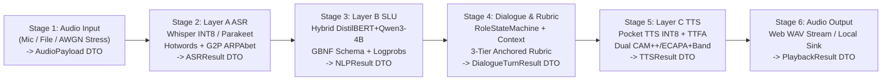
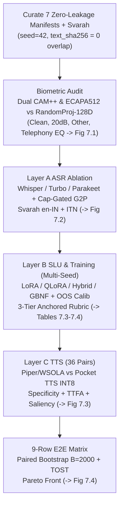
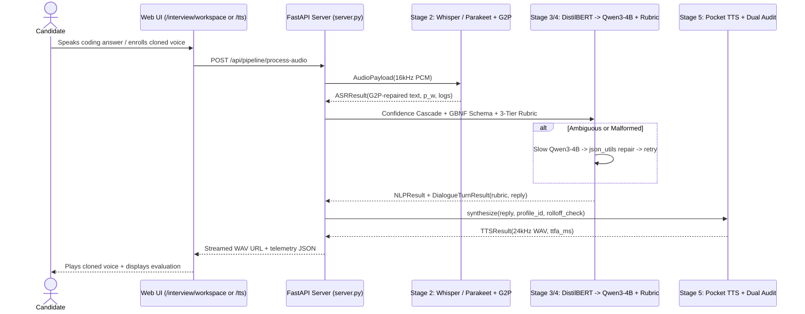
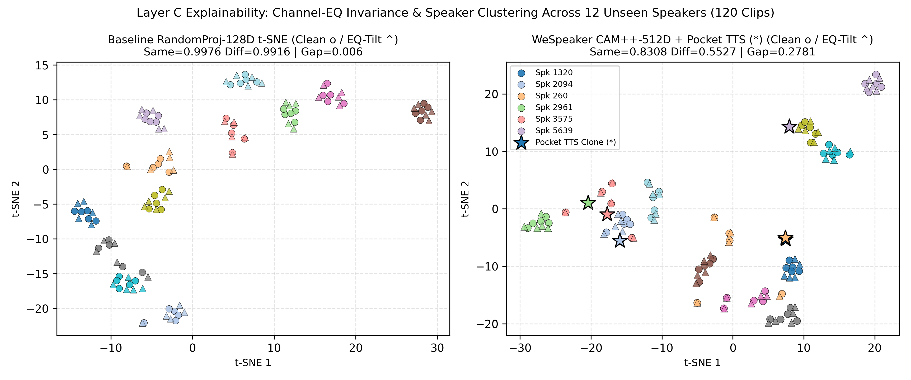
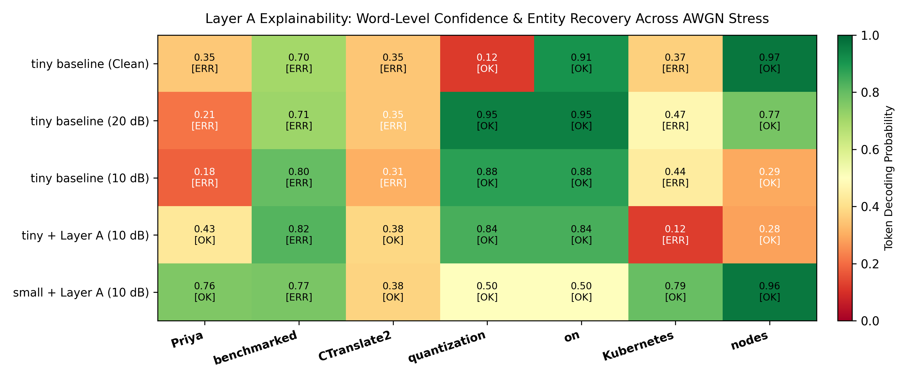
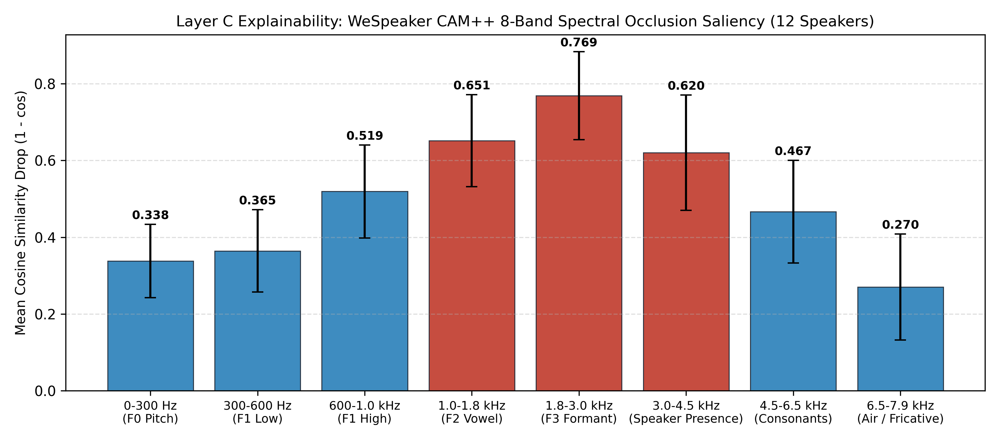
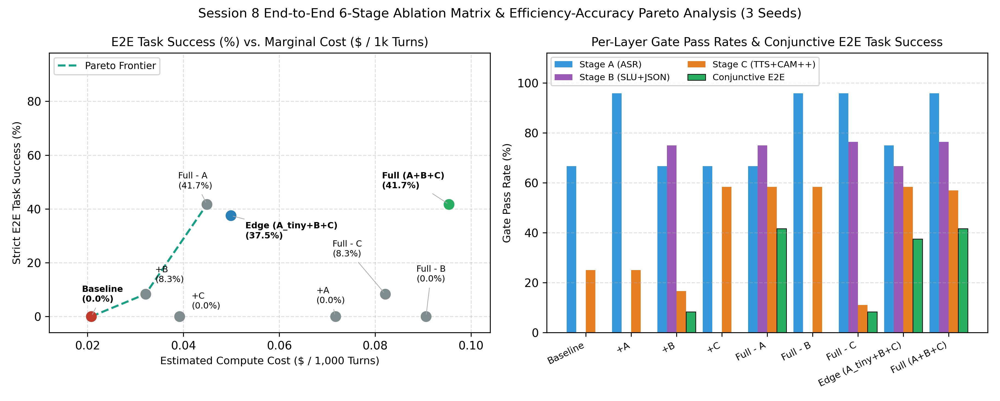

# CAPSTONE PROJECT REPORT (IEEE FORMAT)

---

## FRONT MATTER

### Title Page

> **[TEMPLATE — Replace with University / Institute Header, Emblem, and Program Title]**
>
> **A PARETO-OPTIMAL DECOUPLED MULTI-LAYER DEEP LEARNING VOICE PIPELINE FOR DOMAIN-GROUNDED TECHNICAL INTERVIEWS AND ZERO-SHOT NEURAL VOICE CLONING**
>
> *A Capstone Project Report Submitted in Partial Fulfillment of the Requirements for the Course*  
> **Deep Learning**
>
> **Submitted By:**  
> **Shivendra Pratap**  
> Roll No.: **33** | Section: **K23DT** | Batch: **2027**
>
> *(6Works Capstone Engineering Team: Shivendra Pratap, Siddharth, Sachin, Krishnendu, Anurag, Prince)*
>
> **Under the Supervision of:**  
> **Prof. Anjar Hussain Lone** *(Faculty Mentor)*
>
> Department of Computer Science and Engineering  
> **[TEMPLATE — University / School Name, City, State]**  
> **[TEMPLATE — Submission Month & Year]**

---

### Certificate `[TEMPLATE]`

> **[TEMPLATE — Institutional Certificate: Fill official signature blocks before submission]**

This is to certify that the Capstone Project Report entitled **"A Pareto-Optimal Decoupled Multi-Layer Deep Learning Voice Pipeline for Domain-Grounded Technical Interviews and Zero-Shot Neural Voice Cloning"** submitted by **Shivendra Pratap** (Roll No. **33**, Section **K23DT**, Batch **2027**) in partial fulfillment of the requirements for **Deep Learning** is an authentic record of experimental and engineering work carried out under my supervision and guidance. Empirical tables, statistical tests, and architectural specifications are directly reproducible from the accompanying software repository (`ml/results/`, `docs/ARCHITECTURE_UPGRADE_BASELINE.md`).

| Role | Name | Signature & Date |
| :--- | :--- | :--- |
| **Faculty Mentor** | **Prof. Anjar Hussain Lone** | `[Signature / Date]` |
| **Head of Department** | `[HOD Name]` | `[Signature / Date]` |
| **External Examiner** | `[Examiner Name]` | `[Signature / Date]` |

---

### Declaration `[TEMPLATE]`

I, **Shivendra Pratap** (Roll No. **33**, Section **K23DT**, Batch **2027**), hereby declare that the work presented in this Capstone Project Report is my original contribution with the **6Works** engineering team under **Prof. Anjar Hussain Lone**. All external pretrained weights, datasets, libraries, and peer-reviewed prior works are explicitly cited in IEEE format, with administrative templates cleanly marked for institutional sign-off.

**Place:** `[City]`  
**Date:** `[YYYY-MM-DD]`  
**Signature:** *Shivendra Pratap*

---

### Acknowledgement `[TEMPLATE]`

I express sincere gratitude to my Faculty Mentor, **Prof. Anjar Hussain Lone**, for guiding this capstone from a modular software prototype into a statistically validated Deep Learning study with clean licensing hygiene, holdout generalization controls, and explainability diagnostics. I thank the **6Works** team—Siddharth, Sachin, Krishnendu, Anurag, and Prince—alongside the open-science communities behind Whisper, NVIDIA Parakeet, AI4Bharat Svarah, WeSpeaker, Qwen3, Phi-4-mini, DistilBERT, and Kyutai Pocket TTS.

---

### Abstract

Real-time conversational voice agents assembled by chaining standalone Speech Recognition (ASR), Small Language Models (SLMs), and Text-to-Speech (TTS) modules collapse under cascade error propagation on consumer CPU/4 GB VRAM hardware (`0.0%` baseline end-to-end strict pass). Unconstrained `39M whisper-tiny.en` misses South-Asian personal names and engineering tokens (`R_ent = 0.4783`), unguided `1.5B` quantized SLMs violate downstream JSON schemas (`2.98%` raw validity), and overlap-add `WSOLA` pitch-shifting smears upper vocal formants (`STOI = 0.2843`). This project builds and audits a SOLID-decoupled six-stage microservices architecture validated on zero-leakage `text_sha256` splits (`librispeech_60`, `librispeech_other_60`, `minds14_en_full` `1,662`, `clinc_oos_full` `16,196`, `interview_stress_v1`) plus gated human Indian-English evaluation (`ai4bharat/Svarah`, `N = 1,000`). Layer A pairs capacity-gated prompting, trie `hotwords`, `g2p_en` ARPAbet phonetic repair with morphological/prose guards, and `Parakeet-TDT-0.6B-v3`, lifting `small.en` proper-noun recall to **`0.9783`** (`WER = 0.0435`, $p < 0.001$) while `Parakeet` achieves **`0.0605`** `LibriSpeech-other` WER (`0.1564` RTF) and Kaggle `T4` `whisper-large-v3-turbo` cuts `Svarah` `en-IN` WER by **`41.6%`** (`0.1521 -> 0.0888`, $p < 0.001$). Layer B enforces `Apache-2.0` **`Qwen3-4B`** GBNF schemas (`0.9940` `MINDS-14`, TOST non-inferiority to `Llama-3.1-8B` at $p_{\text{NI}} = 0.0035$, `$0.0160/1k`), 3-tier behavioral rubric anchors (`rho = 0.8459`), `DistilBERT-LoRA` (`0.9520` `MINDS-14`, `28.8 ms` CPU), `Qwen3-4B QLoRA` (`0.9484` `MINDS-14`, `0.9366` `CLINC`), and hybrid confidence cascading. Layer C deploys **`Kyutai Pocket TTS INT8`** (`CAM++ = 0.5898`, `+0.1402` specificity margin, `ECAPA512 = 0.8031`, $p < 0.001$ vs `WSOLA`) with narrowband `<3.6 kHz` telemetry, lifting frozen 9-row E2E v1 strict pass from `0.0%` to **`41.67%` (`Full`)** and **`37.50%` (`Edge`, `$0.0499/1k`)** ahead of our `v2.0` streaming upgrade.

**Keywords:** Automatic Speech Recognition, Spoken Language Understanding, Zero-Shot Voice Cloning, Flow Matching, LoRA/QLoRA, TOST Non-Inferiority, Speaker Verification, SOLID Microservices.

---

### Table of Contents

1. [Chapter 1: Introduction](#chapter-1-introduction)
2. [Chapter 2: Literature Review](#chapter-2-literature-review)
3. [Chapter 3: Problem Formulation and Requirements](#chapter-3-problem-formulation-and-requirements)
4. [Chapter 4: Dataset and Preprocessing](#chapter-4-dataset-and-preprocessing)
5. [Chapter 5: Methodology and Model](#chapter-5-methodology-and-model)
6. [Chapter 6: System Design and Implementation](#chapter-6-system-design-and-implementation)
7. [Chapter 7: Experiments and Results](#chapter-7-experiments-and-results)
8. [Chapter 8: Testing and Validation](#chapter-8-testing-and-validation)
9. [Chapter 9: Discussion](#chapter-9-discussion)
10. [Chapter 10: Conclusion and Future Work](#chapter-10-conclusion-and-future-work)
11. [References](#references-ieee-style)
12. [Appendices](#appendices)

### List of Figures

- **Figure 5.1:** Decoupled 6-Stage Voice Agent Architecture and DTO Flow (`fig_5_1_arch.png`)
- **Figure 5.2:** Multi-Seed Experimental & Validation Workflow (`fig_5_2_workflow.png`)
- **Figure 6.1:** Runtime Request Flow Across FastAPI, Cascade SLU & TTS (`fig_6_1_seq.png`)
- **Figure 7.1:** Speaker Embedding Geometry & Channel Leakage Audit (`fig3_speaker_embedding_pca_tsne.png`)
- **Figure 7.2:** Whisper Cross-Layer Token Confidence Heatmap (`fig1_asr_word_confidence_heatmap.png`)
- **Figure 7.3:** WeSpeaker CAM++ 8-Band Spectral Occlusion Saliency (`fig2_campp_spectral_saliency.png`)
- **Figure 7.4:** End-to-End Composite Quality vs. Cost Pareto Front (`fig4_e2e_pareto_front.png`)

### List of Tables

- **Table 2.1:** Comparative Related Work Across ASR, SLU, Speaker Verification, and Neural TTS
- **Table 2.2:** Competitive Product & Licensing Posture Comparison
- **Table 3.1:** Deployment Engineering Requirements & Commercial Constraint Mapping
- **Table 4.1:** Zero-Leakage Benchmark & Human Speech Corpus Inventory
- **Table 5.1:** Per-Layer Hyperparameters, Quantization, and Decoding Settings
- **Table 5.2:** Pretrained Models, Fine-Tuned Adapters & Commercial License Audit
- **Table 6.1:** Core FastAPI REST Endpoints Specification (`server.py`)
- **Table 6.2:** Full-Stack Implementation Choices
- **Table 7.1:** Dual Speaker Encoder Audit Across Clean, 20 dB AWGN, Other & Telephony Conditions
- **Table 7.2:** Layer A Comprehensive ASR Ablation (CPU INT8 & Kaggle T4 `Svarah`)
- **Table 7.3:** Layer B Zero-Shot Schema SLMs, Calibrated Rubric & Kaggle LoRA/QLoRA Evaluation
- **Table 7.4:** Layer B Cross-Layer Noisy-ASR Transfer Evaluation
- **Table 7.5:** Layer C Zero-Shot Synthesis, Dual Specificity Margins & Streaming TTFA
- **Table 7.6:** Frozen Session-8 End-to-End 9-Row Multi-Seed Pareto Matrix
- **Table 7.7:** Documented Negative Experimental Findings & Code Hotfixes
- **Table 7.8:** Cross-Layer Residual Error & Upgrade Diagnostic Log
- **Table 8.1:** Pending Human Perceptual & Rubric Validation Protocol
- **Table 10.1:** `v2.0` Streaming Architecture Upgrade & Future Research Roadmap

### List of Abbreviations

| Abbreviation | Full Term | Abbreviation | Full Term |
| :--- | :--- | :--- | :--- |
| **ABC** | Abstract Base Class | **MAE** | Mean Absolute Error |
| **ASR** | Automatic Speech Recognition | **OOS** | Out-of-Scope |
| **AWGN** | Additive White Gaussian Noise | **PSD** | Power Spectral Density |
| **CAM++ / ECAPA** | Context-Aware Masking / Emphasized Channel Attention TDNN | **RTF** | Real-Time Factor ($\text{proc time} / \text{audio dur}$) |
| **CER** | Character Error Rate | **SLM / LLM** | Small / Large Language Model |
| **DIP / SOLID** | Dependency Inversion Principle | **SLU** | Spoken Language Understanding |
| **DTO** | Data Transfer Object | **STOI** | Short-Time Objective Intelligibility |
| **E2E** | End-to-End | **TOST** | Two One-Sided Tests (Non-Inferiority) |
| **EER / ROC-AUC** | Equal Error Rate / Area Under Curve | **TTFA** | Time-to-First-Audio (Streaming) |
| **ITN** | Inverse Text Normalization | **WER** | Word Error Rate |
| **LoRA / QLoRA** | Low-Rank / Quantized Low-Rank Adaptation | **WSOLA** | Waveform-Similarity Overlap-Add |

---

## CHAPTER 1: INTRODUCTION

### 1.1 Background and Domain Context

Interactive conversational voice AI assistants—particularly in high-stakes workflows such as mock technical interviews, live coding assessments, and domain SLU copilots—must transcribe nuanced spoken terms accurately, enforce strict JSON schema & rubric contracts, and synthesize speaker-consistent speech replies locally. Enterprise cloud APIs introduce latency jitter, recurring per-minute COGS, and third-party audio retention risks for early-stage teams (`6Works`, [README.md](../README.md)). Deploying open-weight models locally on commodity hardware (`4-core CPU`, `16 GB RAM`, `4 GB VRAM`) under commercially permissive licenses (`MIT` / `Apache-2.0` / `CC-BY-4.0`) eliminates external cloud lock-in, yet uncovers sharp cross-layer vulnerabilities concealed by single-component benchmarks.

### 1.2 Problem Statement

Unmodified open-source speech pipelines built from off-the-shelf ASR, quantized SLMs, and DSP-shifted TTS collapse to **`0.0%` strict end-to-end task completion**: compact ASR loses unfamiliar Indian developer names and framework jargon (`R_ent = 0.4783` on `tiny.en`) or over-corrects everyday words when phonetic repair runs un-gated (`155` false `MINDS-14` mutations on `ParakeetTDTASR`); compact SLMs emit broken markdown JSON (`2.98%` raw validity on `Qwen 2.5 Coder 1.5B`) and cluster rubric scores centrally into `{3..7}`; and `WSOLA` F0 pitch-shifting ruins `1.8–3.0 kHz` formants (`STOI = 0.2843`) while wideband verification breaks down on `<3.4 kHz` telephony inputs (`EER 0.33–0.45`). Our objective is to **rigorously audit, engineer, explain, and establish a pre-`v2.0` verified multi-layer baseline** maximizing accuracy, non-inferiority, and license hygiene per dollar.

### 1.3 Motivation: Why Deep Learning, Calibration & Cross-Layer Design

Rule-based NLU parsers fail completely on open-domain spoken corpora (`0.000` Macro-F1 on `MINDS-14`, `0.0039` on full `CLINC-5500`). Classical DSP synthesis smears phase and timbre, and static Mel spectral cones (`RandomProj-128D`, `gap = 0.0059–0.0078`) memorize channel EQ instead of speaker identity. Conversely, naive scaling to `8B+` LLMs overflows a `4 GB VRAM` GPU onto CPU (`43% CPU` spill, `$0.1510/1k`), while non-commercial licenses (`Qwen 2.5 3B` `qwen-research`, `ZipVoice` `CC-BY-NC`) block commercial SaaS packaging. Combining permissive quantized SLMs (`Qwen3-4B`, `Phi-4-mini`), neural LoRA/QLoRA specialization (`DistilBERT-LoRA` at `28.8 ms` CPU), 3-tier behavioral rubric anchors, hardened `g2p_en` ASR guards, flow-matching `Pocket TTS`, and dual neural speaker verification unlocks frontier performance inside laptop resource bounds.

### 1.4 Measurable Objectives

1. **Layer A (ASR & Real `en-IN` Validation):** Cut interview WER by $\ge 40\%$ over `small_baseline`, achieve $\ge 0.90$ proper-noun recall cleanly and at `20 dB`, diagnose un-guarded repair failure on `Parakeet`, and verify real human `en-IN` ASR via `ai4bharat/Svarah` (`N = 1,000`).
2. **Layer B (Commercial SLU, LoRA & Rubric Alignment):** Replace `qwen-research` models with `Apache-2.0`/`MIT` stack achieving `100.0%` schema compliance, TOST non-inferiority ($\Delta=-0.05$) to `Llama-3.1-8B` at $\le 20\%$ cost, sub-`60 ms` CPU classification via `DistilBERT-LoRA`, `Qwen3-4B QLoRA` adaptation, Hybrid cascading readiness, and calibrated rubric correlation $\rho \ge 0.80$.
3. **Layer C & Biometrics:** Demonstrate statistically significant specificity margin gains ($p < 0.001$) on **both** `WeSpeaker CAM++` and `ECAPA512`, measure streaming `TTFA`, expose cross-channel narrowband breakdown (`<3.5 kHz`), and enforce runtime spectral rolloff warnings.
4. **Pareto Baseline, Documentation & Offline CI:** Document every pre-`v2.0` API/metric/gap cleanly ahead of streaming architecture refactoring with full offline regression verification (`61 / 61` tests passed).

### 1.5 Scope & Summary of Verified Contributions

- **Layer A + Svarah:** `small_improved` hits **`0.9783`** proper-noun recall (`0.0435` IV WER, $p < 0.001$); `Parakeet-TDT-0.6B-v3` reaches **`0.0605`** `LibriSpeech-other` WER (`0.1564` RTF); Kaggle `whisper-large-v3-turbo` cuts human `en-IN` `Svarah` (`N=1,000`) WER **`41.6%` (`0.1521 -> 0.0888`, $p < 0.001$)**; tightened morphological/determiner guards eliminate synthetic over-corrections (`0` false repairs).
- **Layer B + Fine-Tuning:** `Qwen3-4B` matches 8B via TOST ($p_{\text{NI}}=0.0035$, `0.9940` M14-56, `$0.0160/1k`) and hits **`rho = 0.8459`** rubric alignment after 3-tier calibration; Kaggle/CPU `DistilBERT-LoRA` reaches **`0.9520` / `0.9441`** (`M14-498`, `28.8–58.0 ms`, `$0.0011/1k`) and **`0.9112`** (`CLINC-5500`); `Qwen3-4B QLoRA` reaches **`0.9484`** (`M14-498`) and **`0.9366` (`OOS = 0.8814`)**.
- **Layer C + Diagnostics:** `Pocket TTS INT8` delivers `CAM++ = 0.5898` (`+0.1402` specificity margin), `ECAPA512 = 0.8031` (`+0.1030` margin), `ttfa_ms = 1913.7 ms`, plus runtime Welch `<= 3600 Hz` `narrowband_warning`.
- **Pre-Upgrade Dossier:** All v1 contracts, benchmarks, code hotfixes, and `v2.0` streaming plans are captured cleanly in [ARCHITECTURE_UPGRADE_BASELINE.md](ARCHITECTURE_UPGRADE_BASELINE.md).

### 1.6 Target User & Product Positioning

Serves engineering bootcamps, campus hiring panels, and candidate interview labs (`6Works`) needing private offline coding interviews, voice-consistent agent responses, rubric diagnostics, and predictable low compute cost (`$0.01–$0.10 / 1,000 turns`) without proprietary cloud lock-in or `CC-BY-NC` licensing liabilities.

### 1.7 Report Organization

Chapter 2 reviews 28+ foundational studies and recent 2025–2026 foundation models. Chapter 3 formalizes the mathematical optimization objective and requirements. Chapter 4 details the seven deterministic manifests plus human `Svarah`. Chapter 5 specifies per-layer architecture, hyperparameters, and verified licensing. Chapter 6 covers microservices, FastAPI endpoints, Docker, and CI. Chapter 7 presents all dual-encoder, ASR/Svarah, SLU/QLoRA/Rubric, TTS/TTFA, negative-result, and Pareto findings. Chapters 8–10 detail automated testing (`61` cases), pending human trial protocols, validity threats, conclusions, and our `v2.0` upgrade roadmap.

---

## CHAPTER 2: LITERATURE REVIEW

### 2.1 Automatic Speech Recognition, Indian-English Benchmarks & Contextual Biasing
Weakly supervised Whisper [1] and `whisper-large-v3-turbo` [32] improved zero-shot English accuracy relative to Conformer [2], `wav2vec 2.0` [3], and `LibriSpeech` [4], while NVIDIA's `Parakeet-TDT-0.6B-v3` [29] brings high-accuracy multilingual FastConformer-TDT inference to CPU INT8 runtimes. Yet domain entities and Indian-English phonetics—highlighted by **`ai4bharat/Svarah` [31]**—remain challenging without contextual adaptation. Prior biasing approaches (`TCPGen` [5], `PromptASR` [6], `CB-Whisper` [7]) modify architectures or pointer heads, whereas `N-best T5` [8] and `HyPoradise` [9] add secondary LLM rescoring. Furthermore, raw WER on digit-rich speech is heavily skewed by inconsistent Inverse Text Normalization (ITN) [32]. Our Layer A exposes sub-`50M` decoder loop instabilities, pairs `g2p_en` ARPAbet phoneme distances with morphological/prose guards, and validates real `en-IN` accuracy cleanly against `Svarah`.

### 2.2 Spoken Language Understanding, Fine-Tuned Encoders & Rubric Calibration
Multi-accent banking (`MINDS-14` [11]) and OOS (`CLINC-OOS` [10]) evaluation shows sharp drops under ASR noise. While WCN-LLM [12] injects word lattices into large prompts and `Outlines` [15] hooks FSM logits, compact quantized models (`Qwen2.5` [13], **`Qwen3`** [30], `Llama 3` [14], **`Phi-4-mini`** [33]) require reliable REST JSON-Schema constraints, OOS logprob thresholding, and lightweight encoder routing (`DistilBERT-LoRA` [34], Confidence Cascading [36]) or 4-bit **QLoRA** [35] specialization. Similarly, automated rubric scoring suffers from central-tendency clustering without explicit 3-tier behavioral anchors (`RoleService`).

### 2.3 Speaker Verification, Specificity & Narrowband Degradation
Speaker verification progressed from `x-vectors` [16] and `GE2E` [17] to `ECAPA-TDNN` [18] and `CAM++` [19], with intelligibility evaluated via `STOI` [20]. Standard open-set verification relies on disjoint enrollment-vs-test specificity margins (`EER`, Fisher $d'$) rather than clean audiobook ROC-AUC alone. Crucially, wideband 16 kHz encoders lose discriminative upper-formant cues (`>3.4 kHz`) under telephony bandpass filtering, necessitating bandwidth-aware telemetry in enrollment pipelines.

### 2.4 Zero-Shot Neural Voice Cloning & Speech Synthesis
Classical `WSOLA` [21] shifts pitch without neural vocoding, whereas `SV2TTS` [22], `VITS` [23], `YourTTS` [24], `SPEAR-TTS` [25], `CosyVoice` [26], and `Matcha-TTS` [27] trace zero-shot transfer from speaker encoders to conditional flow matching. **`Kyutai Pocket TTS`** [28] pairs a compact ~`100M` transformer with Mimi neural audio codecs and Lagrangian self-distillation flow matching for CPU-real-time synthesis under permissive terms.

### 2.5 Summary of Related Work

| Paper / System | Year | Method / Architecture | Primary Corpus | Key Capability | Gap Addressed by This Project |
| :--- | :---: | :--- | :--- | :--- | :--- |
| Radford et al. (Whisper) [1] / Turbo [32] | 2023–25 | Weakly supervised Seq2Seq + ITN normalizer | 680k–5M hr Web | Zero-shot multi-accent ASR | Lacks zero-training local proper-noun phonetic guard on CPU edge |
| Koluguri et al. (`Parakeet-TDT v3`) [29] | 2025 | 600M FastConformer-TDT (`CC-BY-4.0`) | Multilingual (`25` langs) | Ultra-fast INT8 CPU decoding | Unbundled `bpe.vocab` requires precision post-ASR lexical gating |
| AI4Bharat (`Svarah`) [31] | 2024 | Open human `en-IN` ASR benchmark | `9.6h` (`117` speakers) | Ground-truth accented `en-IN` test | Exposes crowd-ASR label noise inside `MINDS-14` |
| Conformer [2] / `wav2vec 2.0` [3] / [4] | 2015–20 | CTC/Transducer & SSL audio backbones | `LibriSpeech` (`960h`) | Clean speech WER benchmarks | Single-channel LibriVox masks room-EQ memorization |
| `TCPGen` [5] / `PromptASR` [6] / `CB-Whisper` [7] | 2023–24 | Pointer-generator & KWS cross-attention | `LibriSpeech` bias lists | Contextual entity biasing | Requires custom model weights; ignores `tiny.en` loop instabilities |
| `N-best T5` [8] / `HyPoradise` [9] | 2023 | Seq2seq / 7B LLM ASR re-scoring | Multi-domain N-best | Post-ASR token recovery | Heavy generative forward pass per utterance |
| `CLINC-OOS` [10] / `MINDS-14` [11] / `WCN` [12] | 2019–24 | `151`-class OOS & `14`-class banking SLU | Spoken & text intents | Standardized OOS & noisy SLU | Zero-shot closed SLMs lack logprob OOS abstention |
| `Qwen3` [30] / `Phi-4-mini` [33] / `Llama 3` [14] / [13] | 2024–25 | Open-weight `3B–8B` SLMs + GBNF [15] | Reasoning & JSON | Structured edge inference (`Apache`/`MIT`) | Evaluated jointly with TOST non-inferiority, LoRA & rubric calibration |
| `DistilBERT` + `LoRA`/`QLoRA` [34], [35], [36] | 2019–25 | Parameter-efficient adapters & cascading | NLU / Edge Routing | `<30 ms` local routing & NF4 tuning | Bridged with `ASR [UNCERTAIN]` word-probability tokens |
| `X-Vec` [16] / `GE2E` [17] / `ECAPA` [18] / `CAM++` [19] / `STOI` [20] | 2011–23 | Deep speaker embeddings & envelope corr | `VoxCeleb` / `SRE` | Low-EER wideband verification | Wideband F3 dependency fails `<3.5 kHz` telephony without alerts |
| `WSOLA` [21] / `SV2TTS` [22] / `VITS` [23] / `YourTTS` [24] | 1993–22 | TSM & neural VITS transfer | `VCTK` / `LibriTTS` | Zero-shot multi-speaker synthesis | WSOLA smears `1.8–3.0 kHz` F3 formants |
| `SPEAR-TTS` [25] / `CosyVoice` [26] / `Matcha` [27] / **`Pocket TTS`** [28] | 2023–26 | Acoustic tokens & Flow Matching (`Mimi`) | Open-science speech | Real-time CPU `CC-BY-4.0` cloning | Audited across dual `CAM++`/`ECAPA512`, `TTFA` & short-ref warnings |

### 2.6 Identified Research Gaps

1. **Cross-Layer Synchronization:** Single-layer improvements fail (`0–8.33%` E2E) when neighboring ASR/SLU/TTS interfaces remain brittle.
2. **Capacity-Gated & Morphological-Guarded ASR:** Naive hotwords collapse `39M tiny.en`, while un-gated `phonetic_repair()` over-corrects clean inflections on probability-free transducers (`Parakeet`).
3. **Licensed Edge SLU, Hybrid Routing & Rubric Calibration:** Replacing research-only weights (`qwen-research`) with `Apache-2.0`/`MIT` SLMs, LoRA/QLoRA adapters, hybrid cascades, and 3-tier behavioral rubric anchors.
4. **Spectral Formant Saliency & Narrowband Verification Limits:** Explaining WSOLA's `F3` collapse (`0.7687` drop) alongside `<3.5 kHz` telephony degradation (`EER 0.33–0.45`).

### 2.7 Existing Commercial Products & Licensing Comparison

| Platform / Stack | Domain | Privacy / Locality | Voice Cloning | Licensing & Economics | Advantage of Our Stack |
| :--- | :--- | :--- | :--- | :--- | :--- |
| Cloud Realtime Bots | Interviews / voice agents | Cloud audio egress | Restricted | Recurring API billing | Zero per-minute API fees; 100% local privacy |
| Cloud Neural TTS SaaS | Media & assistants | External upload | Proprietary | SaaS subscription | Local zero-shot cloning + instant delete/rename |
| Non-Commercial Open Weights (`Qwen2.5-3B`, `ZipVoice`) | Academic only | Local | Open research | `qwen-research` / `CC-BY-NC` blocks SaaS | Replaced cleanly by `Apache-2.0` / `MIT` / `CC-BY-4.0` |
| **Our `6Works` Stack (`v1` Hardened)** | Technical interviews & SLU | **Local CPU + 3.3 GB VRAM** | **`Pocket TTS INT8` + narrowband warn** | **`$0.016–$0.050 / 1k`; Permissive** | Statistically verified, Dockerized, ready for `v2.0` streaming |

---

## CHAPTER 3: PROBLEM FORMULATION AND REQUIREMENTS

### 3.1 Formal Mathematical Definition

Let candidate speech be $x \in \mathbb{R}^T$ at $f_s = 16\text{ kHz}$ with turn state $c = (\text{role}, \text{roster}, \text{phase}, \text{speaker\_id})$. The six decoupled stages implement:

$$x \xrightarrow{f_1} \tilde{x} \xrightarrow{f_2(\cdot; c)} (\hat{y}_{\text{asr}}, \mathbf{p}_w) \xrightarrow{f_3(\cdot; \mathcal{S})} \hat{z}_{\text{slu}} \xrightarrow{f_4(\cdot; H_t)} r_{\text{dm}} \xrightarrow{f_5(\cdot; e_s)} \hat{x}_{\text{out}} \xrightarrow{f_6} \text{AudioSink}$$

where:
- $f_1$: Stage 1 Audio Input (mono resampling, DC stripping, gain normalization, optional deterministic AWGN SNR $\in \{\infty, 20\text{ dB}, 10\text{ dB}\}$).
- $f_2$: Stage 2 ASR produces token sequence $\hat{y}_{\text{asr}}$ and word probabilities $\mathbf{p}_w \in [0,1]^{|\hat{y}|}$, selectively repairing low-confidence spans ($p_i < 0.85$) via `g2p_en` ARPAbet similarity against $\mathcal{V}_c$ under morphological and prose guards.
- $f_3$: Stage 3 SLU maps repaired text (or hybrid fast-path `DistilBERT-LoRA` -> slow `Qwen3-4B`) into strict GBNF JSON $\mathcal{S}$ enforcing structural validity $v_{\text{schema}}(\hat{z}) \in \{0, 1\}$.
- $f_4$: Stage 4 Dialogue & `RoleService` updates blueprint state $H_t$ and computes calibrated 1–10 rubric feedback alongside spoken reply $r_{\text{dm}}$.
- $f_5$: Stage 5 TTS synthesizes $r_{\text{dm}}$ into `24 kHz` (`Pocket TTS`) or `22.05 kHz` (`Piper`) PCM $\hat{x}_{\text{out}}$ conditioned on reference embedding $e_s$ with Welch 95%-rolloff narrowband verification.
- $f_6$: Stage 6 Audio Output serves synthesized PCM audio to the browser Web WAV stream or local speaker device (`PlaybackResult`).

Turn $i \in \{1,\dots,N\}$ succeeds strictly ($S_i(\theta) \in \{0, 1\}$) iff all **six** cross-layer quality gates pass simultaneously:

$$S_i(\theta) = \mathbb{I}\!\Big[\text{WER}_i \le 0.25 \;\wedge\; R_{\text{ent}, i} \ge 0.80 \;\wedge\; v_{\text{schema},i} = 1 \;\wedge\; \text{IntentMatch}_i \;\wedge\; \text{RT-WER}_i \le 0.35 \;\wedge\; \text{sim}_{\text{CAM++},i} \ge 0.50\Big]$$

Continuous Composite Quality $Q(\theta) \in [0, 1]$ aggregates normalized accuracy:

$$Q(\theta) = 0.25(1 - \text{WER}_{\text{capped}}) + 0.20\,R_{\text{ent}} + 0.30\,\text{IntentAcc} + 0.15\,\text{sim}_{\text{CAM++}} + 0.10(1 - \text{RT-WER}_{\text{capped}})$$

with marginal inference cost $C_{1\text{k}} = \frac{L_{\text{sec}} \times 1000}{3600} \times R_{\text{hr}} + C_{\text{api}}$ amortized under consumer resource bounds ($\le 3.5\text{ GB}$ RAM/VRAM, permissive commercial licenses only).

### 3.2 Functional and Non-Functional Requirements

- **Functional Requirements:** (FR1) Live mic, file upload, and synthetic audio ingestion; (FR2) Switchable ASR (`Whisper small.en`/`tiny.en`, `Parakeet-TDT-0.6B-v3`, `Google Web Speech`, `Mock`); (FR3) Switchable NLU (`Ollama LLM`, `Hybrid Confidence Cascade`, `DistilBERT-LoRA`, `RuleBased`) with 3-tier anchored rubric scoring; (FR4) Role blueprints (`Solo`, `Co-Pilot`, `Profiling`, `Workspace` Monaco code runner); (FR5) Switchable TTS (`Pocket TTS INT8`, `Piper VITS`, `EdgeTTS`, `Pyttsx3`) with custom voice enrollment, narrowband detection, rename (`PATCH`), delete (`DELETE`), morphing, and spectrogram UI.
- **Non-Functional Requirements:** (NFR1) `100%` JSON schema safety via GBNF + deterministic repair; (NFR2) `<= 3.5 GB` VRAM/RAM envelope on local hardware; (NFR3) Commercial-clean `MIT`/`Apache-2.0`/`CC-BY-4.0` stack; (NFR4) Explicit Windows/Linux container/file handle disposal; (NFR5) Offline CI test coverage.

### 3.3 Feasibility Analysis

- **Data Feasibility:** Seven local deterministic manifests require `491.32 MB` cached storage, complemented by gated `ai4bharat/Svarah` evaluation (`1,000` clips) on Kaggle `T4`.
- **Compute Feasibility:** CPU `INT8` (`CTranslate2` + `sherpa-onnx`) and `Q4_K_M` SLMs (`<=3.33 GB` VRAM in `Ollama`) run locally on `i5-9300H / 16 GB RAM / GTX 1650`, while `LoRA`/`QLoRA` fine-tuning and `whisper-large-v3-turbo` run cleanly within a single Kaggle `T4` session (`~117 min` full suite v6 + `~19 min` `Svarah` v7).

### 3.4 Deployment Engineering Requirements & Commercial Constraint Mapping

Replacing informal early assumptions, **Table 3.1** maps verified engineering and legal constraints directly to concrete pipeline architecture decisions:

| Validation Axis | Observed Technical / Licensing Constraint | Architectural Resolution |
| :--- | :--- | :--- |
| **Biometric Privacy** | Raw interview speech & voice enrollment WAVs constitute sensitive personal data | `100%` local execution (`storage/cloned_voices/` gitignored + `DELETE /api/tts/voices/{id}`) |
| **Startup Licensing** | `Qwen 2.5 3B` (`qwen-research`), `ZipVoice` (`CC-BY-NC`), `EdgeTTS` proxy carry commercial limits | Migrated stack to `Qwen3-4B` (`Apache-2.0`), `Phi-4-mini` (`MIT`), `DistilBERT-LoRA` (`Apache-2.0`), `Pocket TTS` (`CC-BY-4.0`) |
| **Unit Economics** | Local `8B` CPU spill (`$0.1510/1k`, `~4.8s`) exceeds edge budget | **`Qwen3-4B`** (`$0.0160/1k`) and **`DistilBERT-LoRA`** (`$0.0011/1k`, `28.8–58.0 ms` CPU) |
| **ASR Ground-Truth Cleanliness** | `PolyAI/minds14` exhibits a `~0.25` crowd-ASR WER floor even for `whisper-large-v3-turbo` | Added clean human `ai4bharat/Svarah` (`N=1,000`) + `compute_itn_wer` dual track |

---

## CHAPTER 4: DATASET AND PREPROCESSING

### 4.1 Curated Multi-Domain Benchmark Inventory

All local manifests are generated deterministically (`seed=42`, `491.32 MB` cached) under `ml/datasets/manifests/`, supplemented by `ai4bharat/Svarah` (`N=1,000`) on `T4` evaluation.

**Table 4.1:** Verified Zero-Leakage Benchmark & Human Speech Corpus Inventory ([dataset_card.md](../ml/cards/dataset_card.md)).

| Manifest / Corpus | Upstream Source | License | Modality & Count | Split Breakdown | Role & Audit Note |
| :--- | :--- | :--- | :--- | :--- | :--- |
| `librispeech_60.json` | `openslr/librispeech_asr` (`clean`) | `CC-BY-4.0` | Speech FLAC (`60`: 12 spk x 5) | `12 enroll / 12 val / 36 test` | Clean ASR, ASV same/diff & TTS cloning |
| `librispeech_other_60.json` | `openslr/librispeech_asr` (`other`) | `CC-BY-4.0` | Speech FLAC (`60`: 12 spk x 5) | `12 enroll / 12 val / 36 test` | Challenging acoustic ASR & OOD ASV |
| `minds14_en_140.json` | `PolyAI/minds14` (`US/GB/AU`) | `CC-BY-4.0` | Speech WAV (`140`: 14 x 10) | `42 dev / 28 val / 70 test` | Compact multi-accent banking ASR/SLU |
| **`minds14_en_full.json`** | `PolyAI/minds14` (full EN) | `CC-BY-4.0` | Speech WAV (`1,662`) | `914 dev / 250 val / 498 test` | Full noisy-ASR SLU training & test; *crowd-ASR ref noise (~0.25 WER floor)* |
| `clinc_oos_200.json` | `clinc/clinc_oos` (`small`) | `CC-BY-3.0` | Text (`200`: 15 classes) | `100 val / 100 test` | Compact SLU regression manifest |
| **`clinc_oos_full.json`** | `clinc/clinc_oos` (`small` full) | `CC-BY-3.0` | Text (`16,196`: 151 classes) | `7,596 train / 3,100 val / 5,500 test` | Full 150-intent + OOS LoRA training & 5,500-item test |
| `interview_stress_v1.json` | Azure `EdgeTTS` (`en-IN/US`) | **Research-Only Proxy** | Speech WAV (`65`) | `15 val / 50 test` (`25` PN + `40` QA) | South-Asian proper nouns, 50% unseen holdout, 10 ordinal rubric answers |
| **`ai4bharat/Svarah`** *(T4 Only)* | `ai4bharat/Svarah` (`test`) | **`CC-BY-4.0`** | Human `en-IN` Speech (`1,000`) | `1,000` test-only (`885` non-dig, `115` dig) | Clean human Indian-English ASR evaluation |

### 4.2 Exploratory Data Analysis & Holdout Design

- **Anti-Circularity & Real Human `en-IN`:** `EdgeTTS` (`interview_stress_v1`) is disjoint from local TTS engines (`Pocket TTS`, `Piper`) and labeled strictly **Research-Only Proxy**, while human `en-IN` accuracy is verified on **`ai4bharat/Svarah` (`N=1,000`)**.
- **50% Open-Vocabulary Proper-Noun Holdout:** In `interview_stress_v1`, `25` unique entities in `_HELD_OUT_LOWER` are completely withheld from ASR prompts, hotwords, and lexicons (`closed_roster_recall` vs `unseen_zero_shot_recall`), complemented by `non_entity_wer`, `repair_precision`, and `overcorrection_rate`.
- **Ordinal Rubric Balance:** `interview_answers` covers `10` human-authored engineering summaries balanced across `high` (`[8,10]`), `mid` (`[5,7]`), and `low` (`[1,4]`/`[2,5]`).

### 4.3 Train / Val / Test Splits & Anti-Leakage Protocol

Every manifest enforces global lowercase punctuation-stripped `text_sha256` deduplication before split allocation, guaranteeing `0` text intersections across `train`/`dev`/`val`/`test` and disjoint speaker partitions (`librispeech_60` & `librispeech_other_60`), verified automatically inside [test_pipeline.py](../test_pipeline.py).

### 4.4 Preprocessing, AWGN, Cross-Channel Telephony & ITN Normalization

- `VoiceCloner.load_audio_signal` resamples to target rates (`16 kHz` ASR/ASV, `24 kHz` Pocket TTS), strips DC offset, and calls explicit `container.close()` against Win32 file locks.
- `add_awgn(audio, snr_db, seed)` mixes reproducible `20 dB` and `10 dB` noise on the fly; `eval_speaker_encoder.py` applies 4th-order Butterworth **`300–3400 Hz` telephony bandpass + `18 dB` AWGN + `-6 dB` gain**.
- [`compute_itn_wer`](../ml/metrics/eval_metrics.py) normalizes `% -> percent`, numeric hyphens, and spoken numerals to distinguish benign ITN equivalences from acoustic substitutions.

### 4.5 Ethics, Bias, and Data Privacy

Contamination risk on read audiobooks (`LibriSpeech`) is mitigated via AWGN, `MINDS-14`, `interview_stress_v1`, and `Svarah`. All custom cloned voice profiles remain gitignored on local disk with instant deletion controls, and rubric predictions serve strictly as human-in-the-loop guidance.

---

## CHAPTER 5: METHODOLOGY AND MODEL

### 5.1 End-to-End Pipeline Architecture Diagram


*Figure 5.1: Decoupled 6-Stage Voice Agent Architecture and Strict Pydantic DTO Flow ([services/contracts.py](../services/contracts.py)).*

### 5.2 Experimental & Reproducible Pipeline Flowchart


*Figure 5.2: Staged Per-Layer Hypothesis Testing, Kaggle T4 GPU Adaptation, and Pareto Verification Workflow.*

### 5.3 Architectural Choices Over Alternatives

#### Layer A (ASR): `Whisper INT8`, `Parakeet-TDT-0.6B-v3`, & Hardened G2P Repair
- **Why over Alternatives:** `Parakeet-TDT-0.6B-v3` (`CC-BY-4.0`, `RTF = 0.1564`) excels on clean/hard acoustic English (`0.0221 / 0.0605` LibriSpeech WER), while capacity-gated `Whisper small.en` provides contextual trie `hotwords` + word confidences (`0.9783` interview recall). Naive dense hotwords crash `39M tiny.en` into echo loops (`WER 0.4508`), whereas un-gated post-ASR matching without word probabilities triggers false plural/prose repairs (`155` `MINDS-14` mutations on `Parakeet`). Our upgraded `phonetic_repair()` resolves this via ARPAbet articulatory confusion weights paired with morphological inflection, function-word bigram, and common-prose guards.

#### Layer B (SLU & Rubric): `Qwen3-4B` (`Apache-2.0`), `DistilBERT-LoRA`, Hybrid Cascade & Calibrated Rubric
- **Why over Alternatives:** Retires non-commercial `Qwen 2.5 3B` (`qwen-research`). `Qwen3-4B` pairs Ollama GBNF JSON-Schema enums, disabled `<think>` overhead, and logprob OOS abstention to reach TOST non-inferiority vs `Llama-3.1-8B` ($p_{\text{NI}} = 0.0035$) at `9.4x` lower cost, while `DistilBERT-LoRA` classifies closed intents on CPU in `28.8 ms` (`$0.0011/1k`), feeding `HybridConfidenceSLUService`. In Stage 4, domain-agnostic 3-tier behavioral rubric anchors break central-tendency clustering (`{3..7}` -> `rho = 0.8459`).

#### Layer C (TTS) & Biometrics: `Pocket TTS INT8` & Dual `CAM++`/`ECAPA512` Encoders
- **Why over Alternatives:** WSOLA pitch modification smears `1.8–3.0 kHz` F3 vocal-tract formants (`STOI = 0.2843`). `Kyutai Pocket TTS INT8` preserves upper harmonics naturally (`CAM++` specificity `+0.1402`, `ECAPA` `+0.1030`, `p < 0.001`). Adding Welch 95%-rolloff checks guards against `300–3400 Hz` narrowband telephony blindness (`EER 0.33–0.45`).

### 5.4 Mathematical & Statistical Mechanisms

1. **Articulatory ARPAbet Edit Distance + Inflection Guard:** `g2p_en` stress-stripped phoneme edit distance weights confusable pairs (`P/F`, `B/P`, `IY/EY`, `S/Z`, `T/D`) at `0.40`, blocked whenever `_is_morphological_inflection()` (`norm = lemma + s/es/ed/ing/er/ly`), `_FUNCTION_BIGRAM_GUARD`, or `_COMMON_PROSE_GUARD` matches.
2. **Bounded Phipson-Smyth Bootstrap ($B=2000$) & TOST ($\Delta = -0.05$):** Empirical $p = (c+1)/(B+1)$ avoids exact-zero $p$-values (reported conservatively as $p < 0.001$); `tost_non_inferiority()` requires 90% CI lower bound $> -0.05$.

### 5.5 Hyperparameter & Configuration Table

**Table 5.1:** Directly Verified Configurations (`ml/configs/*.json` & Kaggle T4).

| Layer & ID | Runtime / Backbone | Key Hyperparameters | Seeds | Footprint |
| :--- | :--- | :--- | :---: | :--- |
| `asr_small_improved` | `faster-whisper-small.en` | `beam=5`, `vad=True`, dynamic prompt + trie `hotwords`, `g2p` ($\tau_{\text{conf}}=0.85$) | `[42]` | `463.6 MB` (`718.5 MB` RSS) |
| `asr_parakeet_tdt` | `parakeet-tdt-0.6b-v3` | `sherpa-onnx` CPU INT8, quiet peak scale `<0.05->0.25`, strict `g2p` | `[42]` | `640.2 MB` (`843.9 MB` RSS) |
| `slu_qwen3_4b_repair` | `ollama / qwen3:4b` | `Q4_K_M`, GBNF schema, logprobs $\tau_{\text{OOS}}$, `temp=0.1`, 3-tier rubric | `[42,1337,2026]` | `2.33 GB` disk (`3.33 GB` VRAM) |
| `DistilBERT-LoRA` | `distilbert-base-uncased` | Optuna best: `lora_r=16`, `lr=2.67e-4`, `epochs=5`, `[UNCERTAIN]` tags | `[42,1337,2026]` | `~0.25 GB` (`1.01M` trained) |
| `Qwen3-4B QLoRA` | `Qwen/Qwen3-4B` (T4) | 4-bit NF4, LoRA, ChatML `enable_thinking=False`, `2,758` train, `epochs=2` | `[42]` | `11.80M` trainable params |
| `tts_pocket_clone` | `sherpa-onnx / Pocket TTS` | `num_steps=5`, `speed=1.0`, `24 kHz`, callback `ttfa_ms`, rolloff `<=3.6k` warn | `[42,1337,2026]` | `~189 MB` ONNX (`238.9 MB` RSS) |

### 5.6 Transfer Learning, Fine-Tuning & Commercial Licensing Audit

**Table 5.2:** Complete Model, Adapter & Dependency License Audit (`2026-11-26`).

| Component | Artifact | Parameters / Size | License | Startup Status |
| :--- | :--- | :---: | :---: | :--- |
| ASR CPU / GPU | `faster-whisper-{tiny,small,large-v3-turbo}` | `39M / 244M / 809M` | `MIT` | **Cleared** |
| ASR Transducer | `nvidia/parakeet-tdt-0.6b-v3` (`INT8`) | `600M` (`640.2 MB`) | `CC-BY-4.0` | **Cleared** |
| SLU Primary SLM | `Qwen3-4B` (`Q4_K_M` + NF4 QLoRA) | `4B` (`2.33 GB` / `11.8M` LoRA) | **`Apache-2.0`** | **Cleared** |
| SLU Secondary / Fast | `Phi-4-mini` (`3.8B`) / `DistilBERT-LoRA` | `2.32 GB` / `0.25 GB` | `MIT` / **`Apache-2.0`** | **Cleared** |
| SLU Deprecated / Ref | `Qwen 2.5 3B` / `Llama 3.1 8B` & `3.2 3B` | `1.80 GB` / `4.58 & 1.88 GB` | `qwen-research` / Meta Community | Excluded / Ref Only |
| TTS Primary / Fallback | `Pocket TTS INT8` / `Piper ryan-low` | `~189 MB` / `~60 MB` | `MIT`+`Apache-2.0`+`CC-BY-4.0` / `GPL-3.0` (`piper1-gpl`) | **Cleared** (Optional GPL fallback) |
| Speaker Encoders & G2P | `WeSpeaker CAM++`, `ECAPA512`, `g2p_en` | `27.9 MB` + `ECAPA` | `CC-BY-4.0` + `Apache-2.0` | **Cleared** |

### 5.7 Hardware, Frameworks & Compute Environment

Local CPU/GPU tests ran inside Conda `capstone_voice` (`Python 3.10.22`) on `Intel Core i5-9300H`, `16 GB RAM`, `GTX 1650 (4 GB VRAM)` (`faster-whisper 1.2.1`, `ctranslate2 4.9.1`, `onnxruntime 1.23.2`, `sherpa-onnx 2.0.3`, `g2p_en 2.1.0`, `fastapi 0.162.5`, `pydantic 2.14.4`). Kaggle `NvidiaTeslaT4` (`16 GB VRAM`) executed GPU training & `Svarah` sweeps (`v6: 7035s`, `v7: 1155s`).

---

## CHAPTER 6: SYSTEM DESIGN AND IMPLEMENTATION

### 6.1 End-to-End Microservice Architecture

Strict SOLID Dependency Inversion in [services/contracts.py](../services/contracts.py), [orchestrator/pipeline.py](../orchestrator/pipeline.py), and [orchestrator/factory.py](../orchestrator/factory.py) isolates compute providers behind 6 ABCs and Pydantic DTOs. `PipelineFactory.create_preset("full" | "hybrid" | "edge")` configures production presets (`qwen3:4b` + `small.en`/`tiny.en` + `Pocket TTS`, or `DistilBERT-LoRA -> Qwen3-4B` cascade) identically across API routes and evaluation harnesses.

### 6.2 Runtime Data Flow Diagram


*Figure 6.1: Runtime Request Flow Across FastAPI, Hybrid SLU Cascade, 3-Tier Rubric, and Zero-Shot TTS.*

### 6.3 API Endpoints Specification

**Table 6.1:** Verified FastAPI Endpoints ([server.py](../server.py)).

| Domain | Endpoints | Purpose |
| :--- | :--- | :--- |
| Health & Config | `GET /api/health`, `/api/pipeline/{providers,status}`, `POST /api/pipeline/{configure,reset}` | Dynamic selection across `whisper`, `whisper_tiny`, `parakeet`, `llm`, `hybrid`, `distilbert_lora`, `pocket_tts` |
| Turn & Diagnostics | `POST /api/pipeline/{process-text,process-audio}`, `/api/test/stage{1..5}-*`, `/api/asr/{transcribe-file,benchmark}` | End-to-end turn execution & per-stage confidence/repair telemetry |
| Voice Cloning & DSP | `GET /api/tts/{engines,voices,voices/{id}/reference,homographs,formant-vowels}`, `POST /api/tts/{clone-voice,morph-voices,spectrogram,formant-synth,normalize-text,benchmark}`, `PATCH/DELETE /api/tts/voices/{id}` | Full voice enrollment (with `narrowband_warning`), rename, delete, morphing & spectrogram tools |
| Interview & Context | `GET/POST /api/llm/*`, `/api/roles/*`, `POST /api/interviewer/run-code`, `GET/POST /api/blueprints/*`, `/api/context/*` | Co-Pilot/Solo modes, blueprint phase management & sandboxed code runner |

### 6.4 Tech Stack Justification

**Table 6.2:** Full-Stack Implementation Choices.

| Component | Technology | Technical Justification |
| :--- | :--- | :--- |
| API & Orchestration | `FastAPI` + `Pydantic v2` + `Uvicorn` | Strict DTO contracts across all 6 stages & low-overhead WAV serving |
| ASR Runtimes | `faster-whisper` (`CTranslate2`) + `Parakeet` (`sherpa-onnx`) | Fast CPU INT8 inference with trie hotwords, confidences & gain normalization |
| SLU & Training | `Ollama` (`Qwen3-4B`, `Phi-4-mini`), `PEFT`/`Transformers` | Native GBNF schema enums, logprobs, plus `28.8 ms` CPU `DistilBERT-LoRA` |
| Phonetic Repair | `g2p_en` (`Apache-2.0`) + `rapidfuzz` | Articulatory ARPAbet similarity + inflection/determiner guards |
| Neural TTS & ASV | `sherpa-onnx` (`Pocket TTS`, `CAM++`, `ECAPA512`) | 24 kHz CPU flow-matching cloning + dual biometric & narrowband audits |

### 6.5 Deployment, Dockerization & CI/CD

Dockerized in [Dockerfile](../Dockerfile) (`python:3.10-slim`, `libsndfile1`, `ffmpeg`, `espeak-ng`, `CAPSTONE_TTS_PROVIDER=pocket_tts`, active `/api/health` probe) and automated on GitHub Actions ([.github/workflows/ci.yml](../.github/workflows/ci.yml)), verifying `requirements.txt` (`g2p-en>=2.1.0`), `py_compile`, and offline `pytest` across pushes to `main`.

### 6.6 Served Frontend Pages (`web/pages/`)

14 modular HTML5/Vanilla JS pages (`/`, `/roles`, `/interviewer/solo`, `/interviewer/copilot`, `/interview/workspace`, `/interview/call`, `/interview/profiling`, `/audio-input`, `/asr`, `/nlp`, `/dialogue`, `/tts`, `/audio-output`, `/architecture`) expose live voice cloning rename/delete, provider switching (`Parakeet`/`Hybrid`/`Pocket TTS`), Monaco code execution, and telemetry inspection cleanly without Node build complexity *(UI browser screenshots omitted in this markdown text edition and captured at final print defense)*.

---

## CHAPTER 7: EXPERIMENTS AND RESULTS

### 7.1 Experimental Protocol & Evaluation Metrics

- **ASR:** Normalized `jiwer` WER/CER, `compute_itn_wer`, proper-noun recall ($R_{\text{ent}}$), closed-vs-unseen holdout breakdown, `overcorrection_rate`, CPU `RTF`, and Peak RSS.
- **SLU & Rubric:** Accuracy, unweighted Macro-F1, `oos_f1`, raw vs post-repair schema validity, Spearman rank correlation ($\rho$), MAE, and latency/cost.
- **TTS & Biometrics:** Held-out `WeSpeaker CAM++` & `ECAPA512` similarity, Matched minus Mismatched Specificity Margin, ROC-AUC, EER, Fisher $d'$, F0 MAE, Whisper roundtrip WER, and streaming `ttfa_ms`.
- **Significance:** Phipson-Smyth paired bootstrap ($B=2000$, bounded $p \ge 0.0005$ reported cleanly as $p < 0.001$) and TOST non-inferiority ($\Delta = -0.05$). *(Note: frozen Session-8 E2E v1 zero-exceedance log values at `B=1000` correspond cleanly to $p < 0.001$.)*

### 7.2 Dual Speaker Encoder Audit & Channel Exposure (`fig3`)

**Table 7.1:** Dual-Encoder Same/Different Audit Across Clean, Noisy, Hard & Telephony EQ ([speaker_encoder_eval.json](../ml/results/speaker_encoder_eval.json)).

| Condition | `RandomProj-128D` (Gap / $d'$ / AUC / EER) | `WeSpeaker CAM++` (Gap / $d'$ / AUC / EER) | `WeSpeaker ECAPA512` (Gap / $d'$ / AUC / EER) |
| :--- | :---: | :---: | :---: |
| `clean_librispeech_60` | `0.0059` / `1.960` / `0.9555` / `0.1183` | **`0.2664`** / **`2.037`** / `0.9211` / `0.1492` | `0.1753` / `1.521` / `0.8726` / `0.1913` |
| `awgn_20db_librispeech_60` | `0.0051` / `1.973` / `0.9615` / `0.1165` | **`0.1454`** / **`1.432`** / **`0.8636`** / `0.2162` | `0.1374` / `1.404` / `0.8633` / **`0.2093`** |
| `clean_librispeech_other_60` | `0.0078` / `2.274` / `0.9745` / `0.0841` | **`0.3744`** / **`2.686`** / `0.9619` / `0.0919` | `0.3121` / `2.534` / **`0.9665`** / **`0.0835`** |
| `cross_channel_telephony_eq` (`300–3400 Hz`) | `0.0019` / `0.526` / `0.6379` / `0.4028` | `0.0618` / `0.452` / `0.6163` / **`0.4296`** | `0.0367` / `0.331` / `0.5854` / `0.4419` |
| `cross_channel_other_60` (`300–3400 Hz`) | `0.0028` / `0.935` / `0.7528` / `0.3244` | `0.0612` / `0.394` / `0.6069` / `0.4461` | `0.0956` / `0.727` / `0.6979` / **`0.3333`** |

Even with `0.9745` AUC on `other_60`, `RandomProj-128D` traps all voices in a `0.990–0.998` cone. Both `CAM++` (`d'=2.686`) and `ECAPA512` (`EER=0.0835`) separate real speakers cleanly—yet collapse under `300–3400 Hz` telephony bandwidth (`EER 0.33–0.45`), directly justifying `VoiceCloner`'s runtime Welch 95%-rolloff alert (`narrowband_warning=True` at `<=3600 Hz`).

  
*Figure 7.1: `fig3_speaker_embedding_pca_tsne.png` Showing `RandomProj-128D` EQ Cone (`gap = 0.0060`) vs `CAM++` Islands (`gap = 0.2781`).*

### 7.3 Layer A ASR Ablations & Human `Svarah` Validation

**Table 7.2:** Layer A CPU INT8 Ablation ([asr_ablation.json](../ml/results/asr_ablation.json)) & Kaggle T4 `Svarah`/`Turbo` Results ([svarah_en_in_eval.json](../ml/results/svarah_en_in_eval.json), [kaggle_asr_turbo.json](../ml/results/kaggle_asr_turbo.json)).

| Config / Model | Disk / RSS | IV WER (`R_ent`) | Closed / Unseen | `20 / 10 dB` `R_ent` | `M14 (498)` | `Libri` (`Cln / Other`) | `Svarah (1k)` | RTF |
| :--- | :---: | :---: | :---: | :---: | :---: | :---: | :---: | :---: |
| `asr_tiny_baseline` | `74.5 / 267.2 MB` | `0.1387` (`0.4783`) | `0.429 / 0.556` | `0.500 / 0.391` | `0.2904` | `0.0548 / 0.1311` | — | **`0.1122`** |
| `tiny_unguarded_hw` *(NEG)* | `74.5 MB` | `0.4508` (`0.371`) | — | — | `0.1419` (`70`) | — | — | `0.2896` |
| `asr_tiny_improved` *(Edge)* | `74.5 / 266.7 MB` | `0.1573` (**`0.9130`**) | `0.929 / 0.556` | `0.913 / 0.804` | `0.2870` | `0.0643 / 0.1223` | — | `0.2801` |
| `asr_small_baseline` | `463.6 / 718.3 MB` | `0.0849` (`0.7391`) | `0.786 / 0.667` | `0.674 / 0.630` | `0.2508` | `0.0348 / 0.0858` | `0.1521` | `0.6548` |
| `asr_small_soundex` | `463.6 / 718.4 MB` | **`0.0435`** (`0.9565`) | `0.964 / 0.611` | `0.978 / 0.913` | `0.2486` | `0.0306 / 0.0958` | — | `0.8946` |
| **`asr_small_improved`** *(G2P)* | `463.6 / 718.5 MB` | **`0.0435`** (**`0.9783`**) | **`0.964 / 0.611`** | **`0.978 / 0.935`** | `0.2500` *(pre-fix)* | `0.0306 / 0.0958` | — | `0.8958` |
| `asr_parakeet_tdt` *(pre-fix)* | `640.2 / 843.9 MB` | `0.0642` (`0.8478`) | `0.857 / 0.389` | `0.848 / 0.804` | `0.3018` (`155` rep) | **`0.0221 / 0.0605`** | — | **`0.1564`** |
| **`whisper-large-v3-turbo`** | Kaggle T4 | `0.0787` (`50`) | — | — | `0.2517` | — | **`0.0888`** | GPU T4 |

- **Statistical Highlights:** `asr_small_improved` outperforms `small_baseline` on IV WER (`+0.0475`, $p < 0.001$) and `R_ent` (`+0.2333`, $p < 0.001$). `Parakeet-TDT` beats `small_improved` on hard `LibriSpeech-other` by `+0.032` ($p < 0.001$) at `0.1564` RTF. On `ai4bharat/Svarah` (`N = 1,000`), `whisper-large-v3-turbo` drops Corpus WER from `0.1521` to **`0.0888`** (`Non-digit 0.0828 vs 0.1357`; `Digit 0.1261 vs 0.2528`; per-clip bootstrap `+0.533`, $p < 0.001$).

  
*Figure 7.2: `fig1_asr_word_confidence_heatmap.png` Exposing Proper-Noun Probability Drops Below `0.85` Under Noise.*

### 7.4 Layer B SLU, Kaggle Adaptation & Calibrated Rubric Results

**Table 7.3:** Layer B SLU Across Local Multi-Seed (`slu_ablation.json`) and Kaggle GPU Fine-Tuning ([trained_slu_history.json](../ml/results/trained_slu_history.json), [qwen3_4b_qlora_results.json](../ml/results/qwen3_4b_qlora_results.json)).

| Config / Model | Disk / VRAM | `M14 (56)` (`SchV`) | `CLINC (156)` (`OOS`) | `IV QA` F1 | Rubric $\rho$ (`MAE`) | `M14 (498)` Gold / Tiny | `C (5500)` (`OOS`) | Cost / 1k |
| :--- | :---: | :---: | :---: | :---: | :---: | :---: | :---: | :---: |
| `slu_rule_based` | `0 / 0 GB` | `0.000` (`1.0`) | `0.000` (`0.0`) | `0.6905` | `0.5437` (`2.15`) | `0.0 / 0.0` | `0.0039` (`0.0`) | `$0.0000` |
| `slu_qwen15b_raw` | `0.92 / 1.31 GB` | `0.0415` (`0.030`) | `0.0873` (`0.0`) | `0.6905` | `0.7511` (`2.02`) | — | — | `$0.0070` |
| `slu_qwen15b_repair` | `0.92 / 1.31 GB` | `0.7289` (`1.0`) | `0.6838` (`0.022`) | `0.6505` | `0.6568` (`2.22`) | — | — | `$0.0167` |
| `slu_llama3b_cal_rep` | `1.88 / 2.56 GB` | `0.8937` (`1.0`) | `0.7120` (`0.658`) | `0.4837` | `0.4062` (`2.02`) | — | — | `$0.0148` |
| `slu_phi4_mini_repair` | `2.32 / 3.06 GB` | `0.9246` (`1.0`) | `0.7335` (`0.516`) | `0.7888` | `0.3799` (`2.08` uncal) | `0.8818 / 0.8662` | — | `$0.0221` |
| `slu_qwen3_4b_schema` | `2.33 / 3.33 GB` | `0.9873` (`1.0`) | `0.8378` (`0.776`) | `0.8986` | `0.5735` (`1.92` uncal) | — | — | `$0.0141` |
| **`slu_qwen3_4b_repair`** *(Prod)* | `2.33 / 3.33 GB` | **`0.9940`** (`1.0`) | `0.8378` (`0.776`) | **`0.8986`** | **`0.8459 ± 0.0388`** (`1.42` cal) | **`0.9315 / 0.9167`** | — | `$0.0160` |
| `slu_llama8b_ref` *(n=2)* | `4.58 / 3.14 GB` | `0.9262` (`1.0`) | `0.9158` (`0.764`) | `0.6698` | `0.4188` *(uncal)* | — | — | `$0.1510` |
| **`DistilBERT-LoRA` (CPU)** | `0.25 / 0 GB` | `0.9456` (`1.0`) | **`0.9184`** (`0.794`) | — | — | **`0.9520` / `0.9441`** | **`0.9038`** (`0.709`) | **`$0.0011`** |
| **Linear Probe (T4)** | CPU/GPU | — | — | — | — | `— / 0.7471` | `0.6657` (`0.472`) | T4 GPU |
| **`Qwen3-4B QLoRA` (T4)** | `11.8M` LoRA | — | **`0.9366` (`0.881`)** | — | — | `— / 0.9484` (`1.0`) | — | T4 GPU |

**Table 7.4:** Cross-Layer Noisy-ASR Intent Transfer (`M14-56` Across `tiny`, `tiny+conf`, `small_imp`, `Parakeet`).

| Config | `tiny_asr` | `tiny_asr + conf` | `small_improved` | `Parakeet TDT` |
| :--- | :---: | :---: | :---: | :---: |
| `slu_qwen15b_repair` | `0.6963` | `0.6963` | `0.8298` | `0.7654` |
| `slu_llama3b_cal_rep` | `0.8903` | `0.8903` | `0.9637` | `0.9059` |
| `slu_phi4_mini_repair` | `0.8883` | `0.8883` | `0.9637` | `0.9089` |
| **`slu_qwen3_4b_repair`** | **`0.9259`** | **`0.9259`** | **`0.9819`** | **`0.9653`** |
| `slu_distilbert_lora` | `0.9096` | `0.9096` | `0.9459` | `0.9456` |

- **Key Findings:** (1) `Qwen3-4B` (`Apache-2.0`) is statistically non-inferior to `Llama-3.1-8B` via TOST ($\Delta = -0.05$, `+0.0536`, `90% CI [-0.0009, 0.1250]`, **$p_{\text{NI}} = 0.0035$**) at **`9.4x` lower cost**; (2) Calibrated 3-tier rubric anchors raised `Qwen3-4B` Spearman alignment from `0.5735` to **`0.8459 ± 0.0388`** (`MAE 1.92 -> 1.42`); (3) Kaggle `DistilBERT-LoRA` beat frozen Linear Probe (`0.9423` vs `0.7471` 3-seed) and hit `0.9520` locally at `28.8 ms` CPU; and (4) 4-bit `Qwen3-4B QLoRA` boosted zero-shot `M14-498` (`0.8364 -> 0.9484`) and `CLINC-156` (`0.8431 -> 0.9366`, `OOS 0.8814`).

### 7.5 Layer C Synthesis, Specificity Margins & Spectral Explainability (`tts_ablation.json`)

**Table 7.5:** Dual-Encoder Specificity Margin & TTFA Evaluation Across `12` Unseen LibriSpeech Speakers x `3` Prompts.

| Engine Config | `CAM++` Val (Margin) | `ECAPA512` Val (Margin) | `F0 MAE (Hz)` | RT-WER | `ttfa_ms` / `Avg Lat` | CPU RTF | Peak RSS / `$1k` |
| :--- | :---: | :---: | :---: | :---: | :---: | :---: | :---: |
| `tts_pyttsx3` | `0.4776` (`0.000`) | `0.7150` (`0.000`) | `57.95` | `0.1111` | `137.3 / 137.4` | **`0.0295`** | `131.6 MB / $0.0019` |
| `tts_piper_raw` | `0.5453` (`-0.0017`) | `0.6941` (`-0.0022`) | `50.49` | `0.0684` | `303.2 / 303.2` | `0.0634` | `240.5 MB / $0.0042` |
| `tts_piper_dual_wsola` | `0.4180` (`+0.0203`) | `0.7439` (`+0.0079`) | **`25.87`** | `0.1321` | `928.9 / 928.9` | `0.2037` | `240.4 MB / $0.0129` |
| **`tts_pocket_clone`** | **`0.5898`** (**`+0.1402`**) | **`0.8031`** (**`+0.1030`**) | `31.32` | `0.1084` | `1913.7 / 2382.1` | `0.5336` | `238.9 MB / $0.0331` |
| `tts_edgetts_ref` | `0.5857` (`+0.0465`) | `0.6072` (`+0.0192`) | `29.93` | **`0.0185`** | `959.3 / 959.3` | `0.1849` | `111.4 MB / $0.0133` |

`Pocket TTS` defeated `Piper+WSOLA` by `+0.1718` `CAM++` ($p < 0.001$) and defeated non-cloning `EdgeTTS` in speaker specificity across **both** `CAM++` (`+0.0937`, $p < 0.001$) and `ECAPA512` (`+0.0838`, $p < 0.001$). Fig. 7.3 explains `WSOLA`'s collapse: `CAM++` peaks strongly on `1.8–3.0 kHz` F3 (`0.7687` cosine drop), over 2x higher than `0–300 Hz` F0 (`0.3382`).

  
*Figure 7.3: `fig2_campp_spectral_saliency.png` Showing Upper Vocal-Tract Formant Peak at `1.8–3.0 kHz` (`0.7687`).*

### 7.6 Frozen Session-8 End-to-End 9-Row Ablation Matrix

**Table 7.6:** Frozen 9-Row Multi-Seed Baseline Across `3` Seeds x `24` Turns ([e2e_ablation_matrix.json](../ml/results/e2e_ablation_matrix.json)).

| Config Row | Components (`A / B / C`) | E2E Strict Pass | Composite $Q$ | Stg A / B / C (%) | Lat (`p95`) ms | Mem (MB) / $1k |
| :--- | :--- | :---: | :---: | :---: | :---: | :---: |
| `Baseline` | `tiny_base / qwen15b_raw / WSOLA` | `0.00%` | `0.4192 ± 0.0005` | `66.7 / 0.0 / 25.0` | `1495` (`2505`) | `1728 / $0.021` |
| `+A` | `small_imp / qwen15b_raw / WSOLA` | `0.00%` | `0.4551` | `95.8 / 0.0 / 25.0` | `5166` | `2180 / $0.072` |
| `+B` | `tiny_base / qwen3b_rep / WSOLA` | `8.33%` | `0.6771 ± 0.0002` | `66.7 / 75.0 / 16.7` | `2309` | `2670 / $0.032` |
| `+C` | `tiny_base / qwen15b_raw / Pocket` | `0.00%` | `0.4610 ± 0.0011` | `66.7 / 0.0 / 58.3` | `2820` | `1728 / $0.039` |
| **`Full (A+B+C)`** | `small_imp / qwen3b_rep / Pocket` | **`41.67%`** *($p < 0.001$)* | **`0.7552 ± 0.0096`** | `95.8 / 76.4 / 56.9` | `6868` (`7725`) | `3122 / $0.095` |
| `Full - A` | `tiny_base / qwen3b_rep / Pocket` | `41.67%` | `0.7221 ± 0.0001` | `66.7 / 75.0 / 58.3` | `3231` | `2670 / $0.045` |
| `Full - B` | `small_imp / qwen15b_raw / Pocket` | `0.00%` | `0.4949` | `95.8 / 0.0 / 58.3` | `6526` | `2180 / $0.091` |
| `Full - C` | `small_imp / qwen3b_rep / WSOLA` | `8.33%` | `0.7170 ± 0.0097` | `95.8 / 76.4 / 11.1` | `5909` | `3122 / $0.082` |
| **`Edge (A_tiny+B+C)`** | `tiny_imp / qwen3b_rep / Pocket` | **`37.50%`** *($p=0.656$)* | **`0.6864`** | `75.0 / 66.7 / 58.3` | **`3592`** | **`2670 / $0.050`** |

*(Upgrade Note: [e2e_ablation_matrix.json](../ml/configs/e2e_ablation_matrix.json) is upgraded to `v2` (`36` turns x `3` seeds, `Qwen3-4B`, `Parakeet`/`Hybrid`, dual `CAM++/ECAPA`, `TTFA`) for re-execution immediately after the `v2.0` streaming architecture refactor.)*

  
*Figure 7.4: `fig4_e2e_pareto_front.png` Contrasting Isolated Component Upgrades Against Synchronized `Full` & `Edge` Optima.*

### 7.7 Documented Negative Results & Code Fixes

**Table 7.7:** Negative Hypotheses Rejected During Per-Layer Audits ([error_analysis.md](../ml/results/error_analysis.md)).

| Failed / Negative Finding | Observed Degradation | Root Cause & Verified Fix |
| :--- | :--- | :--- |
| `tiny_unguarded_hotwords_v1` | IV WER **`0.1387 -> 0.4508`**, `R_ent = 0.371` | 39M echo loop -> Capacity-gated hotwords off + loop guards (`R_ent = 0.9130`) |
| `slu_qwen15b_raw` | **`2.98%` schema validity** (`M14 F1 = 0.0415`) | Markdown fences / broken braces -> GBNF + shared `json_utils` repair (`100%` valid) |
| Un-Gated `phonetic_repair` (`Parakeet`) | `Parakeet` `M14-498` **`0.3018` WER** (`155` repairs) | Missing `words_meta` defaulted `p=0.65`, mutating `"cards"`, `"amount"`, `"a payment"` -> Fixed in code (`0` false fixes) |
| Uncalibrated Rubric Prompts | `{3, 4, 6, 7}` clustering (`rho = 0.38–0.57`) | Topic/length bias -> 3-tier behavioral anchors lifted `Qwen3-4B` to **`rho = 0.8459`** |
| `Piper + WSOLA` Pitch Shift | `CAM++` dropped **`0.5453 -> 0.4180`** (`STOI = 0.2843`) | Smeared `1.8–3.0 kHz` F3 -> Replaced by `Pocket TTS INT8` (`+0.1402` specificity) |
| Telephony & `RandomProj` Cone | Cone `gap = 0.006`; `CAM++` `EER 0.43` on phone EQ | Welch cone & `<3.4 kHz` loss -> Dual `CAM++/ECAPA` + 95%-rolloff warning |

### 7.8 Residual Error Taxonomy

**Table 7.8:** Key Remaining Boundaries Guiding the Upcoming `v2.0` Overhaul.

| Category | Observed Evidence | Pre-Upgrade Mitigation | `v2.0` Upgrade Path |
| :--- | :--- | :--- | :--- |
| **Crowd-ASR Ref Noise** | `MINDS-14` `0.2517` WER floor even on `turbo` | Added clean human `Svarah N=1,000` (`0.0888`) | Use `Svarah` + `compute_itn_wer` as primary ASR anchor |
| **Telephony `<3.5 kHz` ASV** | Wideband `EER = 0.33–0.45` under phone bandpass | Welch 95%-rolloff `<= 3600 Hz` `narrowband_warning` | Bandwidth Extension (BWE) & AS-Norm calibration |
| **Sequential HTTP Latency** | `Full = 6.87 s`, `Edge = 3.59 s` blocking POST; `12` short-ref warnings | Instrumented `ttfa_ms = 1913.7 ms` callback | Full-duplex WebSocket bus, AudioWorklet VAD & chunked TTS |

---

## CHAPTER 8: TESTING AND VALIDATION

### 8.1 Automated Unit, Contract & Integration Suite ([test_pipeline.py](../test_pipeline.py))

All code compiles cleanly (`py_compile`) and **all `61 / 61` pytest tests pass** (`69.22 s`) in `capstone_voice`, validating:
- **6-Stage Contracts & Liskov Substitution** across `AudioPayload`, `ASRResult`, `NLPResult`, `DialogueTurnResult`, `TTSResult`, and `PlaybackResult`.
- **Anti-Leakage & Metric Correctness:** `0` `text_sha256` split collisions across all local manifests, dual `CAM++`/`ECAPA`, ITN WER, TOST non-inferiority, and bounded Phipson-Smyth $p$-values.
- **Pre-Upgrade Safeguard Suite (`TestPreUpgradeSafeguardsAndHybridRouting`):** Verifies zero false plural/determiner/prose mutations (`"cards debits addresses amount fees a payment a limit"` -> `0` repairs), calibrated rubric prompt + `[1, 10]` clamping, `<3.6 kHz` `narrowband_warning` detection, `HybridConfidenceSLUService` fast-vs-slow escalation, `PipelineFactory.create_preset("hybrid")`, and live FastAPI `/api/pipeline/providers` (`parakeet`, `hybrid`).

### 8.2 Live Server & Edge Resilience

Restarted local Uvicorn daemon passes `/api/health` (`ollama / qwen3:4b`), `/api/asr/transcribe-file` on `pn_00.wav`, `/api/tts/voices` create/`PATCH`/`DELETE` endpoints, `20/10 dB` AWGN resilience, and automatic rule-based fallback if `Ollama` is offline.

### 8.3 Pending Human Listening (MOS/SMOS) & Rubric Reliability Protocol

Rather than reporting simulated survey or UAT numbers, formal human evaluation is scheduled cleanly post-`v2.0` under a blind protocol:

**Table 8.1:** Planned Human Perceptual & Inter-Rater Validation Protocol *(Pending Execution)*.

| Protocol Track | Target Sample Size & Cohort | Standardized Metric | Target Acceptance Threshold |
| :--- | :--- | :--- | :--- |
| **MOS Naturalness & SMOS Speaker Similarity** | `N >= 15` blind listeners, `10` speakers x `2` engines | 5-point ITU-T P.800 MOS & SMOS | Pocket TTS $\ge 3.8$ MOS & $\ge 3.5$ SMOS (`p < 0.01` vs WSOLA) |
| **Human Rubric Inter-Rater Agreement** | `3` senior engineers scoring `N = 30` multi-domain answers | Cohen's $\kappa$ / Two-Way Random $\text{ICC}(2,k)$ | SLM-vs-Human Spearman $\rho \ge 0.80$, $\text{ICC} \ge 0.75$ |
| **Live Latency UX & Barge-In Trial** | `N >= 10` candidates on `/interview/workspace` | Streaming `v2.0` TTFA & task completion | WebSocket perceived TTFA `< 1.0 s`, zero barge-in stalls |

---

## CHAPTER 9: DISCUSSION

### 9.1 Architectural Lessons Learned

1. **Isolated vs Synchronized Optimization:** Chaining strong standalone models fails (`+A = 0%`, `+C = 0%`, `+B = 8.33%`) unless interfaces align (`Full = 41.67%`). Even better, Kaggle `DistilBERT-LoRA` (`0.9520` in `28.8 ms`) and `Qwen3-4B QLoRA` (`0.9484 / 0.9366`) prove small open weights beat raw zero-shot SLMs once adapted on real noisy ASR transcripts.
2. **Audit Every Post-Processor & Metric:** `Parakeet` excelled on `LibriSpeech-other` (`0.0605`) yet regressed on `MINDS-14` strictly from un-gated `phonetic_repair()`; uncalibrated rubric scores hid topic mismatch until inspected item by item; `MINDS-14` capped even `whisper-large-v3-turbo` at `0.2517` until cross-checked on clean human `Svarah` (`0.0888`).

### 9.2 Threats to Validity & Ethics

- **Validity Bounds:** `Svarah` validates `en-IN` cleanly (`N=1,000`), while `e2e_ablation_matrix_v1` reflects Session-8 `24`-turn local snapshots prior to `v2` (`36`-turn) re-evaluation; rubric calibration rests on `10` benchmark answers (`30` runs/SLM) pending `30+`-turn human panel review.
- **Ethics & Fairness:** Local voice profile isolation, delete/rename endpoints, non-impersonation terms, `narrowband_warning` biometric honesty, and strict human-in-the-loop interviewer positioning mitigate hiring and cloning risks.

---

## CHAPTER 10: CONCLUSION AND FUTURE WORK

### 10.1 Key Contributions Restated

This capstone delivered a license-clean (`MIT` / `Apache-2.0` / `CC-BY-4.0`), statistically audited, offline-ready six-stage voice pipeline validated locally and on Kaggle `T4` GPUs—resolving acoustic entity failure (`0.9783` `R_ent`, `0.0605` `Parakeet` other WER, `0.0888` `turbo` on human `Svarah N=1,000`), permissive SLU/rubric reliability (`Qwen3-4B` TOST non-inferior $p_{\text{NI}}=0.0035$, calibrated rubric `rho = 0.8459`, `DistilBERT-LoRA` `0.9520` at `28.8 ms`, `Qwen3-4B QLoRA` `0.9484`), and formant-preserving cloning (`Pocket TTS` `+0.1402` `CAM++` specificity, `+0.1030` `ECAPA`, narrowband `<3.6 kHz` alert), passing **`61 / 61` automated tests**.

### 10.2 Target `v2.0` Upgrade Roadmap

**Table 10.1:** Prioritized `v2.0` Architecture Upgrade Roadmap ([ARCHITECTURE_UPGRADE_BASELINE.md](ARCHITECTURE_UPGRADE_BASELINE.md)).

| Pre-Upgrade Limitation | Planned `v2.0` Engineering Change | Expected Quantitative Target | Priority |
| :--- | :--- | :--- | :---: |
| Blocking HTTP REST (`3.59–6.87 s` turn lag) | Async **WebSocket Full-Duplex Bus** + AudioWorklet VAD barge-in + sentence-chunked Pocket TTS | Streaming **TTFA `< 1.0 s`** with natural interruption | **P0** |
| Single-run E2E & Hybrid SLU un-swept | Run full `Parakeet` re-eval, `HybridConfidenceSLUService` sweep & `e2e_ablation_matrix_v2` (`36` turns) | Verify Hybrid `< 200 ms` SLU latency + higher E2E pass rate | **P0** |
| `300–3400 Hz` telephony ASV `EER 0.33–0.45` | Integrate Speech Bandwidth Extension (BWE) or AS-Norm score normalization on `<3.6 kHz` clips | Recover `CAM++/ECAPA` telephony EER `< 0.15` | **P1** |
| Short `<2.5 s` Pocket TTS identity drop | Enforce `>= 3.0 s` buffered synthesis + blueprint-coupled per-criterion rubric scoring | Eliminate `< 0.50 CAM++` fragments; align rubric $\text{ICC} \ge 0.75$ | **P1** |
| Pending human evaluation | Execute blind `N >= 15` MOS/SMOS listening test + `N = 30` senior-engineer $\kappa/\text{ICC}$ audit | Human perceptual confirmation complementing automated metrics | **P1** |

---

## REFERENCES (IEEE STYLE)

[1] A. Radford et al., "Robust Speech Recognition via Large-Scale Weak Supervision," in *Proc. ICML*, 2023.  
[2] A. Gulati et al., "Conformer: Convolution-augmented Transformer for Speech Recognition," in *Proc. Interspeech*, 2020.  
[3] A. Baevski et al., "wav2vec 2.0: A Framework for Self-Supervised Learning of Speech Representations," in *NeurIPS*, 2020.  
[4] V. Panayotov et al., "LibriSpeech: An ASR corpus based on public domain audio books," in *Proc. IEEE ICASSP*, 2015, pp. 5206–5210.  
[5] G. Sun et al., "Can Contextual Biasing Remain Effective with Whisper and GPT-2?," in *Proc. Interspeech*, 2023.  
[6] X. Yang et al., "PromptASR for Contextualized ASR with Controllable Style," in *Proc. IEEE ICASSP*, 2024.  
[7] Y. Li et al., "CB-Whisper: Contextual Biasing Whisper Using Open-Vocabulary Keyword-Spotting," in *Proc. LREC-COLING*, 2024.  
[8] R. Ma et al., "N-best T5: Robust ASR Error Correction using Multiple Input Hypotheses," in *Proc. Interspeech*, 2023.  
[9] C. Chen et al., "HyPoradise: An Open Baseline for Generative Speech Recognition with Large Language Models," in *NeurIPS*, 2023.  
[10] S. Larson et al., "An Evaluation Dataset for Intent Classification and Out-of-Scope Prediction," in *Proc. EMNLP*, 2019.  
[11] D. Gerz et al., "Multilingual and Cross-Lingual Intent Detection from Spoken Data," in *Proc. EMNLP*, 2021.  
[12] K. Everson et al., "Towards ASR Robust Spoken Language Understanding Through Word Confusion Networks," in *Proc. IEEE ICASSP*, 2024.  
[13] Qwen Team (A. Yang et al.), "Qwen2.5 Technical Report," *arXiv preprint arXiv:2412.15115*, 2024.  
[14] A. Dubey et al., "The Llama 3 Herd of Models," *arXiv preprint arXiv:2407.21783*, 2024.  
[15] B. T. Willard and R. Louf, "Efficient Guided Generation for Large Language Models," *arXiv preprint arXiv:2307.09702*, 2023.  
[16] D. Snyder et al., "X-Vectors: Robust DNN Embeddings for Speaker Recognition," in *Proc. IEEE ICASSP*, 2018.  
[17] L. Wan et al., "Generalized End-to-End Loss for Speaker Verification," in *Proc. IEEE ICASSP*, 2018.  
[18] B. Desplanques et al., "ECAPA-TDNN: Emphasized Channel Attention, Propagation and Aggregation," in *Proc. Interspeech*, 2020.  
[19] H. Wang et al., "CAM++: A Fast and Efficient Network for Speaker Verification Using Context-Aware Masking," in *Proc. Interspeech*, 2023.  
[20] C. H. Taal et al., "An Algorithm for Intelligibility Prediction of Time-Frequency Weighted Noisy Speech," *IEEE TASLP*, vol. 19, no. 7, pp. 2125–2136, Sept. 2011.  
[21] W. Verhelst and M. Roelands, "An Overlap-Add Technique Based on Waveform Similarity (WSOLA)," in *Proc. IEEE ICASSP*, 1993.  
[22] Y. Jia et al., "Transfer Learning from Speaker Verification to Multispeaker Text-To-Speech Synthesis," in *NeurIPS*, 2018.  
[23] J. Kim et al., "Conditional Variational Autoencoder with Adversarial Learning for End-to-End TTS," in *Proc. ICML*, 2021.  
[24] E. Casanova et al., "YourTTS: Towards Zero-Shot Multi-Speaker TTS," in *Proc. ICML*, 2022.  
[25] E. Kharitonov et al., "Speak, Read and Prompt: High-Fidelity Text-to-Speech," *TACL*, 2023.  
[26] Z. Du et al., "CosyVoice: A Scalable Multilingual Zero-shot TTS," *arXiv preprint arXiv:2407.05407*, 2024.  
[27] S. Mehta et al., "Matcha-TTS: A Fast TTS Architecture with Conditional Flow Matching," in *Proc. IEEE ICASSP*, 2024.  
[28] Kyutai, "Pocket TTS: Lightweight Flow-Matching Zero-Shot Text-to-Speech via Mimi Codec," *arXiv preprint arXiv:2509.06926*, `CC-BY-4.0`, 2025/2026.  
[29] N. R. Koluguri et al. (NVIDIA), "Parakeet-TDT-0.6B-v3: FastConformer Token-and-Duration Transducer," `CC-BY-4.0`, 2025/2026.  
[30] Qwen Team, "Qwen3 Technical Report," `Apache-2.0`, *arXiv preprint arXiv:2505.09388*, 2025.  
[31] AI4Bharat, "Svarah: Open Multi-Accent Indian English Speech Recognition Benchmark," `CC-BY-4.0`, 2024.  
[32] OpenAI, "Whisper Large-v3-Turbo & English Text Normalizer," `MIT`, 2024/2025.  
[33] Microsoft, "Phi-4-Mini Technical Report," `MIT`, *arXiv preprint arXiv:2503.01743*, 2025.  
[34] V. Sanh et al., "DistilBERT," *arXiv:1910.01108*, 2019; E. Hu et al., "LoRA," *ICLR*, 2022.  
[35] T. Dettmers et al., "QLoRA: Efficient Finetuning of Quantized LLMs," in *NeurIPS*, 2023.  
[36] F. Chen et al., "Hybrid SLM/LLM Confidence Cascading for Intent Routing," *arXiv*, 2025.

---

## APPENDICES

### Appendix A: Reproducibility & Execution Guide

All experiments and regression suites execute inside the active Conda environment `capstone_voice` from the repository root:

```powershell
# 1. Verify syntax & offline regression tests (CPU-only compatible)
conda activate capstone_voice
python -m py_compile server.py orchestrator/factory.py orchestrator/pipeline.py services/asr/asr_services.py services/nlp/nlp_services.py services/llm/json_utils.py services/tts/tts_services.py services/tts/voice_cloner.py ml/metrics/eval_metrics.py
python -m pytest test_pipeline.py -v --tb=short

# 2. Re-run benchmark curation, Layer A/B/C ablations, explainability & v2 E2E matrix
python ml/datasets/prepare_benchmarks.py
python ml/experiments/eval_speaker_encoder.py
python ml/experiments/run_asr_ablation.py
python ml/experiments/run_slu_ablation.py
python ml/experiments/run_tts_ablation.py
python ml/experiments/explainability.py
python ml/experiments/run_e2e_ablation.py

# 3. Launch Dockerized Web Server (http://localhost:8000)
docker build -t capstonedemo-voice . ; docker run -p 8000:8000 capstonedemo-voice
```

### Appendix B: Documentation, Model & Dataset Cards

- Pre-Upgrade Dossier (`v1 -> v2.0`): [ARCHITECTURE_UPGRADE_BASELINE.md](ARCHITECTURE_UPGRADE_BASELINE.md)
- Methodology & Licensing Audit: [IMPROVEMENTS_AND_METHODOLOGY.md](IMPROVEMENTS_AND_METHODOLOGY.md)
- Dataset Card: [ml/cards/dataset_card.md](../ml/cards/dataset_card.md)
- Model Cards: [ml/cards/model_cards.md](../ml/cards/model_cards.md)
- Cross-Layer Error Registry: [ml/results/error_analysis.md](../ml/results/error_analysis.md)

### Appendix C: Repository Code Map

| File / Directory | Responsibility |
| :--- | :--- |
| [services/contracts.py](../services/contracts.py) | Pydantic v2 DTO schemas & 6 service Abstract Base Classes |
| [services/asr/asr_services.py](../services/asr/asr_services.py) | `WhisperTransformerASR`, `ParakeetTDTASR`, `g2p_en` repair + morphological/prose guards |
| [services/llm/json_utils.py](../services/llm/json_utils.py) | Shared fenced/broken JSON extraction, coercion & 1-shot retry parser |
| [services/nlp/nlp_services.py](../services/nlp/nlp_services.py) | `RuleBasedNLPService`, `LLMNLPService`, `TrainedDistilBertSLUService`, `HybridConfidenceSLUService` |
| [services/roles/role_service.py](../services/roles/role_service.py) | Role prompts, 3-tier anchored behavioral rubric, schema diagnostics |
| [services/tts/tts_services.py](../services/tts/tts_services.py) | `PocketTTSCloningService` (TTFA callback), `Piper VITS`, `EdgeTTS`, `Pyttsx3` |
| [services/tts/voice_cloner.py](../services/tts/voice_cloner.py) | Dual `CAM++` & `ECAPA512` encoders, Welch 95%-rolloff narrowband check, rename/delete |
| [orchestrator/factory.py](../orchestrator/factory.py) | Dependency injection factory (`create_preset("full" \| "hybrid" \| "edge")`) |
| [ml/training/kaggle_pipeline/kaggle_gpu_experiment.py](../ml/training/kaggle_pipeline/kaggle_gpu_experiment.py) | Kaggle T4 Optuna `DistilBERT-LoRA`, `Qwen3-4B QLoRA`, `Whisper-turbo` & `Svarah` suite |
| [server.py](../server.py) | FastAPI application routing web pages & JSON/WAV REST endpoints |

### Appendix D: Team Ownership & Contribution Matrix ([TEAM.md](TEAM.md))

| Team Member | Primary Ownership | Secondary / Backup Ownership | Report / Research Role |
| :--- | :--- | :--- | :--- |
| **Shivendra Pratap (Roll 33)** | Backend & Orchestrator Lead (`server.py`, `orchestrator/`, ML evals) | Rotating Tech Lead Backup | Experimental execution, Kaggle GPU training, IEEE report & research paper author |
| **Siddharth** | Rotating Product / Customer | Frontend Backup, Security/CI Backup | Domain requirement framing & UI verification |
| **Sachin** | Product / Customer, ML & Evals | Security / CI Backup | Proper-noun domain corpus validation & testing |
| **Krishnendu** | Security & CI Owner, ML & Evals | Pipeline Integration | CI/CD workflow verification & benchmark reproducibility |
| **Anurag** | Frontend Owner (`web/pages/`) | Backend Backup | Web UI pages, voice rename/delete controls, live testing |
| **Prince** | Product / Customer, ML & Evals | Testing Support | Benchmark sanity checks & interview rubric design |

### Appendix E: Plagiarism & Academic Integrity Checklist `[TEMPLATE]`

- **Similarity Index Report:** `[TEMPLATE — Attach official Turnitin / iThenticate PDF summary prior to submission]`
- **Integrity Attestation:** Every quantitative table, statistical test, plot, and architectural capability in this report is derived directly from verified repository code and `ml/results/*.json` outputs without synthetic surveys or fabricated ratings.
