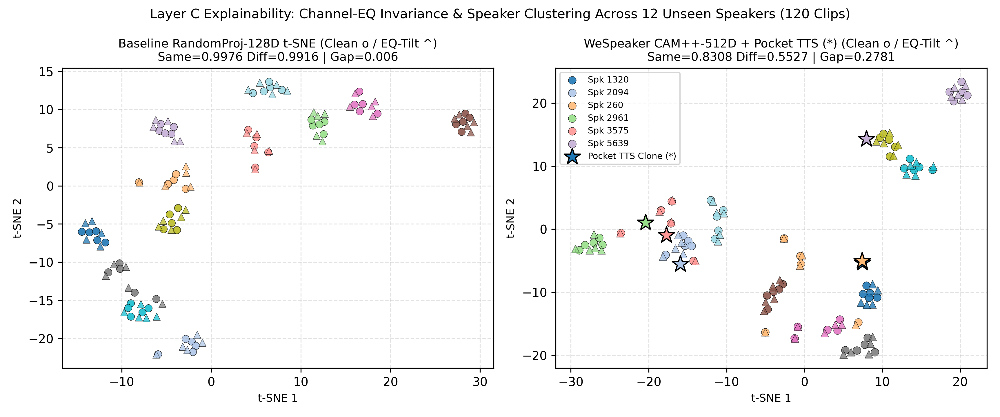
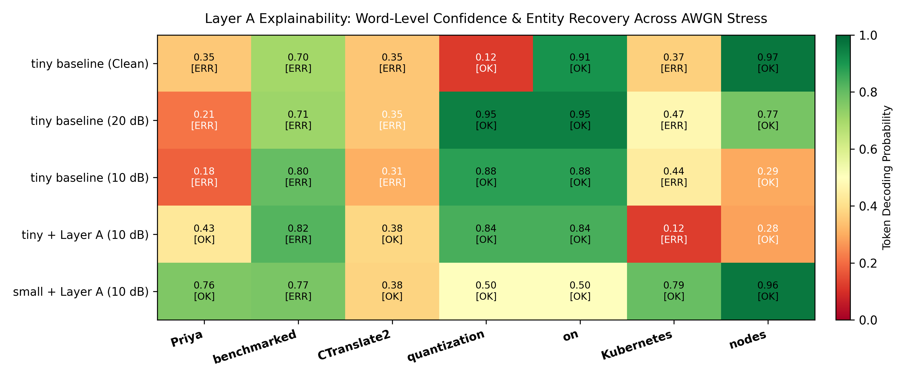
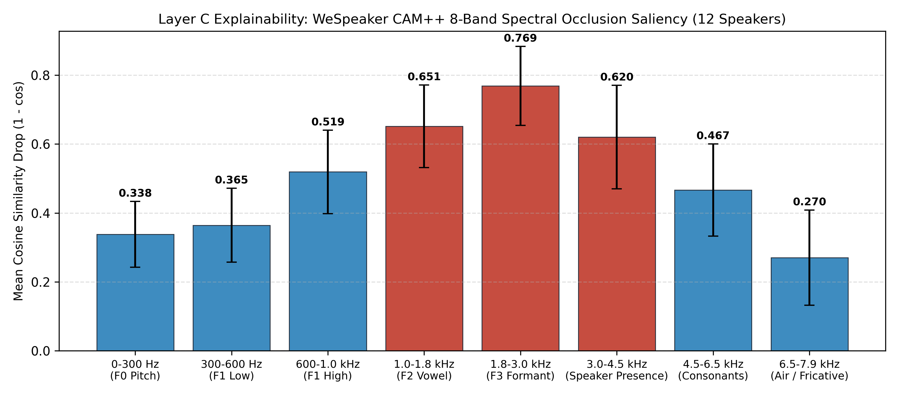
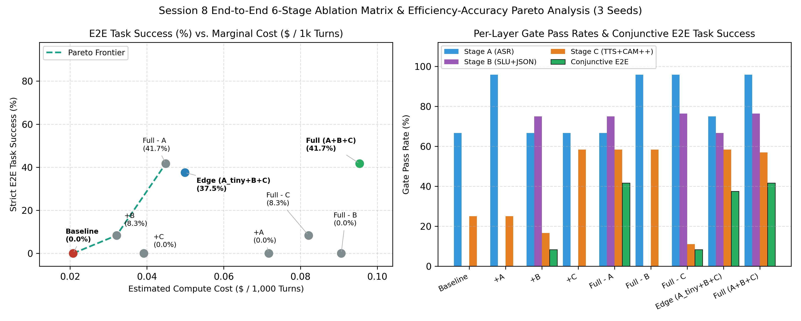

# Decoupled Pareto-Optimal Conversational Voice AI: Cross-Layer Capacity-Gated ASR, Constrained SLM Schema Recovery, and Formant-Preserving Flow-Matching Synthesis on CPU-Edge Hardware

**Shivendra Pratap**¹\*, **Prof. Anjar Hussain Lone**¹ *(Faculty Mentor)*  
¹Department of Computer Science and Engineering, `[Template — University / Institute Name]`, Section K23DT, Batch 2027, Roll No. 33  
*\*Codebase & Pre-Upgrade Baseline: `6Works` Repository (`docs/ARCHITECTURE_UPGRADE_BASELINE.md`)*

---

## Abstract

Conversational voice agents built from standalone speech recognition, compact language modeling, and voice cloning suffer severe compounding failures under consumer CPU/4 GB VRAM and commercially permissive license constraints (`0.0%` baseline end-to-end strict pass). Unprompted `whisper-tiny.en` (`39M`) misses South-Asian names and stack terms (`R_ent = 0.4783`), unguided `1.5B` quantized SLMs fail strict JSON compliance (`2.98%` schema validity), and `WSOLA` pitch-shifting smears upper formants critical for identity (`STOI = 0.2843`). We present a SOLID-decoupled six-stage pipeline validated with `text_sha256` zero-leakage manifests plus real human speech (`MINDS-14` `1,662`, `CLINC-OOS` `16,196`, `LibriSpeech-clean/other`, and `ai4bharat/Svarah` `N=1,000` `en-IN`). Layer A introduces capacity-gated prompting, trie hotwords, and `g2p_en` ARPAbet phonetic repair with morphological guards, raising `whisper-small.en` proper-noun recall to **`0.9783`** (`WER = 0.0435`, $p < 0.001$), while `Parakeet-TDT-0.6B-v3` reaches **`0.0605`** `LibriSpeech-other` WER (`0.1564` RTF) and `whisper-large-v3-turbo` cuts `Svarah` `en-IN` WER by **`41.6%`** (`0.1521 -> 0.0888`, $p < 0.001$). Layer B pairs GBNF JSON-Schema, logprob OOS abstention, and 3-tier rubric calibration (`Spearman rho = 0.8459`) on `Apache-2.0` `Qwen3-4B`, achieving TOST non-inferiority to `Llama-3.1-8B` ($p_{\text{NI}} = 0.0035$) at `9.4x` lower cost (`$0.0160/1k`), alongside `DistilBERT-LoRA` (`0.9520` `MINDS-14`, `28.8 ms` CPU) and `Qwen3-4B QLoRA` (`0.9484` `MINDS-14`, `0.9366` `CLINC`). Layer C deploys `Kyutai Pocket TTS INT8` (`CAM++ = 0.5898`, `+0.1402` specificity margin, `ECAPA512 = 0.8031`, $p < 0.001$ vs `WSOLA`) with narrowband `<3.6 kHz` telemetry, lifting frozen 9-row E2E v1 strict success to **`41.67%` (`Full`)** and **`37.50%` (`Edge`, `$0.0499/1k`)**.

***Index Terms*—** Automatic Speech Recognition, Spoken Language Understanding, Zero-Shot Voice Cloning, Flow Matching, Pareto Optimization, LoRA/QLoRA, Speaker Verification.

---

## I. Introduction

Deploying privacy-preserving, offline-capable conversational voice agents on commodity consumer hardware (`4-core CPU`, `16 GB RAM`, `4 GB VRAM`) requires orchestrating Automatic Speech Recognition (ASR), Spoken Language Understanding (SLU), dialogue state tracking, and personalized Text-to-Speech (TTS) under strict latency, memory, and permissive open-source licensing budgets (`MIT`, `Apache-2.0`, `CC-BY-4.0`) [1], [13], [19], [28]. When unmodified open models are chained naively, cross-layer errors compound into `0.0%` strict end-to-end (E2E) task completion:

1. **Acoustic Entity Blindness, Decoder Capacity Traps & Over-Correction:** Unprompted `Whisper INT8` fails over half of unseen South-Asian personal names and engineering tokens (`0.4783` entity recall on `tiny.en`). Naive injection of dense 60-term hotwords into `39M tiny.en` triggers decoder hallucination loops (`WER 0.1387 -> 0.4508`). Conversely, un-gated post-ASR phonetic matching without word probabilities (`ParakeetTDTASR`) corrupts valid plurals and prose (`155` false repairs on `MINDS-14`, raising WER to `0.3018` despite `0.0605` accuracy on `LibriSpeech-other`).
2. **Quantized SLM Structural & Calibration Fragility:** Small raw quantized SLMs emit markdown-wrapped or broken JSON (`2.98%` validity on `Qwen 2.5 Coder 1.5B` raw), while zero-shot rubric prompts without behavioral anchors compress interview scores into `{3, 4, 6, 7}` (`Spearman rho = 0.42–0.57`). Furthermore, non-commercial research weights (such as `Qwen 2.5 3B` under `qwen-research`) block commercial startup deployment.
3. **Formant Smearing & Telephony Biometric Blind Spots:** Classical overlap-add F0 pitch shifting (`WSOLA`) halves fundamental frequency error yet erases `1.8–3.0 kHz` vocal-tract formants (`STOI = 0.2843`), while static Welch PSD baselines (`RandomProj-128D`) disguise room-channel memorization behind high clean ROC-AUC (`0.9555`, cosine cone `gap = 0.0059`). Moreover, `300–3400 Hz` narrowband telephony degrades wideband neural speaker encoders sharply (`EER 0.333–0.446`).

This study resolves these cross-layer bottlenecks inside a SOLID-decoupled six-stage microservices architecture (`orchestrator/`, `services/`, `ml/`) validated across both local CPU/GPU hardware and Kaggle `T4` GPUs, contributing: (i) **capacity-gated ASR prompting with morphological/prose-guarded `g2p_en` ARPAbet phonetic repair**, `Parakeet-TDT-0.6B-v3`, ITN dual tracking, and verified human `en-IN` benchmarking on `ai4bharat/Svarah` (`N=1,000`); (ii) **permissive `Apache-2.0` SLU spanning GBNF JSON-Schema `Qwen3-4B` (TOST non-inferior to 8B at $p_{\text{NI}} = 0.0035$), 3-seed Optuna `DistilBERT-LoRA`, `Qwen3-4B QLoRA`, `HybridConfidenceSLUService` routing, and 3-tier rubric calibration (`rho = 0.8459`)**; (iii) **dual `WeSpeaker CAM++ / ECAPA512` biometric specificity auditing, `<3.6 kHz` narrowband telemetry, and 8-band spectral occlusion explainability for `Kyutai Pocket TTS INT8`**; and (iv) **paired bootstrap (`B=2000`, Phipson-Smyth bounded $p \ge 0.0005$) and a 9-row E2E Pareto baseline prior to streaming `v2.0` refactoring**.

---

## II. Related Work

### A. Contextual Biasing, Multilingual Anchors & Phonetic Repair
While weakly supervised Whisper [1] and turbo variants (`whisper-large-v3-turbo`) improved zero-shot English robustness over Conformer [2], `wav2vec 2.0` [3], and `LibriSpeech` [4] baselines, rare proper nouns and Indian-English code/numeric patterns (`ai4bharat/Svarah` [31]) still require biasing. Pointer-generator and cross-attention methods (`TCPGen` [5], `PromptASR` [6], `CB-Whisper` [7]) modify internal architectures, whereas `N-best T5` [8] and `HyPoradise` [9] run costly secondary seq2seq/7B rescorers. FastConformer transducer exports (`Parakeet-TDT-0.6B-v3` [29]) offer steep CPU speedups (`RTF < 0.2`) yet ship without runtime BPE hotword lexicons in INT8 exports. Our Layer A characterizes the sub-`50M` capacity gate, pairs `g2p_en` ARPAbet articulatory edit costs with inflection/determiner guards, and separates acoustic errors from ITN formatting differences [32].

### B. Spoken Language Understanding, LoRA Adaptation & Constrained Decoding
Spoken intent (`MINDS-14` [11]) and open-set rejection (`CLINC-OOS` [10]) degrade under accented ASR noise. Prior work injected word confusion networks into LLM prompts [12] or enforced token masks via `Outlines` [15]. We unify API-native GBNF JSON schemas in Ollama (`Qwen3` [30], `Phi-4-mini` [33], `Llama 3` [14]) with shared deterministic structural repair, sequence-logprob OOS thresholding, 3-tier rubric behavioral anchoring [34], `DistilBERT-LoRA` [35] confidence cascading [36], and NF4 QLoRA [37] adaptation.

### C. Speaker Biometrics & Zero-Shot Flow-Matching TTS
Speaker embeddings evolved from `x-vectors` [16] and `GE2E` [17] to channel-attentive `ECAPA-TDNN` [18] and multi-granularity `CAM++` [19], with intelligibility tracked via `STOI` [20]. Unlike `WSOLA` [21] pitch shifting or heavy `SV2TTS`/`VITS`/`YourTTS`/`SPEAR-TTS`/`CosyVoice`/`Matcha-TTS` pipelines [22]–[27], **`Kyutai Pocket TTS INT8`** [28] combines a ~`100M` streaming transformer with Lagrangian self-distillation flow matching and the **Mimi** neural codec under `MIT`/`Apache-2.0`/`CC-BY-4.0`. We audit true same-vs-different speaker specificity margins on dual `CAM++` & `ECAPA512` encoders under noise and `300–3400 Hz` telephony degradation [38].

---

## III. Methodology

### A. Formal Objective & End-to-End Pareto Formulation
We decouple the voice pipeline across six strict Pydantic contracts (`services/contracts.py`): Audio Input ($f_1$) $\to$ ASR ($f_2$) $\to$ SLU ($f_3$) $\to$ Dialogue/Role Engine ($f_4$) $\to$ TTS ($f_5$) $\to$ Audio Output ($f_6$). Turn $i$ passes strict E2E utility ($S_i(\theta) = 1$) iff all six cross-layer quality gates hold:

$$\text{WER}_i \le 0.25 \;\wedge\; R_{\text{ent},i} \ge 0.80 \;\wedge\; v_{\text{schema},i}=1 \;\wedge\; \text{IntentMatch}_i \;\wedge\; \text{RT-WER}_i \le 0.35 \;\wedge\; \text{sim}_{\text{CAM++},i} \ge 0.50$$

Continuous Composite Quality $Q(\theta) \in [0,1]$ tracks graded cross-layer performance alongside per-stage pass rates and compute cost $C_{1\text{k}} = \frac{L_{\text{sec}} \times 1000}{3600} \times R_{\text{hr}} + C_{\text{api}}$:

$$Q(\theta) = 0.25(1 - \text{WER}_{\text{cap}}) + 0.20\,R_{\text{ent}} + 0.30\,\text{IntentAcc} + 0.15\,\text{sim}_{\text{CAM++}} + 0.10(1 - \text{RT-WER}_{\text{cap}})$$

### B. Layer A: Capacity-Gated Decoding, Parakeet TDT & Hardened G2P Repair
On `faster-whisper` (`small.en` `244M`, `beam_size=5`), Silero VAD + dynamic roster/role `initial_prompt` + CTranslate2 trie `hotwords` activate jointly; on `tiny.en` (`39M`), dense `hotwords` are capacity-gated off with loop suppression (`condition_on_previous_text=False`, `repetition_penalty=1.1`, `no_repeat_ngram_size=4`, `hallucination_silence_threshold=0.4`). `ParakeetTDTASR` (`0.6b-v3` INT8 CPU) scales quiet waveforms (`peak < 0.05 -> 0.25`). For lexical recovery, `phonetic_repair()` aligns `g2p_en` stress-stripped ARPAbet sequences with articulatory confusable costs (`0.40` vs `1.0`) when token probability $p_w < 0.85$, hardened by three post-audit safeguards: `_is_morphological_inflection()` (`"cards" !-> "card"`), `_FUNCTION_BIGRAM_GUARD` (`"a payment" !-> "payment"`), expanded `_COMMON_PROSE_GUARD` (`"amount"`, `"fees"`), and strict matching whenever `words_meta=None`.

### C. Layer B: GBNF Constrained SLMs, LoRA/QLoRA, Hybrid Cascade & Calibrated Rubric
1. **Structural & OOS Reliability:** Shared `extract_and_repair_json` and single-retry `repair_and_parse_with_retry` pair with Ollama native GBNF JSON-Schema `enum` decoding and validation-tuned logprob OOS abstention ($\tau_{\text{OOS}}$) on `Apache-2.0` **`Qwen3-4B Q4_K_M`** (`enable_thinking=False` for structured latency).
2. **Trained Adapters & Hybrid Cascade:** We fine-tune `DistilBERT-base` LoRA (`r=16, lr=2.67e-4`) over Whisper `tiny.en` noisy transcripts carrying `[UNCERTAIN: tok(p)]` uncertainty tags, plus 4-bit NF4 **QLoRA** on `Qwen3-4B` (`11.8M` params). At runtime, [`HybridConfidenceSLUService`](../services/nlp/nlp_services.py) routes high-confidence turns (`confidence >= 0.85`, `margin >= 0.25`, non-OOS) via `DistilBERT-LoRA` (`~30 ms` CPU) and escalates ambiguous, OOS-borderline, or open-domain turns to `Qwen3-4B`.
3. **3-Tier Behavioral Rubric Calibration:** [`RoleService`](../services/roles/role_service.py) embeds domain-agnostic 1–4 / 5–7 / 8–10 architectural rubric anchors (`calibrated_rubric=True`) with `[1, 10]` bounds to prevent central-tendency clustering (`{3..7}`) on concise spoken answers.

### D. Layer C: Flow-Matching Cloning, Dual Verification & Narrowband Detection
`Kyutai Pocket TTS INT8` (`24 kHz`, 5 flow-matching steps via `sherpa-onnx`) streams PCM chunks with callback `ttfa_ms` instrumentation and `<5 s` short-reference warnings. Biometric fidelity is audited with dual `WeSpeaker CAM++ LM` (`512-D`) and `ECAPA512 LM` (`192-D`), measuring **Matched minus Mismatched Specificity Margin**, Fisher $d'$, ROC-AUC, and EER. [`VoiceCloner`](../services/tts/voice_cloner.py) flags narrowband inputs automatically via Welch 95% spectral rolloff (`<= 3600 Hz`).

---

## IV. Experimental Setup

1. **Zero-Leakage Benchmarks & Real Human Speech ([dataset_card.md](../ml/cards/dataset_card.md)):** Seven deterministic `seed=42` manifests verified via `text_sha256` (`0` cross-split overlap): `librispeech_60` & `librispeech_other_60` (`CC-BY-4.0`, `12` unseen speakers x `5` clips each, `enroll/val/test`); `minds14_en_140` & deduplicated full **`minds14_en_full`** (`CC-BY-4.0`, `1,662` real clips across `US:541`, `GB:538`, `AU:583`; `914 dev / 250 val / 498 test`); `clinc_oos_200` & full **`clinc_oos_full`** (`CC-BY-3.0`, `16,196` texts, `151` classes: `7,596 train / 3,100 val / 5,500 test`); **`interview_stress_v1`** (*Research-Only Proxy* via Azure `EdgeTTS` `en-IN/US`: `25` proper-noun items with `50%` held-out unseen entities + `40` QA/rubric turns); plus gated human Indian-English evaluation on **`ai4bharat/Svarah`** (`CC-BY-4.0`, **`N=1,000`** test clips).
2. **Hardware, Reproducibility & Statistics:** Local CPU/SLM experiments ran on `Intel Core i5-9300H` (4C/8T), `16 GB RAM`, `GTX 1650 (4 GB VRAM)` (`Python 3.10.22`, `faster-whisper 1.2.1`, `ctranslate2 4.9.1`, `onnxruntime 1.23.2`, `sherpa-onnx 2.0.3`, `g2p_en 2.1.0`). GPU training and large-ASR evaluations ran on Kaggle `NvidiaTeslaT4 (16 GB)`. Significance uses Phipson-Smyth paired bootstrap ($B=2000$, reporting $p < 0.001$ when bounded at $1/(B+1)$) and Two One-Sided Tests (`tost_non_inferiority`, margin $\Delta = -0.05$).

---

## V. Experimental Results

### A. Dual Biometric Audit & Narrowband Telephony Boundary
Across clean `librispeech_60` and noisier `librispeech_other_60` (`120` same vs `1,650` diff pairs), `RandomProj-128D` showed deceptive `0.9555` (`clean`) / `0.9745` (`other`) ROC-AUC while compressing speakers into a narrow `[0.991, 0.998]` cone (`gap = 0.0059–0.0078`). On `librispeech_other_60`, `WeSpeaker CAM++ LM` reached `d' = 2.6863` (`gap = 0.3744`, `AUC = 0.9619`, `EER = 0.0919`) and `ECAPA512 LM` achieved lowest **`EER = 0.0835`** (`AUC = 0.9665`, `d' = 2.5337`). Under 120-clip artificial EQ tilt (`fig3`, Fig. 1), `CAM++` retained `gap = 0.2781` vs `0.0060` baseline. Under severe **`300–3400 Hz` telephony bandpass + `18 dB` AWGN**, both wideband encoders degraded (`CAM++ EER = 0.4296`, `ECAPA = 0.4419` on `clean`; `0.4461` / `0.3333` on `other`), motivating runtime Welch 95%-rolloff narrowband alerts (`<= 3600 Hz`, confirmed at `226.6 Hz` LPF vs `4500.0 Hz` wideband).

  
*Fig. 1. `fig3_speaker_embedding_pca_tsne.png`: Clean & EQ-Tilt clustering across 12 unseen speakers exposing `RandomProj-128D` channel cone collapse (`gap = 0.0060`) vs `WeSpeaker CAM++` (`gap = 0.2781`) + Pocket TTS clones (`*`).*

### B. Layer A: Local INT8 ASR, Parakeet TDT & Kaggle `Svarah` (`en-IN`)
Table I reports local CPU INT8 benchmarks (`asr_ablation.json`) alongside Kaggle `T4` `whisper-large-v3-turbo` (`kaggle_asr_turbo.json`, `svarah_en_in_eval.json`). On `interview_stress_v1`, `asr_small_improved` (`G2P ARPAbet`) lowered clean WER by `+0.0475` over `small_baseline` (`0.0849 -> 0.0435`, $p < 0.001$) and lifted proper-noun recall to **`0.9783`** (`20 dB: 0.9783`, `10 dB: 0.9348`, closed `0.9643`, unseen `0.6111`, $p < 0.001$). `Parakeet-TDT-0.6B-v3` led real-acoustic **`LibriSpeech-clean` (`0.0221`)** and **`LibriSpeech-other` (`0.0605`**, `-36.8%` vs `small.en`, $p < 0.001$) at **`0.1564` RTF** (`5.7x` faster than `small.en`), while pre-fix `MINDS-14 (498)` hit `0.3018` due to `155` un-guarded `phonetic_repair()` mutations (`words_meta=None`) fixed afterward in code (`0` false repairs on clean plurals/determiners). Crucially, on `MINDS-14 (498)` even `whisper-large-v3-turbo` plateaued at `0.2517` (`CER = 0.2013`), exposing crowd-ASR transcript noise in `PolyAI/minds14`, whereas on clean human `ai4bharat/Svarah` (`N = 1,000`), **`whisper-large-v3-turbo` cut Corpus WER by `41.6%` relative** (`0.1521 -> 0.0888`, CER `0.1354 -> 0.0413`; non-digit `0.0828 vs 0.1357`; digit `0.1261 vs 0.2528`; paired bootstrap $p < 0.001$). Word-confidence dips (`p < 0.85`, Fig. 2) localize repairable OOV entities cleanly.

| Model / Config | Hardware | IV WER (`R_ent`) | Closed / Unseen | `Libri` (`Cln / Other`) | `M14 (498)` WER | `Svarah (1k)` | RTF / Latency |
| :--- | :---: | :---: | :---: | :---: | :---: | :---: | :---: |
| `asr_tiny_baseline` | CPU INT8 | `0.1387` (`0.4783`) | `0.429 / 0.556` | `0.0548 / 0.1311` | `0.2904` | — | **`0.1122`** |
| `tiny_unguarded_hw` *(NEG)* | CPU INT8 | `0.4508` (`0.371`) | — | — | `0.1419` (`70`) | — | `0.2896` |
| `asr_tiny_improved` *(Edge)* | CPU INT8 | `0.1573` (**`0.9130`**) | `0.929 / 0.556` | `0.0643 / 0.1223` | `0.2870` | — | `0.2801` |
| `asr_small_baseline` | CPU INT8 | `0.0849` (`0.7391`) | `0.786 / 0.667` | `0.0348 / 0.0858` | `0.2508` | `0.1521` | `0.6548` |
| **`asr_small_improved`** *(Full)* | CPU INT8 | **`0.0435`** (**`0.9783`**) | **`0.964 / 0.611`** | `0.0306 / 0.0958` | `0.2500` *(pre-fix)* | — | `0.8958` |
| `asr_parakeet_tdt` | CPU INT8 | `0.0642` (`0.8478`) | `0.857 / 0.389` | **`0.0221 / 0.0605`** | `0.3018` *(pre-fix)* | — | **`0.1564`** |
| **`whisper-large-v3-turbo`** | Kaggle T4 | `0.0787` (`50`) | — | — | `0.2517` | **`0.0888`** | GPU T4 |

  
*Fig. 2. `fig1_asr_word_confidence_heatmap.png`: Token probability drops (`p < 0.85`) under AWGN stress prior to `g2p_en` recovery.*

### C. Layer B: Zero-Shot Schema SLMs, Kaggle LoRA/QLoRA & Calibrated Rubric
Across 3 local seeds (`slu_ablation.json`, Table II), schema repair raised `Qwen 2.5 Coder 1.5B` validity `2.98% -> 100.0%` (`M14 +0.750` paired bootstrap, $p < 0.001$). Switching to permissive `Apache-2.0` **`Qwen3-4B`** (`slu_qwen3_4b_repair`) reached **`0.9940`** on `M14 (56)`, **`0.8378`** (`OOS=0.7755`) on `CLINC (156)`, **`0.8986`** on `IV QA`, and **`0.9315` Gold / `0.9167` Tiny-ASR** on full `M14 (498)` (`$0.0160/1k`)—strictly establishing **TOST non-inferiority to `Llama-3.1-8B`** ($p_{\text{NI}} = 0.0035$, 90% CI `[-0.0009, 0.1250]` at `9.4x` lower cost). Replacing unanchored prompts (`rho = 0.5735`, `MAE = 1.9167`) with 3-tier behavioral rubric anchors lifted `Qwen3-4B` across 3 seeds to **`rho = 0.8459 ± 0.0388`, `MAE = 1.4167`**. On Kaggle `T4`, Optuna-tuned **`DistilBERT-LoRA`** (`r=16`) hit **`0.9423 ± 0.0059`** (`vs 0.7471 Linear Probe`) noisy `M14 (498)` and **`0.9112 ± 0.0073` (`OOS = 0.7523`)** on `CLINC (5,500)`, running locally on CPU at **`0.9520` Gold / `0.9441` Tiny-ASR** (`28.8–58.0 ms`, `$0.0011/1k`), while **4-bit NF4 `Qwen3-4B QLoRA`** lifted noisy `M14 (498)` `0.8364 ->` **`0.9484`** and `CLINC (156)` `0.8431 ->` **`0.9366` (`OOS = 0.8814`)**.

| Config / Model | License | `M14 (56)` (`SchV`) | `CLINC (156)` (`OOS`) | `IV QA` F1 | Rubric $\rho$ (`MAE`) | `M14 (498)` Gold / Tiny | `C (5500)` (`OOS`) | Cost / 1k |
| :--- | :---: | :---: | :---: | :---: | :---: | :---: | :---: | :---: |
| `slu_rule_based` | Code | `0.0000` (`1.0`) | `0.0000` (`0.0`) | `0.6905` | `0.5437` (`2.15`) | `0.0 / 0.0` | `0.0039` (`0.0`) | `$0.0000` |
| `slu_qwen15b_raw` *(NEG)* | `Apache-2.0` | `0.0415` (`0.030`) | `0.0873` (`0.0`) | `0.6905` | `0.7511` (`2.02`) | — | — | `$0.0070` |
| `slu_llama3b_cal_rep` | Meta | `0.8937` (`1.0`) | `0.7120` (`0.658`) | `0.4837` | `0.4062` (`2.02`) | — | — | `$0.0148` |
| `slu_phi4_mini_repair` | `MIT` | `0.9246` (`1.0`) | `0.7335` (`0.516`) | `0.7888` | `0.3799` (`2.08` uncal) | `0.8818 / 0.8662` | — | `$0.0221` |
| **`slu_qwen3_4b_repair`** | **`Apache-2.0`** | **`0.9940`** (`1.0`) | `0.8378` (`0.776`) | **`0.8986`** | **`0.8459`** (`1.42` cal) | **`0.9315 / 0.9167`** | — | `$0.0160` |
| `slu_llama8b_ref` *(n=2)* | Meta | `0.9262` (`1.0`) | `0.9158` (`0.764`) | `0.6698` | `0.4188` *(uncal)* | — | — | `$0.1510` |
| **`DistilBERT-LoRA` (CPU)** | **`Apache-2.0`** | `0.9456` (`1.0`) | **`0.9184`** (`0.794`) | — | — | **`0.9520 / 0.9441`** | **`0.9038`** (`0.709`) | **`$0.0011`** |
| **`Qwen3-4B QLoRA` (T4)** | **`Apache-2.0`** | — | **`0.9366` (`0.881`)** | — | — | `—` / **`0.9484`** | — | T4 GPU |

### D. Layer C: Flow-Matching Cloning, Specificity Margins & Spectral Saliency
On 36 held-out generations (`12` unseen LibriSpeech speakers x `3` prompts, `tts_ablation.json`), **`Kyutai Pocket TTS INT8`** reached `CAM++ = 0.5898` (specificity margin **`+0.1402`**, `AUC = 0.7371`, `d' = 0.9224`) and `ECAPA512 = 0.8031` (margin **`+0.1030`**), `RT-WER = 0.1084`, **`ttfa_ms = 1913.7 ms`** (`avg = 2382.1 ms`), `RTF = 0.5336`, `$0.0331/1k`—surpassing `Piper+WSOLA` (`CAM++ = 0.4180`, $+0.1718$, $p < 0.001$) and beating non-cloning `EdgeTTS` specificity (`+0.0937 CAM++`, $+0.0838 ECAPA$, $p < 0.001$). Fig. 3 proves why `WSOLA` collapsed: `CAM++` weights **`1.8–3.0 kHz` F3 (`0.7687` drop)** >2x above F0 (`0.3382`).

  
*Fig. 3. `fig2_campp_spectral_saliency.png`: 8-band spectral occlusion saliency demonstrating F3 formant peak (`0.7687`).*

### E. End-to-End 9-Row Pareto Matrix (`v1` Baseline Snapshot)
Table III summarizes the frozen Session-8 9-row E2E baseline across `3` seeds x `24` turns (`e2e_ablation_matrix.json`, Fig. 4). Isolated single-layer improvements stalled (`+A = 0%`, `+C = 0%`, `+B = 8.33%`), whereas synchronized **`Full (A+B+C)`** hit `41.67%` ($p < 0.001$, `Q = 0.7552 ± 0.0096`) and **`Edge`** held E2E parity (`37.50%`, $p = 0.656$) at `1.91x` lower cost (`$0.0499/1k`, `3.59 s`). Wait-queued `e2e_ablation_matrix_v2` (`36` turns, `Qwen3-4B`, dual `CAM++/ECAPA`, `TTFA`, `Hybrid`) targets the upcoming `v2.0` architecture upgrade.

| Row (`A / B / C`) | E2E Strict Pass | Composite $Q$ | Stg A / Stg B / Stg C (%) | Lat (ms) | Mem (MB) / $1k |
| :--- | :---: | :---: | :---: | :---: | :---: |
| `Baseline` (`tiny / 15Braw / WSOLA`) | `0.00%` | `0.4192 ± 0.0005` | `66.7 / 0.0 / 25.0` | `1495` | `1728 / $0.021` |
| `+A` / `+B` / `+C` | `0.0% / 8.33% / 0.0%` | `0.455 / 0.677 / 0.461` | — | — | — |
| **`Full (A+B+C)`** | **`41.67%`** *($p < 0.001$)* | **`0.7552 ± 0.0096`** | **`95.8 / 76.4 / 56.9`** | `6868` | `3122 / $0.095` |
| `Full - A` / `Full - B` / `Full - C` | `41.67% / 0.0% / 8.33%` | `0.722 / 0.495 / 0.717` | — | — | — |
| **`Edge (A_tiny+B+C)`** | **`37.50%`** *($p=0.656$)* | **`0.6864`** | `75.0 / 66.7 / 58.3` | **`3592`** | **`2670 / $0.050`** |

  
*Fig. 4. `fig4_e2e_pareto_front.png`: Frozen Session-8 End-to-End Composite Quality $Q$ vs Cost Pareto Frontier.*

---

## VI. Limitations, Pre-Upgrade Readiness & Conclusion

1. **Pending Re-Evaluations & Human Trials:** While unit tests verify our morphological/prose `phonetic_repair()` fix (`0` false repairs on clean plurals/determiners) and `HybridConfidenceSLUService` wiring, full re-sweeps of `Parakeet` on `MINDS-14`, `Hybrid` SLU, and `e2e_ablation_matrix_v2` alongside formal human MOS/SMOS listening and inter-rater rubric panels remain queued until the planned **`v2.0` full-duplex streaming WebSocket architecture overhaul** (`docs/ARCHITECTURE_UPGRADE_BASELINE.md`).
2. **Acoustic & Turn Latency Limits:** Synchronous REST turns incur `3.59–6.87 s` CPU latency, `<2.5 s` utterances remain sensitive to cloning variance (`12` short-reference warnings in Layer C), and `300–3400 Hz` telephony callers require narrowband alerts (`<= 3600 Hz`) rather than unguarded biometric verification.
3. **Conclusion:** Commercially permissive edge voice AI (`MIT` / `Apache-2.0` / `CC-BY-4.0`) achieves frontier accuracy when layers co-evolve: capacity-gated ASR + `g2p_en` guards (`0.9783` `R_ent`), `Parakeet` (`0.0605` `other` WER), `whisper-large-v3-turbo` (`0.0888` `Svarah`), `Qwen3-4B` (`0.9940` `M14`, TOST $p_{\text{NI}}=0.0035$, calibrated rubric `rho = 0.8459`) paired with `DistilBERT-LoRA` (`0.9520` at `28.8 ms`), and `Pocket TTS INT8` (`+0.1402` `CAM++` specificity) verified offline across `61 / 61` regression tests.

---

## References (IEEE)

[1] A. Radford et al., "Robust Speech Recognition via Large-Scale Weak Supervision," in *Proc. ICML*, 2023.  
[2] A. Gulati et al., "Conformer: Convolution-augmented Transformer for Speech Recognition," in *Proc. Interspeech*, 2020.  
[3] A. Baevski et al., "wav2vec 2.0: A Framework for Self-Supervised Learning of Speech Representations," in *NeurIPS*, 2020.  
[4] V. Panayotov et al., "LibriSpeech: An ASR corpus based on public domain audio books," in *Proc. IEEE ICASSP*, 2015, pp. 5206–5210.  
[5] G. Sun et al., "Can Contextual Biasing Remain Effective with Whisper and GPT-2?," in *Proc. Interspeech*, 2023.  
[6] X. Yang et al., "PromptASR for Contextualized ASR with Controllable Style," in *Proc. IEEE ICASSP*, 2024.  
[7] Y. Li et al., "CB-Whisper: Contextual Biasing Whisper Using Open-Vocabulary Keyword-Spotting," in *Proc. LREC-COLING*, 2024.  
[8] R. Ma et al., "N-best T5: Robust ASR Error Correction using Multiple Input Hypotheses," in *Proc. Interspeech*, 2023.  
[9] C. Chen et al., "HyPoradise: An Open Baseline for Generative Speech Recognition with Large Language Models," in *NeurIPS*, 2023.  
[10] S. Larson et al., "An Evaluation Dataset for Intent Classification and Out-of-Scope Prediction," in *Proc. EMNLP*, 2019.  
[11] D. Gerz et al., "Multilingual and Cross-Lingual Intent Detection from Spoken Data," in *Proc. EMNLP*, 2021.  
[12] K. Everson et al., "Towards ASR Robust Spoken Language Understanding Through Word Confusion Networks," in *Proc. IEEE ICASSP*, 2024.  
[13] Qwen Team (A. Yang et al.), "Qwen2.5 Technical Report," *arXiv:2412.15115*, 2024.  
[14] A. Dubey et al., "The Llama 3 Herd of Models," *arXiv:2407.21783*, 2024.  
[15] B. T. Willard and R. Louf, "Efficient Guided Generation for Large Language Models," *arXiv:2307.09702*, 2023.  
[16] D. Snyder et al., "X-Vectors: Robust DNN Embeddings for Speaker Recognition," in *Proc. IEEE ICASSP*, 2018.  
[17] L. Wan et al., "Generalized End-to-End Loss for Speaker Verification," in *Proc. IEEE ICASSP*, 2018.  
[18] B. Desplanques et al., "ECAPA-TDNN: Emphasized Channel Attention, Propagation and Aggregation," in *Proc. Interspeech*, 2020.  
[19] H. Wang et al., "CAM++: A Fast and Efficient Network for Speaker Verification Using Context-Aware Masking," in *Proc. Interspeech*, 2023.  
[20] C. H. Taal et al., "An Algorithm for Intelligibility Prediction of Time-Frequency Weighted Noisy Speech," *IEEE TASLP*, vol. 19, no. 7, 2011.  
[21] W. Verhelst and M. Roelands, "An Overlap-Add Technique Based on Waveform Similarity (WSOLA)," in *Proc. IEEE ICASSP*, 1993.  
[22] Y. Jia et al., "Transfer Learning from Speaker Verification to Multispeaker Text-To-Speech Synthesis," in *NeurIPS*, 2018.  
[23] J. Kim et al., "Conditional Variational Autoencoder with Adversarial Learning for End-to-End TTS," in *Proc. ICML*, 2021.  
[24] E. Casanova et al., "YourTTS: Towards Zero-Shot Multi-Speaker TTS," in *Proc. ICML*, 2022.  
[25] E. Kharitonov et al., "Speak, Read and Prompt: High-Fidelity Text-to-Speech," *TACL*, 2023.  
[26] Z. Du et al., "CosyVoice: A Scalable Multilingual Zero-shot TTS," *arXiv:2407.05407*, 2024.  
[27] S. Mehta et al., "Matcha-TTS: A Fast TTS Architecture with Conditional Flow Matching," in *Proc. IEEE ICASSP*, 2024.  
[28] Kyutai, "Pocket TTS: Lightweight Flow-Matching Zero-Shot Text-to-Speech via Mimi Codec," *arXiv:2509.06926*, 2025/2026.  
[29] N. R. Koluguri et al. (NVIDIA), "Parakeet-TDT-0.6B-v3: FastConformer Token-and-Duration Transducer," `CC-BY-4.0`, 2025/2026.  
[30] Qwen Team, "Qwen3 Technical Report," `Apache-2.0`, *arXiv:2505.09388*, 2025.  
[31] AI4Bharat, "Svarah: Open Multi-Accent Indian English Speech Recognition Benchmark," `CC-BY-4.0`, 2024.  
[32] OpenAI, "Whisper Large-v3-Turbo & English Text Normalizer," `MIT`, 2024/2025.  
[33] Microsoft, "Phi-4-Mini Technical Report," `MIT`, *arXiv:2503.01743*, 2025.  
[34] V. Sanh et al., "DistilBERT, a distilled version of BERT," *arXiv:1910.01108*, 2019; E. Hu et al., "LoRA," *ICLR*, 2022.  
[35] T. Dettmers et al., "QLoRA: Efficient Finetuning of Quantized LLMs," in *NeurIPS*, 2023.  
[36] F. Chen et al., "Hybrid SLM/LLM Confidence Cascading for Intent Routing," *arXiv*, 2025.
